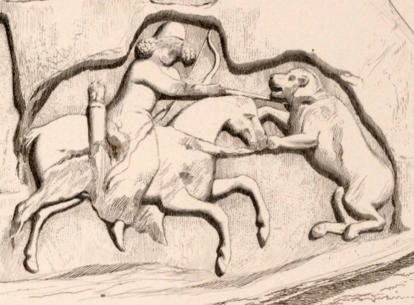

Within the tortuous limestone defile of *Tang-e Sarvak* (Solak) amidst the mountains of Bahmaie, monumental boulders bear the enigmatic rock reliefs and inscriptions of the ancient Elymaean kingdom from the Parthian era. Local Lur inhabitants preserve the myth of the *Dragon Petrified in Gypsum*—a crowned chthonic serpent charged by ancient kings to safeguard the rock inscriptions and subterranean burial chambers against desecration.

Oral lore relates that in antiquity, this dragon was a living scourge whose fiery breath sealed off the defile to all travelers. At last, a righteous hero advanced armed with a shield of burnished silver mirrors. Goaded into madness upon beholding its own monstrous reflection, the dragon froze into a petrified stratum of layered limestone and gypsum. Elders warn that if any tomb raider strikes the reliefs with a hammer, the rock weeps fresh blood and the petrified dragon stirs, crushing the plunderer beneath shifting boulders.

> "The stones of Solak speak, but into the ears of profaners they pour only dragon's venom; whoever breaks the sacred script sees his hand wither and his spirit bound to the rock." — Sacred oath of the Boyer-Ahmadi elders.

Historian Iraj Afshar Sistani notes that this legend reflects the aura of sanctity surrounding the ancient Elymaean open-air sanctuaries and sacrificial altars at Tang-e Sarvak. Carvings of Parthian princes, soaring eagles, and sacred braziers were interpreted by subsequent generations as magical talismans designed to guard these cultural monuments through centuries of turbulence. The solemn wild cypresses and whistling mountain drafts guarding Tang-e Sarvak continue to keep watch over this slumbering petrified dragon.

### Sources & Image Attribution
- **Research Source:** Iraj Afshar Sistani, *Ethnography of Khuzestan and Kohgiluyeh*, Tehran, pp. 310-318; Yaghoub Ghaffari, *Beliefs and Folktales of Kohgiluyeh and Boyer-Ahmad*, p. 175.
- **Image Attribution:** Documented on Wikimedia Commons by Scan by NYPL; License: [Public domain](https://commons.wikimedia.org/wiki/File:Abar-Basi_inscription_depiction.png).
