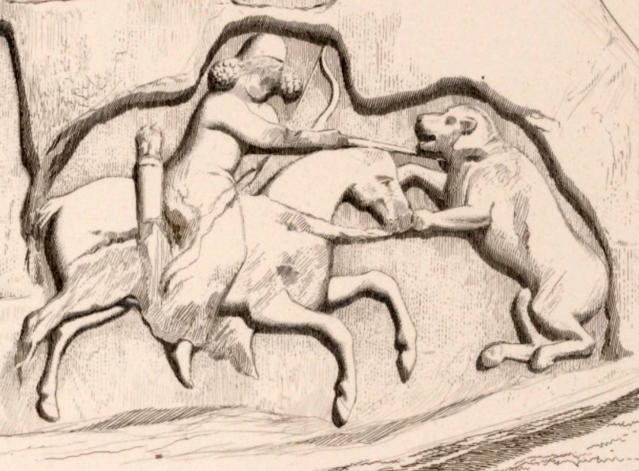

در تنگه‌ای باریک و پرپیچ‌وخم به نام «تنگ سولک» (سروک) در کوهستان‌های بهمئی، صخره‌های عظیم با نقوش برجسته و خطوط باستانی دوران اشکانی و الیمایی آراسته شده‌اند. در میان این سنگ‌های ستبر، بومیان لر از اسطوره‌ی «اژدهای خفته در گچ» یاد می‌کنند؛ ماری سنگین و غول‌پیکر با تاجی بر سر که به امر پادشاهان کهن، نگهبان طلسم ابدی کتیبه‌ها و گنجینه‌های مقبره‌های الیمایی بوده است.

بر اساس باور شفاهی مردم کهگیلویه، این اژدها در دوران‌های باستان موجودی زنده و آتش‌افکن بود که تمام پهنه دره را در دهان خود داشت و هیچ کاروانی جرئت گذر از این تنگه را نداشت. سرانجام پهلوانی قدسی با سپری از آینه‌های صیقلی در برابر او ایستاد؛ اژدها با دیدن بازتاب هیبت هولناک خویش در آینه‌ها، بر جای خشکید و به صخره‌ای لایه‌لایه از جنس گچ و سنگ آهک بدل شد. با این حال، کهنسالان معتقدند که اگر شبی کسی با نیت دستبرد به کتیبه‌ها به صخره‌ها ضربه بزند، از شکاف سنگ خون جاری خواهد شد و اژدها برای لحظاتی چشم می‌گشاید تا دزدان آثار را در کام خود فرو بلعد.

> «سنگ‌های سولک سخن می‌گویند، اما به گوش نامحرمان جز زهر اژدها نخواهند ریخت؛ هر که کتیبه بشکند، دستش بخشکد و جانش در بند صخره افتد.» — متل سوگند پیرمردان بویراحمدی در تنگه سولک.

ایرج افشار سیستانی در پژوهش‌های خود پیرامون آثار تاریخی و باورهای کهگیلویه ثبت کرده است که این افسانه بازتابی از تقدس آتشکده‌ها و قربانگاه‌های صخره‌ای الیمایی در تنگ سولک است. نقوش شاهزادگان، عقاب‌های شکارچی و نیایشگران بر سنگ‌های تنگه، در ضمیر عامه مردم با نیروهای ماوراءطبیعی و طلسم‌های باستانی پیوند خورده بود تا از این میراث شگرف در برابر دستبرد سوداگران در درازنای قرن‌ها محافظت نماید.

سروهای کهنسال و صدای همیشگی باد در شکاف دیواره‌های تنگ سولک، گویی نگهبان این اژدهای خفته‌اند تا یادگار نیاکان الیمایی همچنان دست‌نخورده در سینه کوهستان برجای بماند.

باستان‌شناسان و کهنسالان محلی اشاره می‌کنند که نقش‌برجسته‌های سترگ تنگ سولک با بیش از دو هزار سال قدمت، بازتابی از باور به نامیرایی روان پادشاهان و محافظت ابدی ایزدان از سرزمین است. مار در اساطیر عیلامی و اشکانی نشانه‌ای از باروری و نگهبان ریشه‌های حیات بوده و اژدهای سنگ‌شده در تنگه، به عنوان نمادی از صخره‌های تزلزل‌ناپذیر کهگیلویه، قرن‌ها الهام‌بخش سوارکاران بویراحمدی در دفاع از گذرگاه‌های زاگرس بوده است.

### منابع و اعتبار تصویر
- **منبع پژوهشی افسانه:** ایرج افشار سیستانی، «مردم‌شناسی خوزستان و کهگیلویه»، تهران، ص ۳۱۰-۳۱۸؛ یعقوب غفاری، «باورها و افسانه‌های کهگیلویه و بویراحمد»، ص ۱۷۵.
- **اعتبار تصویر:** ثبت‌شده در ویکی‌مدیا کامنز توسط Scan by NYPL؛ مجوز انتشار: [Public domain](https://commons.wikimedia.org/wiki/File:Abar-Basi_inscription_depiction.png).
