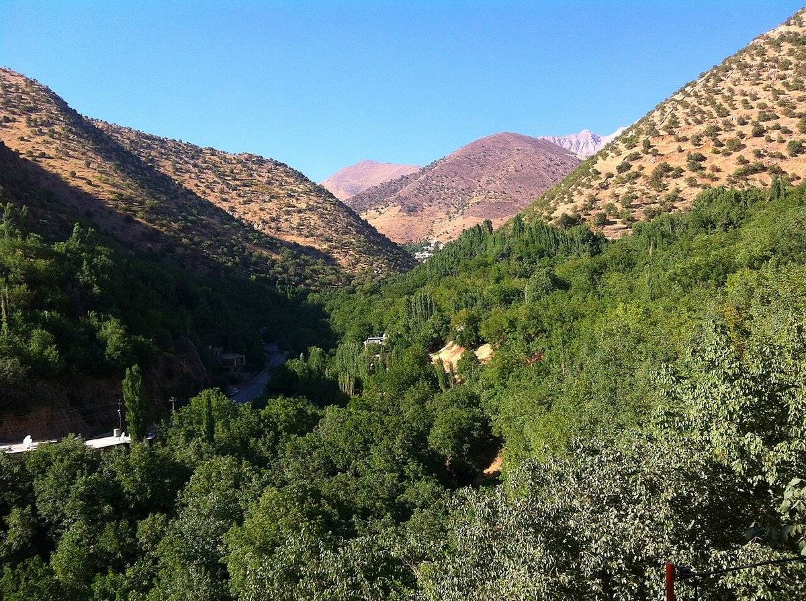

Deep within the dramatic limestone ravines of the central Zagros mountains, where the torrential Sirwan River carves profound gorges through Kurdistan, lies the terraced stone village of Uraman Takht (Hawraman). Famous for its vernacular architecture where the flat rooftop of each stone dwelling forms the front courtyard of the house above it, the settlement's origin is tied in regional oral myth to the primordial sage and patron saint, Pir Shalyar.

According to Hawrami ancestral memory, the ancient chasm of the Sirwan was once dominated by a chthonic stone entity known as the *Dae-e Sangi* (the Mountain Rock Fiend). Whenever mortal communities attempted to establish hamlets along the precipices, the malevolent titan caused devastating earthquakes and sent massive rockfalls crashing down the slopes, crushing crops and destroying timber shelters. Despairing of finding security in the wild canyons, the clan turned to Pir Shalyar, an elder renowned for his deep spiritual harmony with the alpine elements. Armed only with a hawthorn staff cut from the sacred upland woods, he ascended to the highest cliff overlooking the gorge.

> As preserved in the sacred poetic hymns of the Hawrami people: "Hawraman is built of unyielding stone, with Pir Shalyar as the foundation of the earth; accompanied by the sacred daf, its eternal spring shall never fade."

Striking his staff three times against the bedrock, Pir Shalyar chanted the archaic litany of balance between earth, stone, and human spirit. The tremors subsided, and the wild elemental titan was subdued, its colossal petrified limbs forming the very foundational terraces upon which the stepped stone masonry of Uraman Takht could securely rest. Pir Shalyar then taught the villagers the craft of mortarless dry-stone terracing (*Hazar-Peleh*), allowing them to cultivate pomegranate and walnut orchards on near-vertical cliffs. To this day, the annual mid-winter festival of Pir Shalyar commemorates this victory of patience, craft, and spiritual wisdom over seismic chaos.

### Anthropological & Folklore Analysis
The myth functions as an etiologic legend explaining the extraordinary dry-stone architecture of the Hawraman Cultural Landscape (a UNESCO World Heritage Site). It reflects humanity's psychological negotiation with seismically active mountainous topographies, recasting destructive geological forces into cooperative architectural foundations through the mediation of an ancestral holy figure.

### Archival Sources & Attribution
- **Primary Source:** Halabjapedia Folklore Documentation & Ethnographic Studies of Hawraman (Afsanay Hawraman).
- **Source URL:** https://www.halabjapedia.com/article/4119-%D8%A6%DB%95%D9%81%D8%B3%D8%A7%D9%86%DB%95%DB%8C-%D9%87%DB%95%D9%88%D8%B1%D8%A7%D9%85%D8%A7%D9%86
- **Original Language:** Hawrami Kurdish & Persian
- **Image Attribution:** File:Hawraman - Tawela Village in Sulaymaniyah, Kurdistan, Iraq.jpg | Photographer: Diyar Muhammed | License: CC BY-SA 4.0
