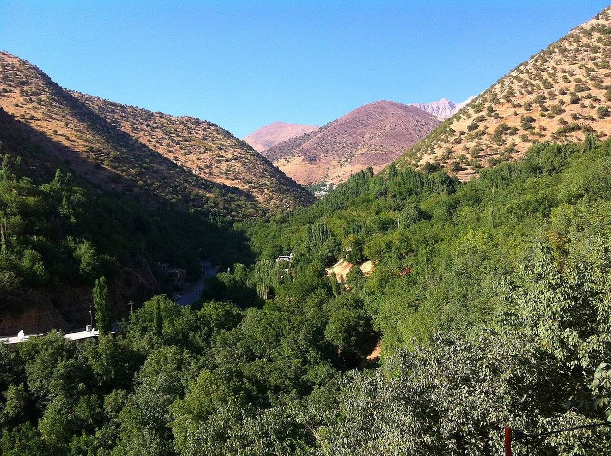

در ژرفای دره‌های سنگی و شیب‌دار زاگرس، آنجا که رود خروشان سیروان صخره‌های سخت را می‌شکافد و روستای پلکانی اورامان تخت چونان تاجی سنگی بر پیشانی کوهستان نشسته است، سالخوردگان هورامی از اسطوره آفرینش و نبرد کیهانی سامان‌بخشی به این دره سخن می‌گویند. معماری شگفت‌انگیز این دیار که در آن پشت‌بام هر خانه، حیاط خانه بالادست است، در حافظه قومی با نام پیر روحانی و دانای کوهسار، «پیر شالیار» پیوند خورده است.

بر پایه این باور دیرین، در آغاز زمان، دره سیروان در تسخیر دیوی هولناک به نام «دیو سنگین» (Dae-e Sangi) بود که در غارهای زیرزمینی کوهستان لانه داشت. این هیولای خاکی هرگاه خشمگین می‌شد، زمین‌لرزه‌های ویرانگر برمی‌انگیخت و صخره‌های عظیم را به درون دره فرو می‌ریخت تا مانع از کشاورزی و سکونت فرزندان خاک شود. انسان‌ها در هراس از ریزش کوه، توان برپایی هیچ سرپناهی نداشتند. در این هنگام، پیر شالیار با دلی سرشار از ایمان و چوبدستی متبرکی از چوب درخت ون (زالزالک وحشی کوهستان)، به فراز بلندترین پرتگاه دره رفت.

> هورامی‌ها در سرودهای کهن خویش چنین ترنم می‌کنند: «هه‌ورامان به‌ردینه‌ن، پیر شالیار زه‌مینه‌ن؛ چه‌نی ده‌ف و که‌موت، وه‌هاره‌ش هه‌میشه‌ن.» (هورامان استوار از سنگ است و پیر شالیار لنگر زمین؛ با آوای دف و راستی، بهارش همیشگی است).

پیر شالیار در میان وزش بادهای سخت، سه بار چوبدست ون خود را بر زمین کوفت و دعای باستانی پیوند انسان و طبیعت را زمزمه کرد. با اراده معنوی او، دیو سنگین که مظهر آشفتگی و هرج‌ومرج زمین‌شناختی بود، مهار شد و تن صخره‌ای او به پایه‌های استوار و سنگ‌چین‌های منظم پلکانی بدل گشت تا انسان‌ها بتوانند خانه‌های خود را سنگ بر سنگ استوار سازند. پیر شالیار به اهالی آموخت که چگونه با سنگ‌های ناهموار، تراس‌های بارور بسازند و انار و گردو بکارند. از آن روزگار تا کنون، مردم هورامان هر ساله در آیینی مقدس با کوبیدن بر دف‌های بزرگ و توزیع آش متبرک شبانه، این پیروزی انسان بر ناهمواری‌های طبیعت و سامان‌یافتگی پایدار اورامان را جشن می‌گیرند.

### بن‌مایه‌ها و ویژگی‌های مردم‌شناختی
این افسانه کهن هورامی به زیبایی چگونگی انطباق انسان با یکی از صعب‌العبورترین زیست‌بوم‌های کوهستانی جهان را توجیه می‌کند. مفاهیمی چون تسخیر نیروهای خشن طبیعت توسط انسان پارسا، پیدایش معماری سنگی پلکانی (Dry-stone terraced architecture)، و استمرار آیین‌های فصلی پیر شالیار، بنیادهای هویت فرهنگی قوم هورامی را به تصویر می‌کشد.

### منابع و پژوهش
- **منبع اصلی:** دانشنامه و پژوهش‌های مردم‌شناختی حلبچه‌پدیا و اورامان‌شناسی (زانیارینامەی هەڵەبجە: ئەفسانەی هەورامان).
- **پیوند مرجع:** https://www.halabjapedia.com/article/4119-%D8%A6%DB%95%D9%81%D8%B3%D8%A7%D9%86%DB%95%DB%8C-%D9%87%DB%95%D9%88%D8%B1%D8%A7%D9%85%D8%A7%D9%86
- **زبان اصلی متن:** کردی هورامی و فارسی
- **تصویر:** File:Hawraman - Tawela Village in Sulaymaniyah, Kurdistan, Iraq.jpg | عکاس: Diyar Muhammed | مجوز: CC BY-SA 4.0
