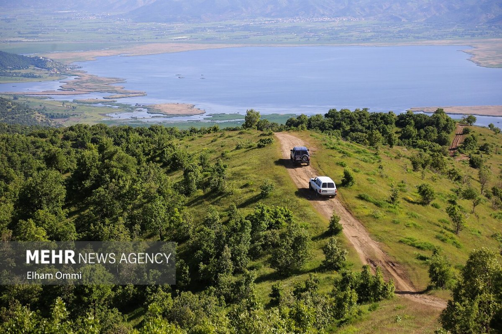

Along the tranquil, reed-fringed shores of Lake Zeribar in Marivan, where sub-lacustrine freshwater springs rise beneath the dramatic shadow of the Zagros peaks, Kurdish collective memory reveres the martial legend of the *Dwanza Swarey Marivan* (The Twelve Horsemen of Marivan). Chronicled in both oral heroic poetry and immortalized in modern Kurdish literature by the master poet Piramerd, this saga celebrates the victory of tactical ingenuity and patriotic fervor over overwhelming military numbers.

The epic is set during an era of foreign invasion when a ruthless imperial army numbering thousands traversed the plains of Sharazur, advancing inexorably toward the strategic borderlands of Marivan. Paralyzed by the scale of the hostile vanguard, local regional rulers prepared to capitulate. Rejecting surrender, twelve master horsemen led by commanders Salim Beg and Ahmad Pasha gathered on the lakeshore. Swearing on the mountain winds and the sacred soil of Kurdistan, they pledged to fight to the last breath to defend the passes.

> As the people of Marivan recite across generations: "They were only twelve horsemen, yet they formed an impregnable fortress of faith; Zeribar remains the eternal witness to their courage so long as the world endures."

Capitalizing on the thick dawn fog that blankets the waters of Lake Zeribar and using the dense waterfront reed-beds for concealment, the twelve riders unleashed lightning cavalry ambushes. Shrouded by the morning vapor and knowing every ravine and defile, they struck the enemy columns at their most vulnerable choke points. Their coordinated war cries and disciplined charges created the illusion that a ghost legion of thousands was descending from the mountain peaks. Utter panic swept through the invading ranks; their battle lines collapsed, and the vast army fractured in chaotic flight toward the lowlands. The triumph of the Twelve Horsemen transformed Lake Zeribar into an enduring regional symbol of grassroots defiance, military genius, and communal honor.

### Anthropological & Folklore Analysis
The saga of the Twelve Horsemen reflects the classic heroic archetype of an outnumbered elite vanguard defending border mountain homelands. Key folkloric elements include the tactical utilization of marshland terrain, the revered bond between Kurdish cavalrymen and their native mountain steeds, and the transformation of defensive warfare into enduring cultural myth.

### Archival Sources & Attribution
- **Primary Source:** Dwanza Swarey Marivan: A Kurdish Historical Tale, by Piramerd, preserved in the Vejin Books Digital Folklore Archive.
- **Source URL:** https://books.vejin.net/ck/book/160
- **Original Language:** Sorani Kurdish
- **Image Attribution:** File:2025 Marivan, a tourism paradise with pristine nature 13 Mehr.jpg | Photographer: Elham Ommi | License: CC BY 4.0
