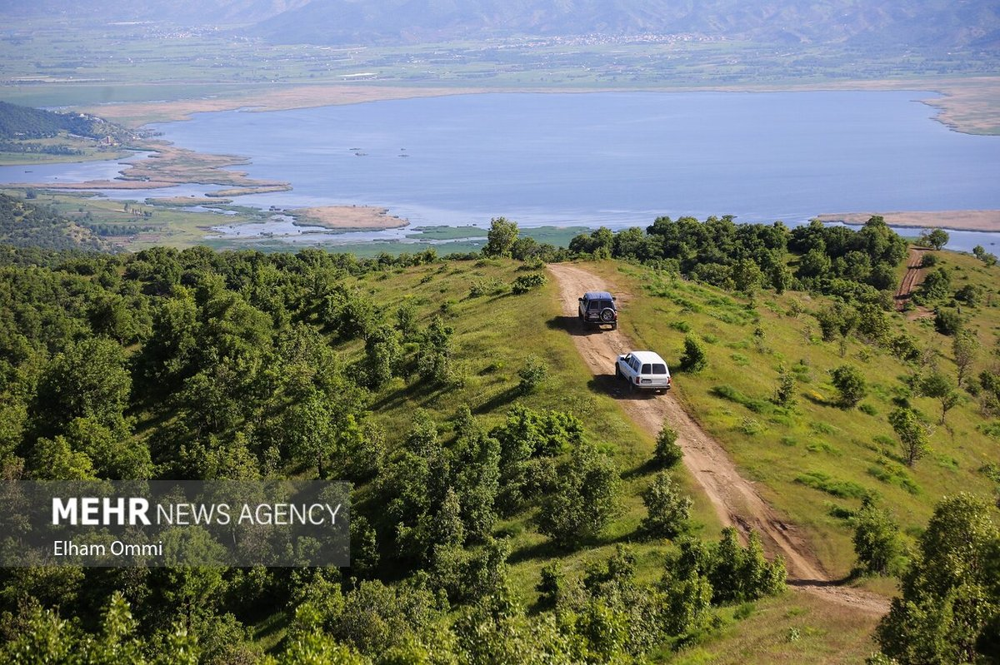

در کرانه‌های نیلگون و پرنیلوفر دریاچه زریبار مریوان، آنجا که چشمه‌های جوشان خودجوش از بستر دریاچه می‌جوشند و کوهستان‌های سرسبز شاهو و دالاهو بر آب‌ها سایه می‌اندازند، حماسه‌ای پرشور از غیرت و سلحشوری در سینه تاریخ کردستان می‌تپد؛ حماسه «دوازده سوار مریوان» (دوانزە سوارەی مەریوان؛ Dwanza Swarey Marivan) که پیرمرد، شاعر و ادیب بزرگ کرد، آن را بر اساس روایات شفاهی به رشته تحریر درآورد.

روایت از روزگاری حکایت می‌کند که لشکری پرشمار و خونخوار به فرماندهی سردارانی ستمگر، دشت شارزور و مرزهای مریوان را در نوردیدند. ارتش مهاجم با غارت قریه‌ها و به آتش کشیدن مزارع، تا نزدیکی ساحل زریبار پیشروی کرده بود و حاکمان وقت از شدت وحشت در فکر تسلیم و واگذاری خاک بودند. در آن شرایط بیم و تاریکی، دوازده سوار برگزیده و چابک‌دست از سلحشوران ایل به رهبری سلیم‌بگ و احمد پاشا سوگند وفاداری به آب و خاک خویش یاد کردند. آنان تصمیم گرفتند به جای تسلیم خفت‌بار، با اسبان تیزتک کردی و شناختی که از جغرافیای منطقه داشتند، راه را بر لشکر انبوه ببندند.

> کردزبانان مریوان در وصف دلیری این پهلوانان می‌گویند: «دوانزە سوارە بوون، بەڵام قەڵایەک لە باوەڕ بوون؛ زریبار شایەتی ئازایەتییانە هەتا دنیا مابێت.» (آنان دوازده سوار بودند اما دژی استوار از ایمان و غیرت ساختند؛ زریبار تا جهان باقی است گواه دلاوری آنان خواهد بود).

دوازده سوار مریوان با بهره‌گیری از مه صبحگاهی دریاچه زریبار و پوشش نیزارهای متراکم ساحلی، حملات غافلگیرانه و چریکی خود را آغاز کردند. آنان در گذرگاه‌های کوهستانی باریک، گردنه‌ها را بر سپاه متجاوز بستند و با فریادهای رعدآسا و شلیک‌های پیاپی، چنان رعب و وحشتی در دل لشکر انبوه افکندند که مهاجمان پنداشتند با لشکری ده‌ها هزار نفره از ارواح کوهستان روبرو شده‌اند. در نبردی سرنوشت‌ساز در تنگه زریبار، این دوازده قهرمان توانستند صفوف دشمن را از هم بپاشند، سرداران متجاوز را تارومار کنند و ارتش چند هزار نفری را به هزیمتی مفتضحانه بکشانند. از آن روزگار تاکنون، زریبار نه فقط نگین طبیعت کردستان، بلکه یادمان ابدی دلاوری دوازده سواری است که با جان‌فشانی، عزت و آزادی میهن را جاودانه ساختند.

### بن‌مایه‌ها و ویژگی‌های مردم‌شناختی
حماسه دوازده سوار مریوان بازتاب‌دهنده کهن‌الگوی نبرد نابرابر پهلوانان بومی در برابر ارتش‌های انبوه مهاجم است. محوریت دریاچه زریبار به عنوان دژ طبیعی، تقدس اسب اصیل کردی (Kurdish Steed) به عنوان هم‌رزم جدایی‌ناپذیر سوارکار، و تبدیل یک واقعه تاریخی-رزمی به افسانه‌ای هویت‌بخش در ادبیات شفاهی و مکتوب کردستان، از برجسته‌ترین ابعاد این داستان است.

### منابع و پژوهش
- **منبع اصلی:** دوانزە سوارەی مەریوان، داستانێکی مێژوویی کوردە، اثر پیرمرد، بازنشر در آرشیو دیجیتال ڤەژینبوکس.
- **پیوند مرجع:** https://books.vejin.net/ck/book/160
- **زبان اصلی متن:** کردی سورانی
- **تصویر:** File:2025 Marivan, a tourism paradise with pristine nature 13 Mehr.jpg | عکاس: Elham Ommi | مجوز: CC BY 4.0
