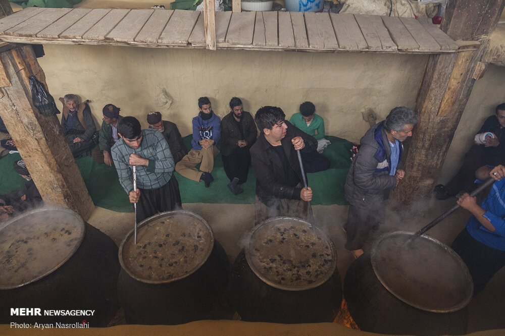

Amidst the cloud-draped amphitheater of stone and terraced crags of Hawraman Takht, where dry-stone houses cling precariously to the vertical slopes of the Zagros, local storytellers preserve the lore of a magnificent, two-headed winged serpent whose golden scales glimmer like burnished bronze in the alpine sunlight. This primeval beast dwells within the subterranean vaults of Mount Owdalan, guarding ancestral treasures and the metaphysical secrets of ancient Kurdish sages.

In Hawrami folklore, this dual-headed creature embodies the cosmic balance between dissolution and renewal, serving as the immortal sentinel of alpine aquifers. One head faces eastward toward the dawn, while the second gazes unblinkingly toward the west; hence, no mortal can approach its domain unobserved. Should a trespasser ascend the precipices driven by greed to loot hidden relics or poison pristine mountain streams, the scree gives way beneath their feet, and the two-headed serpent bursts forth from the crags. One venomous strike induces unending slumber, while the vapor from its second maw permanently blinds the covetous plunderer.

> "The two-headed serpent of Hawraman guards the sacred dust; whoever climbs seeking honest bread departs in peace, but whoever seeks gold becomes paving for the abyss." — Ancient adage recited during the Komsay festival.

Scholars Ali-Ashraf Darvishian and Reza Khandan Mahabadi note in their monumental *Encyclopedia of Iranian Folktales* that the serpent occupies an elevated status as an emblem of sacred wisdom and ecological equilibrium in western Iran. Far from being regarded as a demonic fiend, the two-headed serpent of Hawraman is venerated as a benevolent guardian of nature against human avarice. Villagers entering the Sirwan canyons traditionally place pieces of fresh *kalaneh* flatbread at cave entrances to invoke the protective blessing of this legendary golden guardian.

### Sources & Image Attribution
- **Research Source:** Ali-Ashraf Darvishian & Reza Khandan Mahabadi, *Encyclopedia of Iranian Folktales*, Vol. 11, pp. 245-252; Fieldwork notes on Hawrami oral lore.
- **Image Attribution:** Documented on Wikimedia Commons by Aryan Nasrollahi; License: [CC BY 4.0](https://commons.wikimedia.org/wiki/File:Pir_Shalyar%E2%80%99s_wedding_festival_in_Uraman_Takht_2020-02-01_04.jpg).
