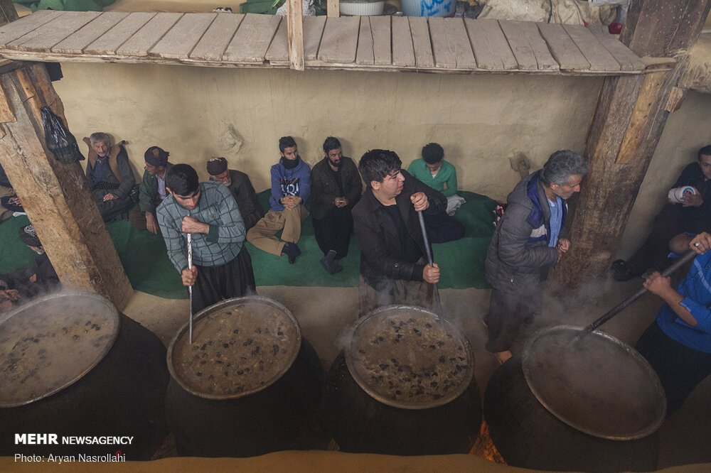

در کوهستان‌های سر به فلک کشیده و صخره‌های پلکانی هورامان تخت، جایی که خانه‌های سنگی بر دوش یکدیگر سوار شده‌اند، کهنسالان اورامی از ماری دوسر و بالدار سخن می‌گویند که فلس‌هایش همچون طلای ناب در پرتو آفتاب می‌درخشد. این موجود اسطوره‌ای، پاسدار گنجینه‌های کهن و رازهای سربه مهر پیران دیرین زاگرس در غارهای پنهان کوه عودالان است.

بر اساس باورهای بومی هورامان، این مار دوسر نماد تقارن میان مرگ و زایندگی و پاسبان چشمه‌های خنک کوهستان است. یک سر او به سوی سپیده‌دم و سر دیگرش به سوی باختر نگران است؛ بدین سان، هیچ صیاد یا سوداگری توان غافلگیر کردن او را ندارد. هرگاه کسی با نیت دست‌اندازی به جنگل‌های بلوط، آلودن آب چشمه‌ها یا طمع‌ورزی در پی زر و سیم پا به حریم غارهای هورامان بگذارد، سنگ‌های کوهستان زیر پای او فرو می‌ریزند و با زوزه‌ای مهیب، ماری با دو سر آتشین از میان شکاف صخره‌ها بر او هجوم می‌آورد. نیش یکی از سرهای مار خواب ابدی به بار می‌آورد و نفس سر دیگرش بینایی متجاوز را تا پایان عمر می‌ستاند.

> «مار دوسر پیر هورامان، بر گنج خاک نشسته است؛ هر که از پی نان کوهستان آید، سلامت بازگردد و هر که پی زر آید، سنگفرش دره‌ها خواهد شد.» — سخن حکیمانه پیران هورامان در جشن کومسای.

علی‌اشرف درویشیان و رضا خندان مهابادی در جلد یازدهم «فرهنگ افسانه‌های مردم ایران» به نقش مار به عنوان نماد کهن نگاهبانی و فرزانگی در افسانه‌های کردی اشاره می‌کنند. در باور مردم هورامان، مار موجودی پلید شمرده نمی‌شود، بلکه پاسدار مقدسی است که نظم طبیعت کوهستان را در برابر طمع بشری حفظ می‌کند. اهالی هورامان پیش از ورود به غارهای باستانی دره سیروان، سرودی به زبان هورامی زمزمه می‌کنند و تکه‌ای نان کلانه بر دهانه غار می‌گذارند تا در پناه نگاهبانی این اژدهای دوسر زرین از گزند حوادث کوه در امان بمانند.

در باورهای مردم اورامانات، مارهای صخره‌ای همواره به عنوان نگهبانان طبیعت و نماد تداوم زندگی در کوهستان تلقی می‌شده‌اند. پیران هورامان بر این باورند که مار دوسر، شاهدی بر پیمان‌های اخلاقی و پاک‌دستی است و اگر کسی در معاملات کوهستان خیانت ورزد یا درختی را بی‌دلیل تبر بزند، سایه نامرئی مار بر سراپای او سنگینی خواهد کرد. در آیین‌های سنتی کومسای در جوار آرامگاه پیر شالیار، سنگ شکستن با زمزمه ادعیه پیوند دارد تا تعادل میان کوه، درختان و ارواح نگهبان هورامان همواره برقرار بماند.

### منابع و اعتبار تصویر
- **منبع پژوهشی افسانه:** علی‌اشرف درویشیان و رضا خندان مهابادی، «فرهنگ افسانه‌های مردم ایران»، جلد ۱۱، ص ۲۴۵-۲۵۲؛ پژوهش میدانی پیر شالیار در هورامان تخت.
- **اعتبار تصویر:** ثبت‌شده در ویکی‌مدیا کامنز توسط Aryan Nasrollahi؛ مجوز انتشار: [CC BY 4.0](https://commons.wikimedia.org/wiki/File:Pir_Shalyar%E2%80%99s_wedding_festival_in_Uraman_Takht_2020-02-01_04.jpg).
