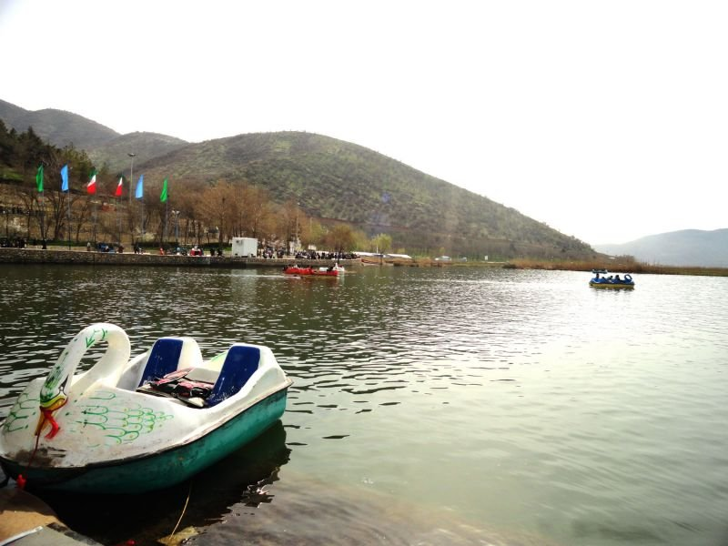

Nestled within an emerald vale surrounded by oak-clad Zagros ridges, the sapphire waters of Lake Zrebar in Marivan harbor an ancient mystery. Kurdish elders recount that in primeval antiquity, no lake existed here; instead, a opulent and fortified metropolis flourished across the plain, governed by a pitiless and tyrannical monarch. Blighted by pride and arrogance, its wealthy denizens shut their doors to the destitute and mocked the suffering of wanderers.

One bitter evening, a destitute dervish clad in tattered rags walked through the city gates pleading for shelter and crusts of bread. Spurned and stoned by the cruel townsfolk, only an impoverished pregnant woman living on the outskirts took pity, offering him her last piece of barley bread. The dervish—who was in truth the sovereign King of the Fairies (Shah-e Parian) in mortal disguise—instructed the woman to take her child and ascend the heights overlooking the valley, sternly bidding her never to look back. At midnight, responding to the fairy king’s curse, subterranean springs surged forth violently from the earth, drowning the golden citadels in a deluge that birthed Lake Zrebar.

> "Zrebar's water feeds from no tributary river; it is the boiling tears of the oppressed, sealing away a city of pride forever beneath the blue ripples." — Kurdish oral proverb in Marivan.

Eminent folklorist Hashem Salimi, in his comprehensive *Legends and Folk Beliefs of Kurdistan*, notes that locals believe the crystalline underwater palace of the Fairy King remains intact beneath the lakebed. On moonlit spring nights, when highland breezes flutter through the reeds, the haunting melodies of fairy harps echo up from the silent deep. Floating water lilies are viewed as the floating tresses of maidens trapped in that cataclysmic purge. This myth elegantly aligns with the true hydrological nature of Zrebar, which receives water solely from freshwater bubbling springs beneath its floor.

### Sources & Image Attribution
- **Research Source:** Hashem Salimi, *Legends and Folk Beliefs of Kurdistan*, Tehran: Soroush, pp. 112-118; Mohammad Ghazi, Introduction to *Kurdish Folktales*, p. 15.
- **Image Attribution:** Documented on Wikimedia Commons by فرشاد شهبازی; License: [CC BY-SA 4.0](https://commons.wikimedia.org/wiki/File:DaryacheZarivar.jpg).
