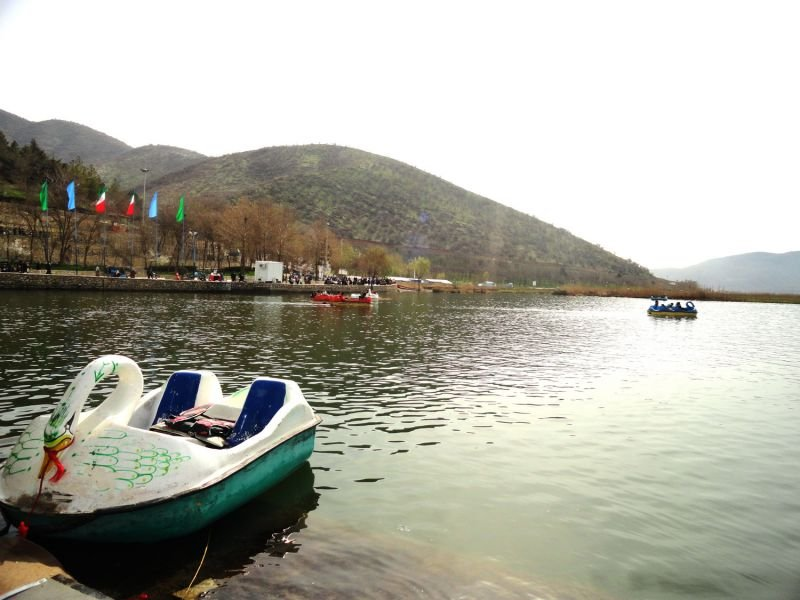

در دره‌ای سرسبز و در میان کوه‌های بلوط‌پوش مریوان، آب‌های فیروزه‌ای دریاچه زریبار رازی کهن را در دل دارند. کهنسالان کُرد روایت می‌کنند که در اعصار کهن، هیچ دریاچه‌ای در این دشت نبود؛ بلکه شهری آباد، پرشکوه و ثروتمند در این نقطه قرار داشت که حاکمی ستمگر و سنگ‌دل بر آن فرمان می‌راند. مردم شهر از کبر و غرور ثروت، درهای خانه‌های خود را بر روی بینوایان می‌بستند و به بی‌پناهان رحم نمی‌کردند.

روزی درویشی تهیدست که لباسی ژنده بر تن داشت، وارد شهر شد و از تک‌تک بزرگان نان و پناه خواست، اما مردم او را سنگ زدند و از دروازه‌ها راندند. تنها زنی فقیر و باردار در حاشیه شهر تکه نانی جوین به درویش بخشید. درویش که در حقیقت شاه‌پریان در کالبد آدمی بود، زن را پند داد که شب‌هنگام با فرزندش شهر را ترک کند و بر فراز تپه مشرف بنشیند و هرگز پشت سر خویش را ننگرد. نیمه‌شب، به نفرین شاه‌پریان، چشمه‌های جوشان از دل زمین فوران کردند و کاخ‌های سیمین و زرین شهر در کام آبی خروشان غرق شدند تا دریاچه زریبار پدید آید.

> «آب زریبار از چشم هیچ رودی نمی‌آید؛ این جوشش اشک مظلومان و نفرین پریان است که شهری از ستم را تا ابد در قعر خویش مدفون ساخت.» — متل کهنسالان کردستان در ساحل مریوان.

هاشم سلیمی در اثر ماندگار «افسانه‌ها و باورهای مردم کردستان» ثبت کرده است که بومیان منطقه بر این باورند کاخ باشکوه شاه‌پریان هنوز در ژرفای تاریک زریبار زنده و پابرجاست. در شب‌های مهتابی اردیبهشت، هنگامی که نسیم خنک کوهستان بر نیزارهای دریاچه می‌وزد، اگر کسی گوش فرا دهد، نوای دلنشین چنگ و سرودهای پریان را از اعماق آب می‌شنود. همچنین نیلوفرهای آبی شناور در زریبار را گیسوان دوشیزگان غرق‌شده در آن شب هولناک می‌دانند.

این اسطوره غرق شدن شهر گناه‌کاران، علاوه بر هشدار اخلاقی درباره عدالت اجتماعی و بخشش، پیوند معنوی عمیقی میان مردم کُرد و اکوسیستم منحصربه‌فرد دریاچه زریبار که آب آن تنها از چشمه‌های خودجوش کف دریاچه تأمین می‌شود، برقرار ساخته است.

شکارچیان و کهنسالان مریوان یادآور می‌شوند که در شب‌های آرام تابستان، هنگامی که سطح دریاچه زریبار چون آینه‌ای صاف می‌گردد، گاه نوری سبزفام از کف دریاچه سوسو می‌زند. مردم محلی این نور را ناشی از چراغ‌های قصر بلورین شاه‌پریان می‌دانند که در جشن‌های شبانه پریان روشن می‌شود. صیادان محلی به احترام پریان آب، هرگز در نیمه‌شب تور بر آب نمی‌اندازند و معتقدند آبزیان زریبار در پناه عهد باستانی پریان هستند و صید شبانه، تورها را پاره و قایق‌ها را واژگون می‌سازد.

### منابع و اعتبار تصویر
- **منبع پژوهشی افسانه:** هاشم سلیمی، «افسانه‌ها و باورهای مردم کردستان»، تهران، انتشارات سروش، ص ۱۱۲-۱۱۸؛ محمد قاضی، مقدمه بر «افسانه‌های کردی»، ص ۱۵.
- **اعتبار تصویر:** ثبت‌شده در ویکی‌مدیا کامنز توسط فرشاد شهبازی؛ مجوز انتشار: [CC BY-SA 4.0](https://commons.wikimedia.org/wiki/File:DaryacheZarivar.jpg).
