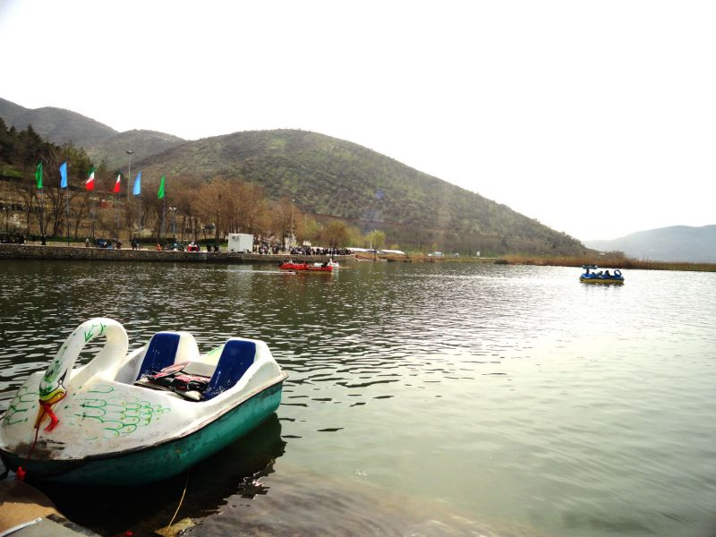

در غرب مریوان در استان کردستان، نگینی از آب شیرین به نام دریاچه زریبار (زرێبار) در میان دشت سرسبز و جنگل‌های بلوط آرمیده است. این تالاب شگفت‌انگیز که هیچ رودی به آن نمی‌ریزد و آب زلالش تنها از چشمه‌های جوشان کف خود دریاچه تامین می‌شود، در باورهای مردم کردستان سرشار از رازهای باستانی و ارواح نگهبان است. مشهورترین روایتی که مادران هورامی و سورانی پای کرسی‌ها زمزمه می‌کنند، داستان شهری آباد و ستم‌پیشه به نام «زریوار» است که در شبی شوم بر اثر نفرین درویشی دل‌شکسته به قعر آب فرورفت و ساکنانش به پریان و ماهیان تالاب بدل گشتند. نیزارهای بلند دریاچه همچون حصاری سبز از این راز کهن پاسداری می‌کنند و رقص باد در میان برگ‌های چولان، نغمه‌ای سوزناک در دشت می‌پراکند.

داستان از آنجا آغاز شد که حاکمی ستمگر بر این دشت فرمان می‌راند و بر مردمان بی‌بضاعت مالیات‌های سنگین می‌بست. روزی درویشی وارسته همراه با همسر باردارش سوار بر الاغی نحیف وارد شهر شد. داروغه حاکم بار الاغ را به زور ربود و زن بیچاره را آزرد. درویش با دلی سوخته به بارگاه حاکم رفت تا دادخواهی کند، اما حاکم به تمسخر او پرداخت و دستور داد او را تازیانه زنند و از شهر برانند. درویش دل‌شکسته و اشک‌ریزان به بالای تپه‌ای در شرق شهر که امروز «تپه کانی مامه‌سیوه» خوانده می‌شود پناه برد؛ رو به سوی آسمان کرد و با خلوص دل نفرین نمود: «بارالها، شهری را که در آن رحم و عدل مرده است، در کام آب فرو ببر!»

> پیران مریوان در ساحل نی‌زارها می‌گویند: «زریبار دریای اشک است؛ وقتی آرام است صدای گهواره و چرخ نخ‌ریسی مادران غرق‌شده را از زیر آب می‌شنوی، و چون مواج می‌شود، فریاد پشیمانی حاکم ستمگر است.»

به محض دعای درویش، زمین شکافته شد و آب‌های زلال و خروشان از چشمه‌های جوشان اعماق خاک فوران کرد. در چشم‌به‌هم‌زدنی، کاخ‌های بلند، باروها و خانه‌های شهر در دریایی پهناور غرق شدند و از آن میان تنها درویش و همسرش در امان ماندند. صیادان کهنسال مریوانی باور دارند که در اعماق آرام زریبار، پریانی گیسوبلند با لباس‌های پولک‌دوزی‌شده کردی شنا می‌کنند که همان دختران شهر باستانی‌اند؛ آنان در شب‌های مهتابی روی جزیره‌های شناور نی (لویزان) می‌نشینند و ترانه‌های غم‌انگیز کردی (سیاوچمانه) می‌خوانند. هرگاه لک‌لک‌های مهاجر بر فراز نیزارها چرخ می‌زنند، مردم می‌گویند این پرندگان سپیدبال، پیغام‌آوران صلح پریان زریبار به جهانیان هستند که دعای خیر نیاکان را در بال‌هایشان دارند. زریوار یادآور ابدی این پیام کهن است که ستم پایدار نمی‌ماند و زلالی آب، آینه پاکی دل‌هاست.

### منبع روایت و تصویر
- **خاستگاه افسانه:** ادبیات فولکلوریک شفاهی مریوان و اورامانات کردستان، ثبت در کتاب‌های افسانه‌ها و متل‌های کردی.
- **عکاس / پدیدآورنده تصویر:** فرشاد شهبازی
- **منبع تصویر:** [صفحه تصویر در ویکی‌انبار](https://commons.wikimedia.org/wiki/File:DaryacheZarivar.jpg)
- **نوع مجوز:** CC BY-SA 4.0
