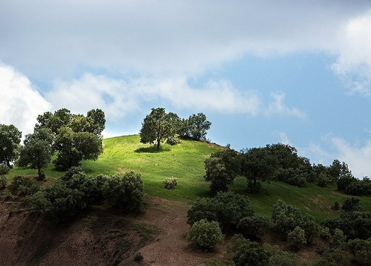

In the rugged northwestern expanse of Lorestan, within the ancestral lands of the Delfan tribes, stands the majestic serrated massif of *Mehrab-Kuh*—a towering limestone fortress carved with sheer escarpments and unfathomed caverns. At the spiritual epicenter of this landscape rests the venerated sanctuary of *Baba Bozorg* (The Great Elder), an ancient mystic folk figure regarded in Laki folklore as the sovereign guardian of alpine tempests, cavern spirits, and the sacred serpents of the crags.

Nomadic Laki lore relates that deep within the impassable clefts of Mehrab-Kuh dwells an immense, white-horned serpent adorned with an ancient patinated bronze collar. Revered as the Living Child of the Mountain, this celestial reptile remains bound to the commands of Baba Bozorg. In epochs of famine or when predatory invaders raided the pastoral plains, the holy sage would strike his wooden prayer beads against the sheer rockface. With each strike, thunderclouds billowed from Mehrab-Kuh’s summits, and the white serpent unleashed gale-force mists that routed invading cavalry.

> "Mehrab-Kuh is the altar of the truthful, and the Elder of Delfan is the keeper of the unseen; the serpent sleeping upon the crag strikes not in malice, but to guard the bread of orphans." — Revered proverb of the nomadic Laks.

Scholar Hamid Izadpanah in his *Ancient and Historical Monuments of Lorestan* highlights that the sacred traditions encompassing Baba Bozorg and Mehrab-Kuh trace back to ancient Mithraic rites celebrated in Zagros cliff sanctuaries. To this day, pilgrimage parties tie brass bells and protective wild rue branches to venerable gnarled oak boughs along the pilgrimage trail, seeking spiritual healing and the benevolence of the ancient mountain guardian.

### Sources & Image Attribution
- **Research Source:** Hamid Izadpanah, *Ancient and Historical Monuments of Lorestan*, Tehran: National Heritage Council, Vol. 2, pp. 88-95; Sekandar Amanollahi Baharvand, *The Lurs*, p. 180.
- **Image Attribution:** Documented on Wikimedia Commons by Aziz Babanezhad; License: [CC BY 4.0](https://commons.wikimedia.org/wiki/File:Mehrab_Kuh_2020-05-01_02.jpg).
