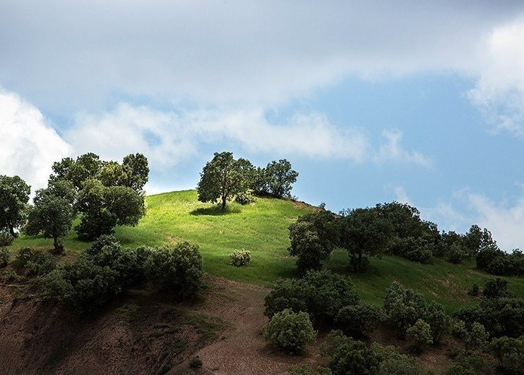

در شمال غربی لرستان و در سرزمین عشایری دلفان، کوهی سترگ و دندانه‌دار به نام «مهراب‌کوه» آسمان را می‌شکافد؛ کوهی که با دیواره‌های صخره‌ای عمودی و غارهای تاریک تاشینه‌اش، از دیرباز مهد باورهای عرفانی و اساطیری لک‌زبانان بوده است. در مرکز این قلمرو افسانه‌ای، بقعه‌ی مرموز «بابا بزرگ» (امامزاده ابراهیم) جای دارد؛ پیری فرزانه و دارای کرامات فراطبیعی که در قصه‌های کهن، فرمانروای ارواح کوهستان، بادهای دره و مارهای نگهبان صخره‌ها شناخته می‌شود.

روایت لکی بازگو می‌کند که در شکاف‌های غیرقابل دسترس مهراب‌کوه، ماری سفید و شاخ‌دار به درازای هفت قامت پنهان است که طوقی زنگاری از مس باستانی بر گردن دارد. این مار عظیم که فرزند صخره خوانده می‌شود، مطیع اوامر پیر بابا بزرگ است. در ایام قحطی یا در هنگام تهاجم چپاولگران به دشت‌های دلفان، این پیر عارف با تسبیح چوبین خود بر سنگ خاره می‌کوفت؛ با هر ضربه، ابرهای باران‌زا از سینه مهراب‌کوه برمی‌خاستند و مار سفید از غار سر بیرون می‌آورد تا سواران دشمن را با دمیدن بادی زهرآگین پراکنده سازد.

> «مهراب‌کوه محراب راستان است و پیر دلفان، پرده‌دار غیب؛ ماری که بر فراز سنگ خفته، نه پی گزند، که پی پاسداری از نان یتیمان سر برآورده است.» — باور ایلاتی لک‌های دلفان در پای کوه مهراب.

حمید ایزدپناه، باستان‌شناس و پژوهشگر پیشگام فرهنگ لرستان، در کتاب «آثار باستانی و تاریخی لرستان» تأکید می‌کند که آیین‌های پیرامون بابا بزرگ و مهراب‌کوه، ادامه‌ی ستایش کهن مهر و میترا در معابد صخره‌ای زاگرس است. هنوز هم در آیین‌های نذر محلی، مردم دلفان برای شفا یافتن بیماران خویش، زنگوله‌های مسی و تکه‌های اسفند بر درختان بلوط اطراف مهراب‌کوه می‌آویزند و خاک ورودی غار شاه‌ماران را توتیای چشم می‌کنند.

حشمت باستانی مهراب‌کوه و داستان‌های شگفت‌انگیز بابا بزرگ، جلوه‌ای بی‌نظیر از آمیزش تصوف بومی غرب ایران با اسطوره‌های کهن زاگرس‌نشینان است که در آن، کوه صخره‌ای به عنوان عبادتگاهی زنده و رازآلود مورد احترام ابدی قرار دارد.

عشایر لک‌زبان دلفان بر این عقیده‌اند که در ایام سخت زمستان که گرگ‌ها و راهزنان گردنه‌های مهراب‌کوه را به خطر می‌اندازند، دعای توسل به بابا بزرگ سپری نفوذناپذیر بر گرداگرد سیاه‌چادرها پدید می‌آورد. زنان ایل با حنا بستن به شاخ قوچ‌های پیش‌آهنگ و اهدای کاسه‌ای از روغن زرد محلی به درویشان کوهپایه، رضایت ارواح نگاهبان مهراب‌کوه را جلب می‌کردند. شکاف‌های سنگی عظیم این کوه که در فرهنگ بومی به «غار پیری» شهرت دارند، هنوز مأمن رازآلود زائرانی است که در جستجوی آرامش به دامنه‌های صخره پناه می‌آورند.

### منابع و اعتبار تصویر
- **منبع پژوهشی افسانه:** حمید ایزدپناه، «آثار باستانی و تاریخی لرستان»، تهران، انتشارات انجمن آثار ملی، جلد ۲، ص ۸۸-۹۵؛ سکندر امان‌اللهی بهاروند، «قوم لر»، ص ۱۸۰.
- **اعتبار تصویر:** ثبت‌شده در ویکی‌مدیا کامنز توسط Aziz Babanezhad؛ مجوز انتشار: [CC BY 4.0](https://commons.wikimedia.org/wiki/File:Mehrab_Kuh_2020-05-01_02.jpg).
