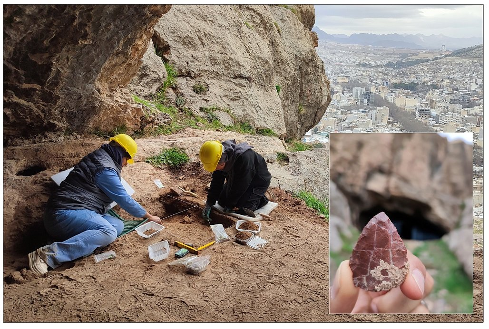

Throughout the oak-forested slopes of Lorestan near Khorramabad, where soaring limestone cliffs define the ancestral homelands of the Lur tribes, oral tradition has preserved the timeless fable of *The Planter and the Bear*. Documented by folklorist Bahram Farokhfal and archived in classical regional compendiums, the narrative celebrates the victory of pastoral intellect and agricultural forethought over predatory physical force.

The story centers on an aging peasant who cultivated a stony, terraced hillside to provide bread for his seven young daughters. One spring morning, as the farmer was steering a wooden ard behind two lean oxen, an enormous brown bear lumbered down from the upper crags. Snarling with bared fangs, the beast demanded half of the farm's harvest under threat of tearing the oxen and the farmer apart. Recognizing that direct resistance would be fatal, the peasant remained calm and proposed a formal partnership: "Let it be as you wish, friend; I shall plow and sow the field. When autumn arrives, everything growing beneath the soil shall be yours, and what grows above ground shall be mine."

> As elders of Lorestan observe in traditional parlance: "Mindless force is a heavy burden; when a farmer possesses true cunning, even the mountain bear becomes an unwitting plowmate who leaves with empty paws."

Delighted by the prospect of effortless gain, the bear slumbered all summer while the farmer cultivated golden wheat. When the harvest arrived, the farmer bundled sheaves of rich grain, leaving the bear only a tangle of inedible fibrous roots. Furious at the outcome, the bear growled: "You tricked me this season! Next year, I claim everything above the soil, and you take what lies beneath!" The following year, the peasant sowed the entire terraced plot with sweet winter turnips. When the bear returned, he was left with withered, bitter leaves, while the farmer dug up baskets of succulent, sweet tubers. Humiliated by the farmer's profound agricultural mastery, the bear retreated into the high alpine wilderness, never daring to harass the tribal farms again.

### Anthropological & Folklore Analysis
The tale represents a regional adaptation of the widespread folklore motif of "The Crop Division" (ATU 1030). In the context of Lorestan's historic tribal economy, the narrative serves as a morality tale encouraging agrarian resilience, demonstrating that cerebral resourcefulness and deep ecological understanding can successfully neutralize existential threats from the surrounding mountain wilderness.

### Archival Sources & Attribution
- **Primary Source:** Legends of the People of Lorestan, collected by Bahram Farokhfal, preserved in the Eranshahr Folklore Repository.
- **Source URL:** https://www.eranshahr.com/ganjine/index.php/2024-11-22%2022%3A21%3A01/%D8%A8%D8%B1%D8%A7%D8%B4%DB%8C%D8%AA-%D9%88-%D8%A8%D8%B1%D8%A7%D8%B9%D8%A7%D9%82%D9%84
- **Original Language:** Luri & Persian
- **Image Attribution:** File:Ghamari cave, Luristan, Iran.jpg | Photographer: Kermanshahi1398 | License: CC0
