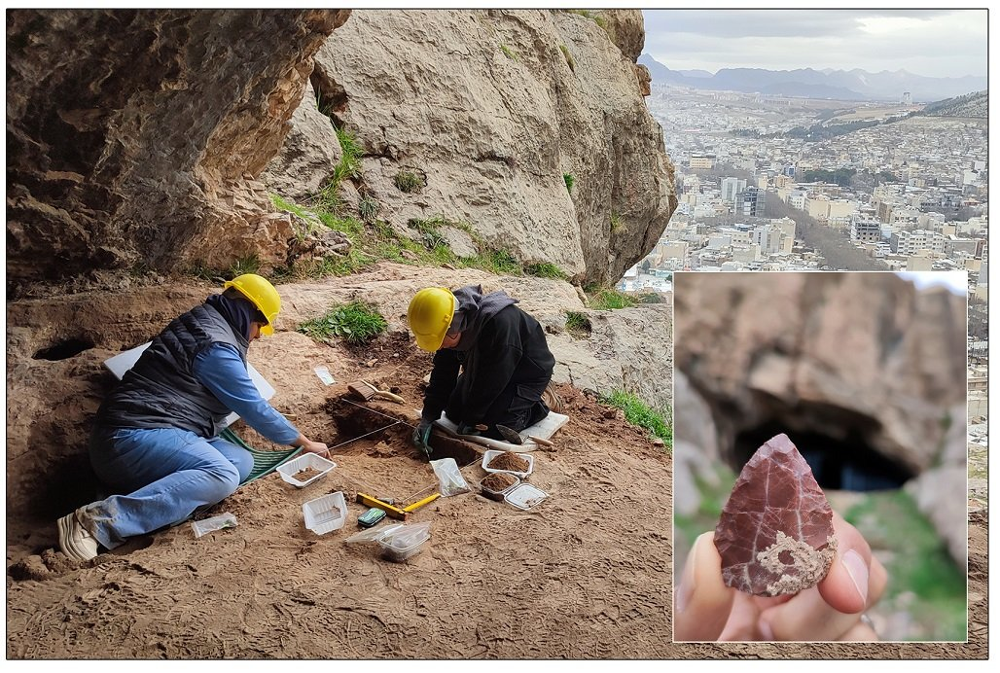

در دامنه‌های پرصلابت و بلوط‌پوش لرستان در حوالی خرم‌آباد، آنجا که صخره‌های زاگرس دیواره‌های سترگ دره‌ها را می‌سازند، پیران ایل سال‌هاست متل کهن «برزگر و خرس» را برای فرزندان خویش بازمی‌گویند؛ روایتی از پیروزی خرد و تدبیر بر نیروی کور جسمانی که بهرام فرخفال آن را در فرهنگ افسانه‌های مردم لرستان ثبت کرده است.

حکایت از پیرمردی برزگر سخن می‌گوید که با دستانی پینه‌بسته و قامتی خمیده، نان روزانه خود و هفت دختر خردسالش را از کشت قطعه زمینی سنگلاخ در دامنه کوهستان به دست می‌آورد. روزی در اوایل بهار، هنگامی که پیرمرد مشغول شخم زدن خاک سفت با دو گاو لاغر بود، خرسی تنومند و درنده با پنجه‌هایی هولناک از شکاف صخره‌ها فرود آمد و با غرشی سنگین گفت: «عمو، خداقوت! یا مرا در حاصل این زمین شریک می‌کنی یا همین دم تو و گاوهایت را در هم می‌شکنم!» کشاورز باهوش که می‌دانست مقاومت در برابر این جانور وحشی حاصلی جز مرگ ندارد، با خونسردی پاسخ داد: «قدمت بر چشم، شریک می‌شویم؛ من زمین را شخم می‌زنم و بذر می‌پاشم، تو هنگام درو بازگرد؛ محصول روی زمین مال من، ریشه‌های زیر خاک از آن تو!»

> لرزبانان خرم‌آباد در ضرب‌المثلی نغز می‌گویند: «زورِ بی‌عقل، بارِ گرونه؛ برزگر که فهم داشته بوئه، خرس هم رفیق شخمش موئه و حاصلی نمی‌وره.» (زورِ تهی از اندیشه باری سنگین است؛ دهقانی که درایت داشته باشد، خرس کوه را هم به زانو درمی‌آورد و حاصلی برای متجاوز باقی نمی‌گذارد).

خرس فریب خورده در تمام تابستان در غار به استراحت پرداخت و پیرمرد گندم کاشت. هنگام درو، پیرمرد ساقه‌های زرین و پردانه گندم را درو کرد و به انبار برد، و هنگامی که خرس آمد، جز انبوهی از ریشه‌های تلخ و بی‌فایده زیر خاک چیزی نصیبش نشد. خرس خشمگین شد و غرید: «امسال مرا فریب دادی، سال دیگر هر آنچه بر روی خاک می‌روید مال من است و ریشه‌های زیر زمین مال تو!» پیرمرد پذیرفت و در سال دوم زمین را سراسر چغندر و شلغم شیرین کاشت. در هنگام برداشت، خرس برگ‌های زرد و تلخ روی زمین را به چنگ آورد، در حالی که پیرمرد خروارها غده شیرین و مغذی را از دل خاک بیرون کشید. خرس که در برابر نبوغ و حسابگری دهقان زاگرس‌نشین احساس خفت می‌کرد، سر به بیابان نهاد و دیگر هرگز به حریم شالیزارها و مزارع ایل نزدیک نشد.

### بن‌مایه‌ها و ویژگی‌های مردم‌شناختی
این افسانه لری تجلی درخشان تیپ داستانی جهانی «تقسیم محصول با دیو یا حیوان وحشی» (Aarne-Thompson-Uther type 1030: The Crop Division) است. انطباق هوشمندانه آن با دانش کشاورزی سنتی بومیان زاگرس، تضاد میان زورمندی ناآگاهانه و زیرکی دهقانی، و ارزش بقا از طریق دوراندیشی، این قصه را به یکی از غنی‌ترین متل‌های لرستان بدل ساخته است.

### منابع و پژوهش
- **منبع اصلی:** افسانه‌های مردم لرستان، ثبت بهرام فرخفال، بازنشر در گنجینه ایرانشهر.
- **پیوند مرجع:** https://www.eranshahr.com/ganjine/index.php/2024-11-22%2022%3A21%3A01/%D8%A8%D8%B1%D8%A7%D8%B4%DB%8C%D8%AA-%D9%88-%D8%A8%D8%B1%D8%A7%D8%B9%D8%A7%D9%82%D9%84
- **زبان اصلی متن:** لری خرم‌آبادی و فارسی
- **تصویر:** File:Ghamari cave, Luristan, Iran.jpg | عکاس: Kermanshahi1398 | مجوز: CC0
