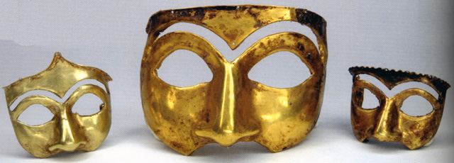

در صخره‌های هولناک و دره‌های سرگیجه‌آور کوه مهله در پلدختر لرستان، غاری پر راز و رمز دهان باز کرده که نامش در تاریخ باستان و فولکلور جهان پرآوازه است: «کلماکره». در گویش لری بالاگریوه، «کل» به معنای بز کوهی نر، «ماک» به معنای پناهگاه و «ره» به مفهوم درخت انجیر کوهی است؛ یعنی پناهگاه بزهای کوهی در جوار درخت انجیر. این غار طبیعی و شگفت‌انگیز که در سال‌های پایانی قرن بیستم یکی از بزرگ‌ترین گنجینه‌های سیمین و زرین جهان باستان (مربوط به دوران ایلام نو و هخامنشی) در آن کشف شد، در باورهای بومی لرستان قرن‌ها قلمرویی طلسم‌شده و خانه نگهبانان جاودانه بوده است. دیواره‌های دهلیزی این غار با چکیده‌سنگ‌های آهکی تندیس‌هایی وهم‌آور ساخته‌اند که گویی ارواح نیاکان در تاریکی به قامت ایستاده‌اند.

روایت پیران پلدختر می‌گوید که در زمان فروپاشی پادشاهی‌های کهن زاگرس و یورش ویرانگر دشمنان، آخرین نگهبانان خزائن مقدس، شمش‌ها، ریتون‌های زرین به شکل شیر و عقاب، و نقاب‌های سیمین نیاکان را با کاروان‌هایی مخفیانه به اعماق این دره بی‌عبور بردند. راهبان و پیشوایان آیینی، گنجینه‌ها را در چهار تالار تاریک غار که سقف آن پوشیده از چکیده‌سنگ‌های بلورین بود نهادند و پیش از آنکه دهانه مخفی را با تخته‌سنگ‌های عظیم بپوشانند، طلسمی آتشین بر خوان آن بستند؛ طلسمی که طبق آن، دو باز زرین با بال‌های آتشین و گله‌ای از پازن‌های کوهی نامرئی مأمور پاسداری از گنجینه تا ابد شدند.

> شکارچیان قدیمی بالاگریوه به جوانان سفارش می‌کردند: «هرگز در صخره‌های کلماکره بزی را که شاخ‌هایش زیر تابش آفتاب می‌درخشد دنبال نکنید؛ آن بز طلسم غار است و صیاد را به کام پرتگاه‌های پرت‌انداز می‌کشاند.»

در افسانه‌های محلی نقل است که قرن‌ها پیش، چوپان جوانی که در مه غلیظ به دنبال بز گمشده‌اش می‌گشت، از روزنه‌ای بسیار باریک به درون غار لغزید. او در تاریکی مطلق، ناگهان کاسه‌های زرین و ریتون‌هایی را دید که چشم‌های بلورینشان در تاریکی برق می‌زد. هنگامی که دست برد تا یکی از کاسه‌ها را بردارد، صدای بال زدن هولناکی در تالار پیچید و دو چشم درخشان از ژرفای غار بر او تابید. جوان وحشت‌زده گریخت و تنها تکه‌ای خزه خشکیده با خود آورد. بومیان معتقدند این گنجینه حاصل هنر و روح آزاد قوم کاسی و لُر بود که خاک را زر ساختند و کوه مهله تا به امروز نجواگر شوکت و پاکی آن روزگاران باقی مانده است. کلماکره یادآور رازی است که زاگرس در دل سینه‌اش برای همیشه به امانت نگه داشت تا نماد اصالت مردمانش باشد.

### منبع روایت و تصویر
- **خاستگاه افسانه:** روایات فولکلوریک شکارچیان و ریش‌سفیدان ایل بالاگریوه در پلدختر لرستان، اسناد باستان‌شناسی پیرامون گنجینه مکشوفه غار کلماکره.
- **عکاس / پدیدآورنده تصویر:** Nightryder84 (Wikimedia Commons)
- **منبع تصویر:** [صفحه تصویر در ویکی‌انبار](https://commons.wikimedia.org/wiki/File:Ancient_iranian_mask.jpg)
- **نوع مجوز:** CC BY-SA 3.0
