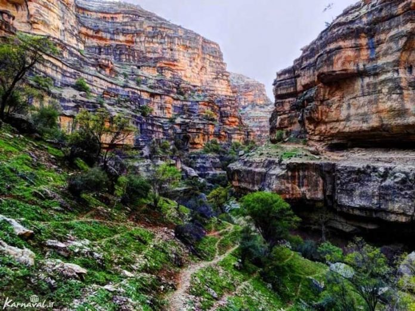

Deep within the colossal vertical gorge of Shirz Canyon, where the churning Seimareh River has sliced through millions of years of karst strata, an ominous shadow emerges in the twilit corridors. Known in Laki dialect as the *Shishak*, this supernatural entity is part specter and part demon, coalesced from freezing wind, red dust, and creeping shadows, bearing the uncanny telltale mark of all western Iranian wraiths: backwards-facing feet.

According to nomadic lore of Kuhdasht, the Shishak haunts solitary hunters caught after nightfall amidst the sheer canyons. It nests among cavern fissures around the monumental natural rock obelisk known as the Stone Minaret of Shirz. As gale-force drafts whistle through the canyon's stone amphitheaters, the Shishak mimics the joyful laughter of young maidens or the distressed cries of lost children, seducing wanderers toward the dizzying abyss. Those who pursue the siren echoes find themselves confronted by a faceless, ash-gray monstrosity whose sub-zero breath snuffs out mortal vitality.

> "In Shirz Canyon, when night engulfs the stone pillar, answer no phantom voice; Shishak speaks with the voice of your beloved only to cast your bones upon the rocks." — Hunter's warning from Lorestan.

Folklorist Seyed Ali Mortazavi notes in *Myths and Folk Beliefs of Lorestan* that the Shishak is a folkloric descendant of ancient Zoroastrian demons of wilderness and delusion. Nomads protected themselves against the entity by pinning a sharp steel needle into their woolen garments or wearing coats turned inside out—a sympathetic magical practice believed to confound the backward-walking creature. Shirz Canyon's sheer walls and subterranean spring caves remain steeped in this primeval aura, where every draft carries the whispers of the canyon’s ageless phantom.

### Sources & Image Attribution
- **Research Source:** Seyed Ali Mortazavi, *Myths and Folk Beliefs in Lorestan*, Farhang-e Mardom Quarterly, Vol. 5, No. 2, pp. 41-49; Hamid Izadpanah, *Laki Dictionary*, p. 112.
- **Image Attribution:** Documented on Wikimedia Commons by Rezazabet; License: [CC BY-SA 4.0](https://commons.wikimedia.org/wiki/File:Shirz_Canyon,_Kuhdasht.jpg).
