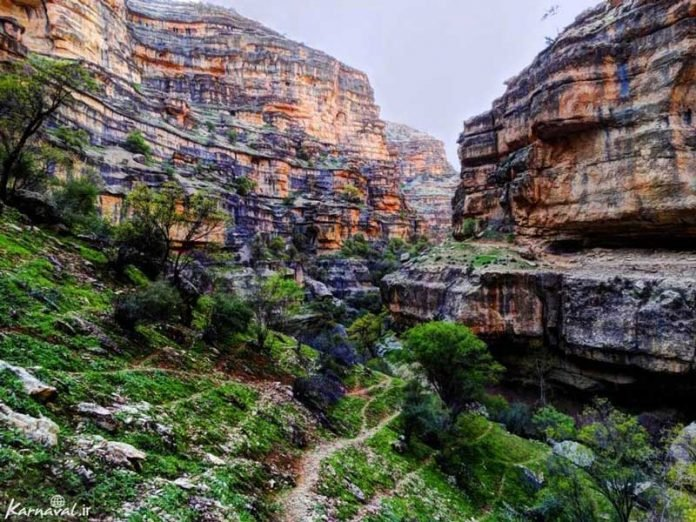

در قلب دیواره‌های عظیم و سر به آسمان ساییده‌ی تنگه شیرز، جایی که رودخانه سیمره صخره‌های آهکی میلیون‌ساله را چون تیغی بران شکافته است، سایه‌ای هولناک در گرگ‌ومیش غروب بر مسافران سایه می‌افکند. این سایه سرگردان در گویش لکی به «شیشک» شهرت دارد؛ موجودی نیمه‌پری و نیمه‌دیو که کالبدی از باد، غبار و سایه‌های سیاه دارد و پاهایش بر خلاف آدمیان، رو به عقب برگشته است.

شیشک در باور عشایر لک و لر کوهدشت، شکارچی ارواح مسافران تنها و شکارچیان شب‌زنده‌دار در پیچ‌وخم‌های وهم‌آور تنگه است. او میان غارهای مرتفع و ستون سنگی شگفت‌انگیز «مناره سنگی شیرز» لانه دارد. هنگامی که باد در دهلیزهای باریک صخره‌ها می‌پیچد، شیشک صدای خنده‌ی دختری شادمان یا ناله‌ی گمگشته‌ای در تاریکی را سر می‌دهد تا رهگذر را از مسیر امن کنار رودخانه به سوی پرتگاه‌های هولناک بکشاند. هر کس که فریفته این صدا شود و به دنبال آن گام بردارد، ناگهان با چهره‌ای بی‌چشم و سراسر پر از شیارهای خاکستری روبه‌رو می‌شود که با دمی یخ‌بندان، چراغ جانش را خاموش می‌کند.

> «در تنگه شیرز، چون تاریکی بر ستون سنگی فرونشیند، صداها را پاسخ مده؛ شیشک با زبان خویشاوندانت سخن می‌گوید تا تو را بر خاک سیاه بنشاند.» — پند کهن شکارچیان کوهدشت لرستان.

پژوهش‌های مردم‌شناسی سید علی مرتضوی پیرامون «اسطوره‌ها و باورهای عامه در لرستان» بیانگر آن است که شیشک بازمانده‌ای از موجودات اساطیری اهریمنی در متون زرتشتی کهن مانند «وشک» یا دیو خشکی و سرگردانی است. بومیان برای رهایی از چنگال شیشک، پوشیدن پیراهن وارونه و بستن سوزن خیاطی فلزی به کلاه یا کمربند را کارساز می‌دانستند، زیرا بر این باور بودند که شیشک از آهن تیز و لباس واژگونه به شدت می‌هراسد و هویت خود را گم می‌کند.

تنگه شیرز با دیواره‌های عظیم صد متری و غار معروف پل خدا، امروزه نیز هنگام غروب خورشید ابهتی سرشار از راز دارد؛ گویی در هر زوزه باد، شیشک هنوز در کمین شنوندگان اسرار دره ایستاده است.

صخره‌نوردان و شکارچیان کهنه‌کار دره شیرز باور دارند که شیشک توانایی تغییر صدا به هر آوایی در طبیعت را دارد؛ از صدای شرشر چشمه‌های ناشناخته گرفته تا آوای زنگوله گوسفندان گمشده. این شگرد به منظور جدا ساختن مسافران از کاروان‌ها و کشاندن آنان به لبه‌های مرگبار صخره‌های گچی به کار می‌رفته است. مردم محلی باور داشتند که همواره باید به صورت گروهی از تنگه شیرز عبور کرد و بر سر راه خویش شاخه‌های خشک بلوط را با آتش روشن نگاه داشت، زیرا شیشک از گرمای اخگرهای آتش به ژرفای شکاف‌های مناره سنگی می‌گریزد.

### منابع و اعتبار تصویر
- **منبع پژوهشی افسانه:** سید علی مرتضوی، «اسطوره‌ها و باورهای عامه در لرستان»، فصلنامه فرهنگ مردم، سال ۵، شماره ۲، ص ۴۱-۴۹؛ حمید ایزدپناه، «فرهنگ لکی»، تهران، ص ۱۱۲.
- **اعتبار تصویر:** ثبت‌شده در ویکی‌مدیا کامنز توسط Rezazabet؛ مجوز انتشار: [CC BY-SA 4.0](https://commons.wikimedia.org/wiki/File:Shirz_Canyon,_Kuhdasht.jpg).
