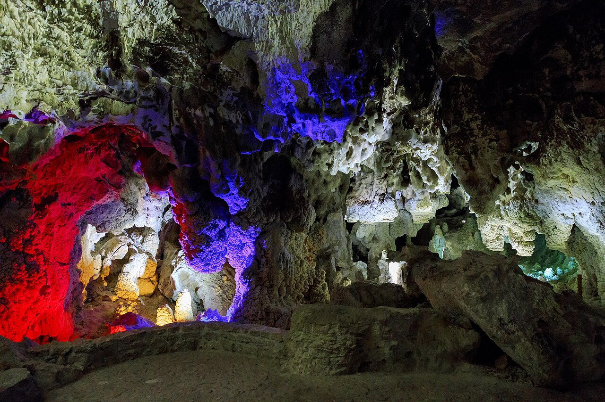

در دامنه‌های کوه تخت در حدفاصل شهرهای دلیجان و نراق در استان مرکزی، غاری اعجاب‌انگیز و طبقاتی با چکیده‌سنگ‌ها و چکه‌سنگ‌های بلورین به رنگ‌های شیری، سرخ و طلایی دهان گشوده است که آن را «غار چال‌نخجیر» می‌نامند. این غار زنده و آهکی که تالارهایی موسوم به چهل‌ستون، باغ وحش، گل‌کلمی و عروس دارد، در شمار زیباترین پدیده‌های غارشناسی خاورمیانه است. اما در زبان و دل مردم محلی دلیجان و نراق، نخجیر زادگاه افسانه‌ای سوزناک و عبرت‌آموز درباره کاروانی باشکوه است که با قهر طبیعت به سنگ‌های بلورین بدل گشتند تا درسی جاودانه برای آیندگان بر جای گذارند.

بر پایه افسانه‌های کهن راجی، روزگاری کاروان عروسی دختر حاکم متمول منطقه همراه با اسب‌های آراسته به یراق‌های زرین، طبق‌های جهیزیه، نوازندگان و میهمانان از این گردنه عبور می‌کرد. کاروان از کنار پیرزنی ناتوان و گرسنه گذشت که برای طفل بیمارش لقمه‌ای نان طلب می‌کرد. عروس مغرور نه تنها کمکی نکرد، بلکه دستور داد پیرزن را با تازیانه برانند و گرد و خاک بر سرش افشانند. پیرزن دل‌سوخته دست به آسمان برداشت و گفت: «الهی هر که در این شادی بی‌رحم پای می‌کوبد، پیش از رسیدن به مقصد، چون دل سنگش سخت و منجمد شود!»

> پیران نراق با صدایی پر از راز زمزمه می‌کنند: «تالار عروس غار نخجیر، همان کجاوه‌ای است که بلورهای آهک بر آن تنیده؛ آن تندیس سپید با تور درخشان، عروس بی‌رحمی است که تا ابد در سکوت سنگ اشک ندامت می‌ریزد.»

با نفرین پیرزن، ناگهان طوفانی سیاه درگرفت و صاعقه‌ای دل کوه را شکافت؛ کاروان برای نجات به دهانه غار پناه بردند اما با ورود به تالارها، قطرات آب به سنگ تبدیل شدند و تک‌تک اسب‌ها، صندوقچه‌های زرین، نوازندگان چنگ و عروس با لباس سپید توردارش، به تندیس‌هایی از بلور و کلسیت بدل گشتند. مردم دلیجان معتقدند انعکاس قطرات آبی که امروز در غار می‌چکد، صدای گریه‌های پنهانی دختران آن کاروان است که به رهگذران پیام فروتنی و دستگیری از بینوایان را یادآوری می‌کنند. پیرزنان نراقی هنگام بافتن قالیچه‌های محلی، نقش تالار سنگ‌شده را با نخ‌های سپید بازآفرینی می‌نمایند. تالار چهل‌ستون نخجیر با ستون‌های آهکی‌اش که همچون ساقه‌های پیچک از زمین تا سقف روییده‌اند، در نگاه بومیان همان مشعل‌های خاموش‌شده کاروان عروس است که به کریستال‌های بی‌زوال بدل گشته‌اند. در سکوت ژرف غار، هر بار که وزش هوای پاک از اعماق زمین در تالارها می‌پیچد، نوایی شبیه به هلهله‌ای دوردست به گوش می‌رسد که به ناگاه در سکوت بلورها خاموش می‌شود تا زنگ بیداری برای آزمندان باشد. غار چال‌نخجیر با بلورهای جادویی و تالارهای الماسینش، تبلور زنده اسطوره‌های اخلاقی در دل کویر مرکزی است.

### منبع روایت و تصویر
- **خاستگاه افسانه:** فرهنگ روایی و فولکلور شفاهی مردم دلیجان و شهر تاریخی نراق، پژوهش‌های افسانه‌شناسی غارهای استان مرکزی.
- **عکاس / پدیدآورنده تصویر:** Elaheabed
- **منبع تصویر:** [صفحه تصویر در ویکی‌انبار](https://commons.wikimedia.org/wiki/File:Chal_Nakhjir_(1).jpg)
- **نوع مجوز:** CC BY-SA 4.0
