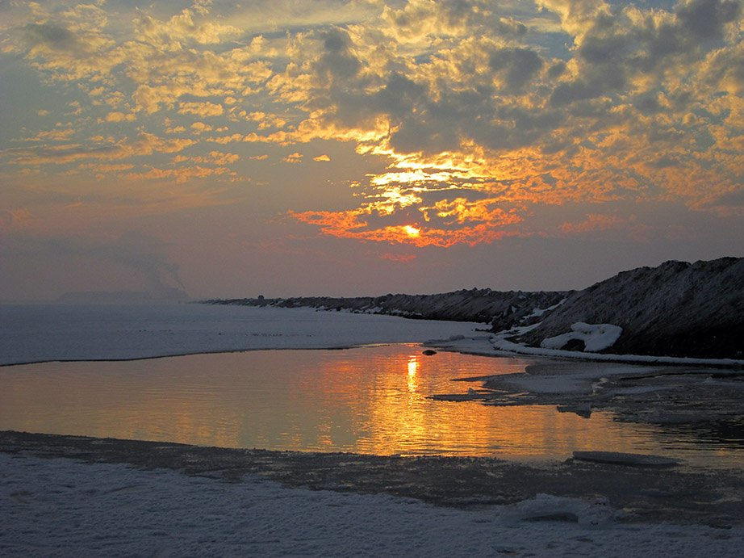

Across the vast saline basin of Meighan Wetland northeast of Arak, where tens of thousands of migratory common cranes descend each winter upon crystalline salt flats, local folklore preserves the legend of the *Firebird of the Salt Flats* (*Morgh-e Atashin*). In the traditional oral lore of Arak and Farahan, this mythical avian spirit is forged of celestial embers and crystalline brine, its plumage burning like polished ruby beneath the winter fog, crowned with a crest of pure salt crystals.

Regional lore recounts that in an ancient epoch when the demon of drought sought to evaporate the wetland into lifeless dust, the Firebird plummeted from the celestial vault, beating its flaming wings against the salt crust. This titanic exertion caused subterranean mineral springs to surge, permanently sustaining the wetland’s delicate water table. Local belief holds that the Firebird serves as the spiritual matriarch of the migratory cranes, circling the foggy shores to guide arriving flocks into protected reed coves. However, should a cruel poacher loose an arrow at the cranes, the Firebird showers the hunter with blinding salt embers, casting permanent darkness over their sight.

> "Cast no stone at the cranes of Meighan; the crane is a pilgrim of the sky and the Firebird keeps vigil in the mist. The hand that strikes a crane’s feather will burn in the hidden embers of the marsh." — Adage of Dawoodabad wetland elders.

Historian Ebrahim Dehgan in *History of Arak and Monographs of the Central Province* and Ali-Ashraf Darvishian in *Encyclopedia of Iranian Folktales* note that this legend was inspired by the dazzling crimson reflections of sunrise upon flocks of flamingos and cranes. The myth functioned as an indigenous conservation pact, securing sanctuary for delicate migratory species throughout centuries. At dawn, when the cranes lift from the shimmering salt pan, the ancient spirit of the Firebird continues to soar over Meighan.

### Sources & Image Attribution
- **Research Source:** Ebrahim Dehgan, *History of Arak and Monographs of the Central Province*, Arak, pp. 241-249; Ali-Ashraf Darvishian, *Encyclopedia of Iranian Folktales*, Vol. 9, p. 315.
- **Image Attribution:** Documented on Wikimedia Commons by مقداد; License: [FAL](https://commons.wikimedia.org/wiki/File:Frozen_salt_lake_Meyghan.JPG).
