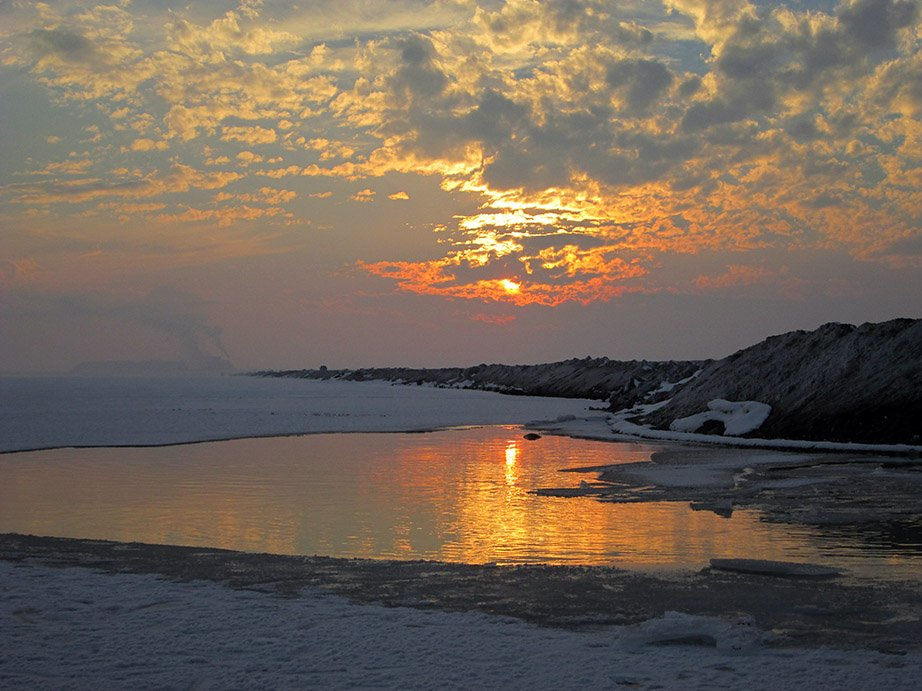

در کویر نمکین و تالاب وسیع میقان در شمال شرقی اراک، جایی که در فصل سرما هزاران درنای خاکستری بر فراز شنزارهای سپید بال می‌گشایند، افسانه‌ای دیرین از پرنده‌ای اسطوره‌ای به نام «مرغ آتشین میقان» نقل می‌شود. در باور کهن مردم اراک و فراهان، این پرنده روحی از جنس نور و آتش آسمانی است که پرهایش چون شعله‌های یاقوت سرخ در میان مه غلیظ نمک‌زار می‌درخشد و تاج بلورینی از نمک خالص بر سر دارد.

روایت اراکی بازگو می‌کند که در روزگاران باستان، هنگامی که دیو خشکسالی قصد داشت تالاب را بخشکاند و خاک منطقه را به کویری بایر و مرده بدل سازد، مرغ آتشین از اعماق آسمان فرود آمد و با بال زدن بر روی شوره، چشمه‌های سولفات سدیم و آب‌های شور زیرزمینی را به جوشش درآورد تا حیات تالاب حفظ شود. خاکستر پرهای ریخته‌شده این پرنده، لایه‌های نمک و املاح غنی میقان را پدید آورد. باور بومی بر این است که مرغ آتشین، مادر و راهنمای درناهای خاکستری است و هر سال پیش از فرارسیدن سوز زمستان، با پروازی دایره‌وار بر فراز دریاچه، مسافران بالدار را به پناهگاه‌های امن نیزار هدایت می‌کند. اما اگر شکارچی سنگ‌دلی دست به سوی درناها ببرد، مرغ آتشین با پرتاب شراره‌هایی از نمک سوزان از بال‌های خویش، چشمان صیاد را تا پایان عمر به کوری مبتلا می‌سازد.

> «به درناهای میقان سنگ مزن؛ درنا پرنده آسمان است و مرغ آتشین در قلب مه نمک‌زار بیدار. هر دستی که بر پر درنا نشیند، در آتش پنهان تالاب خواهد سوخت.» — پند صیادان کهنسال در روستای داودآباد اراک.

ابراهیم دهگان، تاریخ‌نگار نامدار استان مرکزی، در «تاریخ اراک و تک‌نگاری‌های استان مرکزی» و علی‌اشرف درویشیان در جلد نهم «فرهنگ افسانه‌های مردم ایران» یادآور می‌شوند که اسطوره مرغ آتشین میقان، بازتابی شاعرانه از بازگشت فلامینگوها و درناهای سرخ‌فام و پرواز باشکوه آنان در غروب خورشید است. این افسانه نقش بسیار مهمی در ترغیب مردم روستاهای فراهان به احترام گذاشتن به پرندگان مهاجر و صیانت از تالاب حساس میقان در طول تاریخ داشته است.

امروزه نیز هنگامی که دسته‌های عظیم درناها در سحرگاهان میقان به پرواز درمی‌آیند و انوار سرخ خورشید بر بال‌های آنان می‌تابد، شکوه مرغ آتشین اساطیری بار دیگر در پهنه‌ی سپید نمک‌زار تجدید می‌شود.

### منابع و اعتبار تصویر
- **منبع پژوهشی افسانه:** ابراهیم دهگان، «تاریخ اراک و تک‌نگاری‌های استان مرکزی»، اراک، ص ۲۴۱-۲۴۹؛ علی‌اشرف درویشیان، «فرهنگ افسانه‌های مردم ایران»، جلد ۹، ص ۳۱۵.
- **اعتبار تصویر:** ثبت‌شده در ویکی‌مدیا کامنز توسط مقداد؛ مجوز انتشار: [FAL](https://commons.wikimedia.org/wiki/File:Frozen_salt_lake_Meyghan.JPG).
