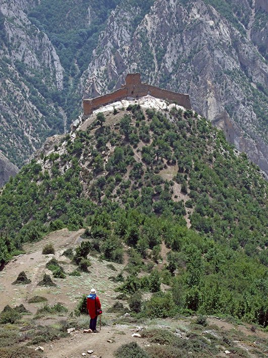

Deep in the mist-laden Hyrcanian forests of Savadkuh, where ancient hornbeam and alder branches intertwine under the Caspian sky, village elders recount the lore of *Asenin* (derived from the Tabari dialect word *Asen*, meaning iron). In the mountain memory of the Talar River valley, Asenin personified the unbreakable kinship between highland inhabitants and their rugged forested environment. Born in an ancestral blacksmith's workshop during a thunderous night—where red-hot iron shavings were traditionally scattered to protect newborns from malevolent nocturnal spirits—she grew into an agile woman whose limbs were said to be as unyielding as forged steel.

In the autumns of old, torrential rains would frequently transform gentle mountain streams into violent torrents, smashing the wooden suspension footbridges that connected isolated hamlets. During one devastating deluge, the swollen Talar River trapped dozens of children, elderly villagers, and entire herds of sheep on an eroding mudbank. Paralyzed by the roaring waves, the strongest woodsmen hesitated to approach the raging torrent. Without hesitation, Asenin strode straight into the icy white waters.

> As preserved in Tabari oral tradition: "Where iron stands, malevolent spirits flee; when a woman possesses a will of tempered steel, she wrests her community from the fiercest flood."

Planting her feet deep into the rocky riverbed, Asenin caught massive floating maple trunks with her bare hands, anchoring the shattered logs against her shoulders to create a living bridge amidst the furious surge. For hours in the freezing deluge, she held the timbers steady while villagers and livestock crossed to the safety of high ground. Just as the final lamb stepped ashore, a massive driftwood boulder struck the timber, sweeping Asenin downstream. Yet local folklore insists the sacred river waters could not vanquish her iron spirit; the currents gently washed her ashore on a tranquil bank of wild poplars. Since that day, she has been venerated throughout Mazandaran as the guardian spirit of highland crossings and the embodiment of maternal courage.

### Anthropological & Folklore Analysis
The legend is rooted in ancient Caspian metallurgical beliefs, where iron served both as an apotropaic charm against supernatural predators (*Al* and *Bakhtak*) and as a metaphor for human perseverance against seasonal mountain disasters. The narrative underscores the prominent matriarchal undertones characteristic of indigenous northern Iranian folk culture.

### Archival Sources & Attribution
- **Primary Source:** Eranshahr Folklore Archive: Regional Legends and Mythological Traditions of Northern Iran.
- **Source URL:** https://www.eranshahr.com/ganjine/aseni
- **Original Language:** Mazandarani (Tabari) & Persian
- **Image Attribution:** File:Build.Kangeh Lou Castle. 001.Farzad Emami.jpg | Photographer: Farzad Emami | License: CC BY-SA 4.0
