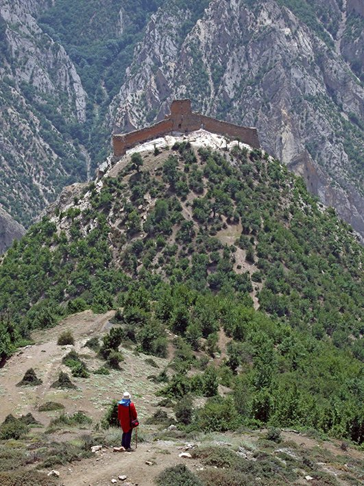

در ژرفای جنگل‌های باستانی سوادکوه، آنجا که شاخسار کهنسال ممرز و توسکا در مه کبود خزر گره می‌خورند، کهنسالان البرز افسانه دختری به نام «آسِنین» (Asenin؛ برگرفته از واژه طبری «آسِن» به معنای آهن و پولاد) را نقل می‌کنند. در باور مردم کوهپایه‌های تالار، آسنین زادبوم جنگل و تجسم پیوند ناگسستنی انسان با سختی‌های کوهستان بود. مادرش او را در شبی پررعد در پای کوره آهنگری سنتی قریه به دنیا آورد؛ جایی که به باور بومیان، براده‌های سرخ آهن نوزاد را از دستبرد آل و پریان بدخواه در امان نگه داشته بود. با گذشت سالیان، آسنین نه تنها سیمایی پرغرور و تهمتن‌وار یافت، بلکه ساق‌ها و زانوانش چنان مقاوم گشت که گویی از پولاد ناب ریخته شده است.

در آن روزگاران، رودخانه‌های خروشان البرز هنگام باران‌های سیل‌آسای پاییزی طغیان می‌کردند و پل‌های چوبی معلق را در هم می‌شکستند. در یکی از این فصول بارانی، طغیان ناگهانی رود تلار تمام راه‌های ارتباطی آبادی را مسدود کرد و رمه‌های گوسفندان همراه با ده‌ها کودک و سالخورده در محاصره آب‌های خروشان و سیلاب‌های گل‌آلود گرفتار شدند. در حالی که مردان آبادی از شدت جریان خروشان آب به وحشت افتاده بودند، آسنین با تن‌پوشی از پشمینه بومی خود را به قلب سیلاب افکند.

> مازندرانی‌ها در باور کهن خویش می‌گویند: «آسِن دَوو، دیو و دَد رَمِنه؛ زِنا که پولادی بوئه، شِه خِنه و مَله رِ سِیلاب جه وَرنه.» (آهن که باشد دیو و گزند می‌گریزد؛ زنی که اراده پولادین داشته باشد، خانه و آبادی‌اش را از چنگال سیل می‌رهاند).

آسنین با ایستادگی در برابر خیزاب‌های سهمگین، تنه‌های تنومند درختان افرا را که سیلاب با خود آورده بود با نیروی بازوی خویش نگاه داشت و پیکر استوار خود را تکیه‌گاه الوارهای شکسته‌پل ساخت. او ساعت‌ها در میان آب‌های یخ‌بسته ایستادگی کرد تا تک‌تک اهالی و گوسفندان از روی دستان و گرده او و الوارهای مهارشده به ساحل امن برسند. هنگامی که آخرین بره نیز نجات یافت، خستگی مفرط و ضربه تنه درختی تنومند او را در خود فرو برد، اما گرداب خروشان نتوانست تن پولادین او را بشکند؛ پیران ده نقل می‌کنند که امواج رود، او را آرام در حاشیه بیشه‌زار سپیدارها بر زمین نهاد. از آن هنگام، مردم مازندران نام آسنین را به عنوان فرشته نگهبان پل‌ها و نماد شکست‌ناپذیری زنان جنگل‌نشین پاس می‌دارند.

### بن‌مایه‌ها و ویژگی‌های مردم‌شناختی
این افسانه کهن مازندرانی ریشه در تقدس فلز آهن در نظام اعتقادی اقوام طبری دارد؛ فلزی که نه تنها طلسم دفاعی در برابر موجودات فراطبیعی (نظیر بختک و آل) شمرده می‌شد، بلکه نماد ایستادگی در برابر بلاهای ویرانگر طبیعی همچون سیل‌های کوهستانی بود. همچنین نمایش زن به عنوان قهرمان فداکار نجات‌بخش، نشانگر کهن‌الگوهای مادرتباری در حوزه جغرافیایی کاسپین است.

### منابع و پژوهش
- **منبع اصلی:** گنجینه افسانه‌ها و اسطوره‌های کهن ایرانشهر (ثبت‌شده به کوشش پژوهشگران بومی مازندران).
- **پیوند مرجع:** https://www.eranshahr.com/ganjine/aseni
- **زبان اصلی متن:** مازندرانی (طبری) و فارسی
- **تصویر:** File:Build.Kangeh Lou Castle. 001.Farzad Emami.jpg | عکاس: Farzad Emami | مجوز: CC BY-SA 4.0
