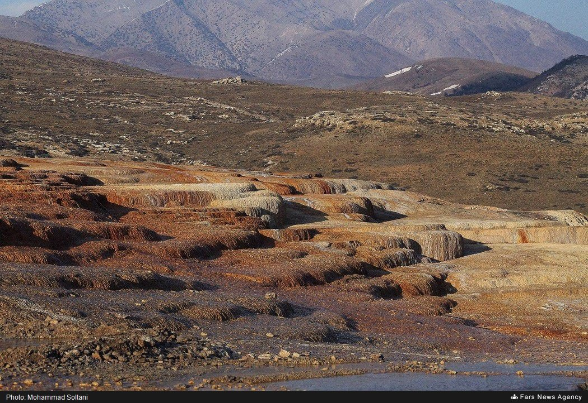

High amidst the mist-laden highlands of Chahardangeh near the ancient village of Orost in Mazandaran, the natural stepped travertine terraces of *Badab-e Soort* glow in iridescent hues of cinnabar, saffron, and gold. Fed by two disparate springs surging from deep subterranean aquifers—one profoundly saline and crystal-clear, the other rich in iron oxides, tart, and bubbling with curative sulfur—these terraced cascades are venerated in Tabari lore as the bathing chambers of the *Pari of Badab Soort*, a benevolent water nymph who cures human suffering with mountain elixirs.

Local oral tradition recounts that in antiquity, the fairy cleft the mountain rock with a golden spindle to save a courageous mountain maiden crippled by a winter wolf pack. From the fissure poured two healing elixirs: saline brine to cleanse infected wounds and red ferruginous waters to strengthen brittle bones. As the nymph descended the mountainside, her trailing celestial gown crystallized the cascading mineral waters into terraced basins of travertine stone. However, should an impure, arrogant, or malevolent soul step into the pools, the sulfurous waters boil violently, inflicting searing blisters upon the trespasser.

> "Step not into the scarlet basin of Badab Soort with an unquiet spirit; these chromatic terraces are the uncoiled tresses of the Alborz Pari, offering cure to the humble and fire to the profane." — Ancient folk wisdom of Orost village.

Mythologist Asadollah Emadi in *Beliefs and Myths of Mazandaran* notes that the sacred aura surrounding Badab Soort’s mineral springs functioned as an ancient ecological taboo, preserving this delicate geological wonder through centuries. Farmers from surrounding valleys historically sprinkled clay jars of the ferruginous water upon their wheat shoots in spring to ward off agricultural blights. At sunset, when solar embers reflect upon the mineral pools, Badab-e Soort appears as an enchanted staircase ascending into the heavens.

### Sources & Image Attribution
- **Research Source:** Asadollah Emadi, *Beliefs and Myths of Mazandaran*, Sari: Shelfin, pp. 142-149; Jahangir Nasri Ashrafi, *Tabari Folklore*, Vol. 2, p. 215.
- **Image Attribution:** Documented on Wikimedia Commons by Mohammad Soltani محمد سلطانی; License: [CC BY 4.0](https://commons.wikimedia.org/wiki/File:Badab-e_Surt_13960127_07.jpg).
