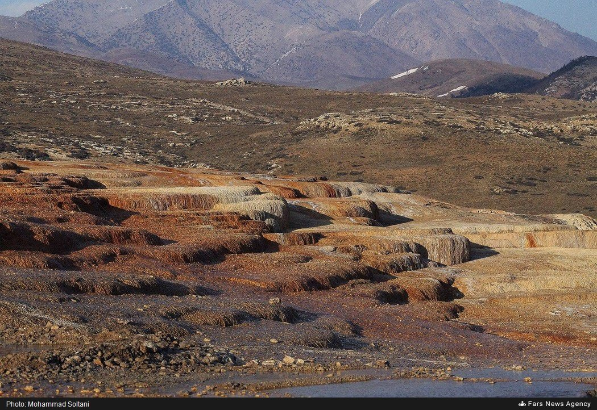

در ارتفاعات مه‌آلود بخش چهاردانگه ساری و در نزدیکی روستای کهن اروست، پلکان‌های طبیعی و شگفت‌انگیز تراورتن با رنگ‌های سرخ، نارنجی و لیمویی به سوی آسمان قد برافراشته‌اند که به «باداب سورت» معروف‌اند. دو چشمه‌ی جوشان با طعم و خواص کاملاً متفاوت، این حوضچه‌های پلکانی را از اعماق زمین تغذیه می‌کنند؛ یکی چشمه‌ای بسیار شور و گزنده و دیگری چشمه‌ای ترش‌مزه، گوگردی و اخرایی‌رنگ. در باورهای بومی تپوری، این چشمه‌های اعجاب‌انگیز، تالار آبتنی «پری باداب سورت» هستند؛ بانویی جادویی که با اکسیر رنگین کوهستان، بیماران خسته از دردهای تن را شفا می‌بخشد.

روایت مازندرانی بازگو می‌کند که در عهد باستان، این پری برای نجات دختری دلیر که پایش در حمله گرگان کوهستان آسیب دیده بود، با سوزن زرین خود سنگ‌های کوه را شکافت و دو چشمه از دل خاره جاری ساخت: آبی شور برای فرونشاندن رنج و چرکینگی و آبی سرخ‌فام و گزنده برای نیروبخشی به استخوان‌ها. با هر گامی که پری بر پله‌ها نهاد، آب ته‌نشین شد و پلکان‌هایی از طلا و یاقوت به یادگار ماند. اما هشدار داده شده است که اگر کسی با ناپاکی، طمع‌ورزی یا کینه‌توزی پا در حوضچه‌های سرخ بگذارد، آب چشمه‌ها به ناگاه می‌جوشد و با گازهای گزنده گوگردی، پوست متجاوز را به تاول‌های سوزان می‌نشاند.

> «در آب سرخ باداب سورت، بی‌وضوی دل پای منه؛ این پله‌های رنگین، گیسوان پری البرز است که برای شفا گشوده شده و با آلودگی، به زهر کوه بدل خواهد شد.» — پند کهنسالان اروست در چهاردانگه مازندران.

اسدالله عمادی در کتاب ارزشمند «باورها و اساطیر مازندران» تأکید می‌کند که باداب سورت از هزاره‌های پیش به عنوان چشمه‌ای مقدس و درمان‌بخش مورد ستایش بوده و باور به حضور پری آب، متضمن حفاظت و دست‌نخورده ماندن این پدیده کمیاب زمین‌شناختی در طول اعصار بوده است. مردم روستاهای اطراف در آغاز هر بهار، کوزه‌ای از آب چشمه ترش را برای تبرک به مزارع گندم خویش می‌پاشیدند تا آفت از غلات دور بماند.

غروب خورشید که پرتوهای زرین را بر کاسه‌های فیروزه‌ای و سرخ باداب سورت می‌تاباند، گویی نگین‌های تاجی اسطوره‌ای را در آغوش البرز روشن می‌سازد؛ یادبودی جاودانه از مهر پری چشمه‌ساران شمال ایران.

اهالی روستای اروست معتقدند که نوشیدن چند قطره از آب حوضچه‌های شور باداب سورت در سحرگاهان، سموم تن را می‌زداید و آب چشمه سرخ، مرهمی معجزه‌آسا برای دردهای رماتیسمی و پوستی است. این باور به پری باداب سورت، مردم را ترغیب می‌کرد تا حریم چشمه‌ها را پاکیزه نگه دارند و هیچ زباله یا آلودگی را وارد این پلکان‌های بلورین نسازند تا خشم پری، سرچشمه‌های شفابخش را بخشکاند.

### منابع و اعتبار تصویر
- **منبع پژوهشی افسانه:** اسدالله عمادی، «باورها و اساطیر مازندران»، ساری، انتشارات شلفین، ص ۱۴۲-۱۴۹؛ جهانگیر نصری اشرفی، «فرهنگ عامه تبری»، جلد ۲، ص ۲۱۵.
- **اعتبار تصویر:** ثبت‌شده در ویکی‌مدیا کامنز توسط Mohammad Soltani محمد سلطانی؛ مجوز انتشار: [CC BY 4.0](https://commons.wikimedia.org/wiki/File:Badab-e_Surt_13960127_07.jpg).
