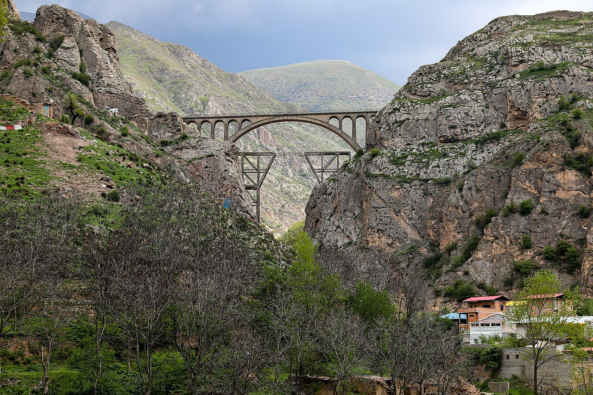

Amidst the sheer gorges and mist-draped chasms of Savadkuh in Mazandaran, where vertical escarpments tower near Sorkhabad and the historic Veresk defile, ancient legends of the mythical giants of Tabaristan continue to echo. At the heart of regional oral lore stands the *Rock-Hurling Div of Sorkhabad*—a primeval colossus standing as tall as a stone bastion, crowned with flint horns and glaring with eyes that smolder like crimson embers.

Tabari oral tradition recounts that in antiquity, this mountain giant held absolute dominion over the perilous mountain passes connecting the Caspian littoral to the Iranian plateau. Any caravan seeking passage was forced to pay heavy tribute in gold or livestock. When defiant travelers refused, the titan tore boulders weighing thousands of pounds from the crags, hurling them down into the defile with apocalyptic fury—boulders that still choke the riverbed of the Talar river at Sorkhabad. Ultimately, the legendary generals of Tabaristan laid siege to the monster from the hidden refuge of the Cave of Espahbod Khorshid, binding him in subterranean chains beneath the cliffs.

> "Through the defiles of Savadkuh, when gale-force winds scream from Gaduk Pass, invoke the divine name; the Div of Sorkhabad still strains against his stone chains beneath the roots of the mountain, yearning to cast another boulder." — Oral lore of Savadkuh elders.

Folklorist Jahangir Nasri Ashrafi in his *Tabari Cultural Lexicon* and Asadollah Emadi in *Myths of the Divs of Mazandaran* note that the giants of Mazandaran personified the wild, untamed geological forces of the Alborz—rockfalls, devastating avalanches, and flash torrents. The myth preserves ancestral memories of carving transit routes through treacherous mountains. Today, the monumental Veresk Bridge arches majestically over the very canyon once said to tremble beneath the giant’s rage.

### Sources & Image Attribution
- **Research Source:** Jahangir Nasri Ashrafi, *Lexicon of Tabari Words and Beliefs*, Tehran: Ehya, Vol. 3, pp. 112-118; Asadollah Emadi, *Myths of the Divs of Mazandaran*, p. 91.
- **Image Attribution:** Documented on Wikimedia Commons by Ninara from Helsinki, Finland; License: [CC BY 2.0](https://commons.wikimedia.org/wiki/File:Crossing_the_Alborz_Mountains_on_a_private_train,_Veresk_(41141184810).jpg).
