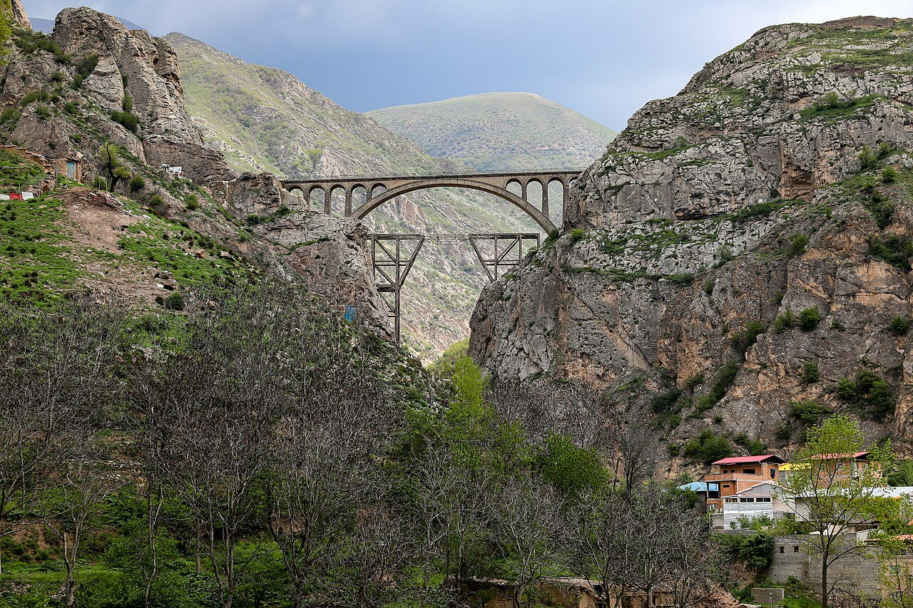

در گذرگاه‌های باریک و پرپیچ‌وخم سوادکوه در مازندران، جایی که صخره‌های عمودی کوهستان در حوالی سرخ‌آباد و تنگه ورسک سر به ابرها می‌سایند، روایت‌های کهن از نبردهای دیوان باستانی تبرستان هنوز در زبان مردم زنده است. در کانون این افسانه‌ها، «دیو سنگ‌افکن سرخ‌آباد» جای دارد؛ دیوی تنومند به بلندای یک برج سنگی، با شاخ‌هایی از سنگ چخماق و چشمانی که از خشم به سرخی آتش سرخ‌آباد می‌درخشد.

افسانه تبری بازگو می‌کند که در گذشته‌های دور، این دیو فرمانروای مطلق تنگه کوهستانی سوادکوه بود و هر کاروان یا مسافری که قصد عبور از کوهستان به سوی فلات مرکزی را داشت، باید باجی گزاف از طلا و احشام به او می‌پرداخت. اگر کاروانی از فرمان او سرپیچی می‌کرد، دیو با دستان خاره‌تراش خود تخته‌سنگ‌هایی به وزن هزار من را از سینه کوه جدا می‌کرد و بر کاروانیان فرو می‌بارید؛ صخره‌هایی که امروزه نیز بستر رودخانه تالار در سرخ‌آباد را پوشانده‌اند و مردم آن‌ها را سنگ‌های پرتابی دیو می‌دانند. سرانجام سپهبدان دلاور طبرستان با پنهان شدن در شکاف غار اسپهبد خورشید و بستن راه آب بر دیو، او را در پای صخره‌های سرخ‌آباد به زنجیر کشیدند.

> «در گذرگاه سوادکوه، چون باد تند از سمت گدوک بتازد و غبار سنگ برخیزد، نام ایزد بر زبان آر؛ دیو سرخ‌آباد هنوز زیر ریشه‌های کوهستان می‌غرد و در آرزوی پرتاب سنگی دیگر دست‌وپا می‌زند.» — روایت پیران سوادکوه در قهوه‌خانه‌های جاده قدیم.

جهانگیر نصری اشرفی در اثر ارزشمند «فرهنگ واژگان و باورهای تبری» و اسدالله عمادی در «افسانه‌های دیوان مازندران» یادآور می‌شوند که دیوان در باورهای مردم مازندران صرفاً موجودات بدکار نیستند، بلکه تجسم نیروهای رام‌نشدنی و سرکش طبیعت کوهستانی البرز مانند رانش زمین، سیلاب‌های ناگهانی و ریزش صخره‌ها هستند. این اسطوره یادبودی است از رنج نیاکان در مهار این کوهستان خشن و گشودن راه‌های تجاری طبرستان به ری.

امروزه پل باشکوه ورسک و ریل‌های قطار درست از بالای همان دره‌ای می‌گذرند که روزگاری قلمرو خشم این دیو افسانه‌ای شمرده می‌شد؛ شاهکاری مهندسی که گویی پاسخی نوین به مهار غول‌های سنگی البرز است.

کهنسالان سرخ‌آباد سوادکوه بیان می‌کنند که صخره‌های دندانه‌دار اطراف پل ورسک، در ذهن مردم دیرین مازندران به عنوان دژهای دفاعی دیوان شمرده می‌شده‌اند. باور بر این بود که ارواح این دیوان سنگی در هنگام ساخت خط راه‌آهن تاریخی شمال، با ارتعاشات زمین خشمگین می‌شدند، اما مهندسان با درک ساختار صخره‌ها و احترام به اقلیم کوهستان، توانستند خطوط ارتباطی را از دل این صخره‌های اساطیری عبور دهند و پایداری را به یادگار بگذارند.

### منابع و اعتبار تصویر
- **منبع پژوهشی افسانه:** جهانگیر نصری اشرفی، «فرهنگ واژگان و باورهای تبری»، انتشارات احیاء، جلد ۳، ص ۱۱۲-۱۱۸؛ اسدالله عمادی، «افسانه‌های دیوان مازندران»، ص ۹۱.
- **اعتبار تصویر:** ثبت‌شده در ویکی‌مدیا کامنز توسط Ninara from Helsinki, Finland؛ مجوز انتشار: [CC BY 2.0](https://commons.wikimedia.org/wiki/File:Crossing_the_Alborz_Mountains_on_a_private_train,_Veresk_(41141184810).jpg).
