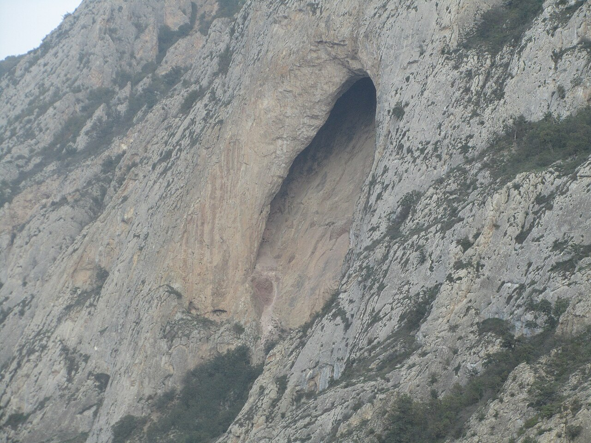

در صخره‌های سر به فلک کشیده و مه‌گرفته سوادکوه مازندران، بر فراز دره دوآب و در میان پیچ‌های گردنه کوهستان، دهانه‌ای عظیم و هلالی شکل در دل سنگ سرخ دهان گشوده است که بومیان آن را «طاق دیو»، «دژ لاپ‌کمر» و آرامگاه افسانه‌ای اسپهبد خورشید می‌نامند. این غار طبیعی که از بزرگ‌ترین طاق‌های سنگی جهان به شمار می‌رود، در نگاه مردم کهنسال طبرستان فراتر از یک شاهکار زمین‌شناسی یا دژ نظامی باستان است؛ آنان باور دارند که این غار، اقامتگاه کهن دیوان مازندران و پناهگاه ارواح پاسداری بوده که در روزگاران کهن، اسرار طلسم‌شده گنجینه‌های البرز را درون حفره‌های تاریک و نفوذناپذیر آن پنهان ساخته‌اند. بومیان طبری معتقدند که دیوان در دل سنگ‌های این طاق، تالارهایی زیرزمینی با ستون‌هایی از بلور و آب‌انبارهایی دست‌نیافتنی تراشیده‌اند که هیچ پای انسانی را توان فرود به اعماق آن نیست.

بنا بر روایت‌های سینه‌به‌سینه مردم سوادکوه، هنگامی که لشکریان بیگانه خاک طبرستان را زیر سم اسبان گرفتند، آخرین اسپهبد ساسانی همراه با خانواده، گنجینه‌های نیاکانی و جنگاوران وفادارش به دهانه این طاق سرکش پناه برد. صخره‌های صاف و دیواره‌های عمودی مانع از دسترسی هر دشمنی می‌شد و برای ماه‌ها، تنها کلاغان و بادهای کوهستان گذرگاه رسیدن به دهانه غار بودند. اما پیران محلی می‌گویند دیوی مهربان و کهنسال به نام «چکل‌دیو» که هزاران سال در ژرفای تاریک دژ خفته بود، با ورود آزادگان دژبان پیمان بست تا اگر دشمن آب‌انبارها را بیالاید، با نعره‌ای کوه را فرو ریزد و گنجینه‌ها را به قعر شکاف‌های بی‌پایان کوه فرستد تا دست ناپاکان به آن نرسد. او شب‌ها با مشعلی از موم کهن بر لبه طاق می‌ایستاد تا پاسداران البرز خوابی آسوده داشته باشند.

> بومیان دوآب همواره در غروب‌های سرد زمستانی می‌گویند: «وقتی سوز سرما از شکاف لاپ‌کمر زوزه می‌کشد، صدای کوبیده شدن گرزهای سنگی و ناله‌های سوگواران دژ را در پیچ‌وخم باد می‌توان شنید.»

افسانه می‌گوید هنگامی که خائنان سرچشمه آبی را که به طاق اسپهبد خورشید می‌رسید با شیر و زهر آلودند، اسپهبد در دامنه کوه زهر چشید تا تسلیم نگردد؛ اما دیوان وفادار و ارواح نگهبان، تالارهای زیرین غار را با سنگ‌های آتشین مهر و موم کردند. چوپانانی که در چکل‌های دوردست سوادکوه شب را به سر برده‌اند، بارها دیده‌اند که در شب‌های چهارده ماه، مشعل‌هایی زرین در دهانه خالی طاق می‌درخشد و سایه مردانی زره‌پوش با کلاه‌خودهای بالدار بر دیواره صخره پدیدار می‌شود. اگر کسی با طمع زر و سیم به دهلیزهای درونی غار نزدیک شود، ناگهان تندبادی سنگین او را به لبه پرتگاه پرتاب می‌کند یا فریادی کرکننده در گوش‌هایش طنین می‌اندازد. طاق اسپهبد خورشید همچنان بر بلندای جاده ایستاده و یادآور غرور تسلیم‌ناپذیر اسطوره‌های مازندران است.

### منبع روایت و تصویر
- **خاستگاه افسانه:** تاریخ شفاهی و باورهای بومی سوادکوه و لفور مازندران، روایت‌های ثبت‌شده در تاریخ طبرستان ابن‌اسفندیار پیرامون دژ لاپ‌کمر.
- **عکاس / پدیدآورنده تصویر:** Mortezafallah55
- **منبع تصویر:** [صفحه تصویر در ویکی‌انبار](https://commons.wikimedia.org/wiki/File:%D8%BA%D8%A7%D8%B1_%D8%A7%D8%B3%D9%BE%D9%87%D8%A8%D8%AF_%D8%AE%D9%88%D8%B1%D8%B4%DB%8C%D8%AF.jpg)
- **نوع مجوز:** CC BY-SA 4.0
