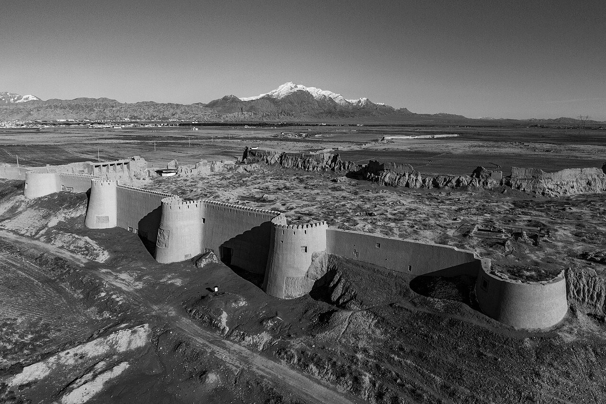

Upon the juniper-clad lower slopes of Mount Shah Jahan in Esfarayen, adjacent to the historic mudbrick ramparts of the ancient city of Belqeys, a gaping cavern entrance punctures the limestone escarpment of Konj-Kuh. The Kurmanji Kurds and Tat elders of northern Khorasan preserve vivid accounts of an ancient clan of *Ajineh* (chthonic mountain spirits) who reside within these subterranean labyrinths, guarding turquoise veins and forgotten silver caches.

Unlike brutish ogres, the Ajineh of Konj-Kuh are depicted as diminutive, artisan subterranean beings clad in mountain-goat fleece who craft enchanted filigree jewelry beneath the luminescent crystals of the cavern ceiling. On moonlit nights, their uncanny music—resembling the traditional double-reed *Qoshmeh*—echoes from the cave's mouth. Should an impoverished, honest shepherd present offerings of fresh goat cheese at the entrance, the Ajineh bless his herd with miraculous fecundity and tip his walking staff with brass. Conversely, if an armed plunderer trespasses seeking to loot their subterranean hoard, the Ajineh snuff out his lanterns with cold gusts, leading the interloper astray into bottomless karst sinkholes.

> "Tread not Konj-Kuh in the dark, and yield not your heart to subterranean melodies; the Ajineh keep their compact with the humble, but if you covet their silver, your bones will turn to powder in the dark." — Adage of Kurmanji mountaineers.

Folklorist Ali-Ashraf Darvishian and Ebrahim Shakourzadeh note in their studies of Khorasan folklore that tales of underground subterranean folk often arose around ancient mining excavations and perilous unexplored karst systems, functioning as essential safety barriers. The whistling wind echoing through Konj-Kuh’s vertical crevices keeps the mystical lore of the silver-smithing Ajineh alive in northern Khorasan.

### Sources & Image Attribution
- **Research Source:** Ali-Ashraf Darvishian, *Encyclopedia of Iranian Folktales*, Vol. 8, pp. 190-196; Ebrahim Shakourzadeh, *Beliefs and Customs of the People of Khorasan*, p. 318.
- **Image Attribution:** Documented on Wikimedia Commons by Dolphinphoto5d; License: [CC BY-SA 4.0](https://commons.wikimedia.org/wiki/File:BELQIS.jpg).
