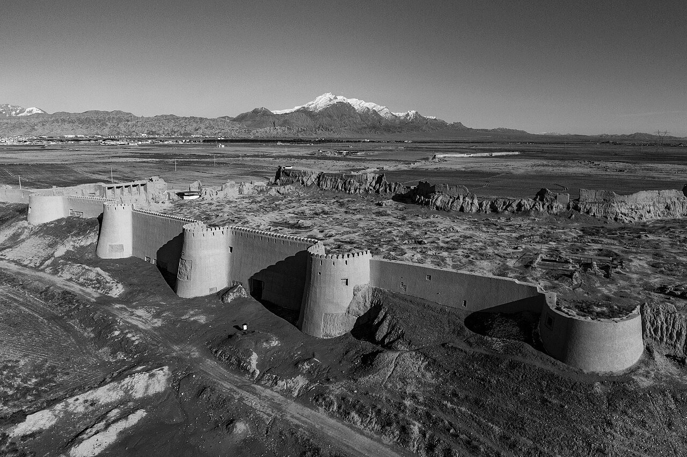

در کوهپایه‌های پوشیده از ارس کوه شاه‌جهان در اسفراین و در مجاورت ویرانه‌های باستانی شهر کهن بلقیس، غاری تاریک و وهم‌انگیز در دل صخره‌های کنج‌کوه دهان گشوده است. کردهای کرمانج و تات‌های کهنسال اسفراین روایاتی شنیدنی از قبیله‌ای از «اجینه‌ها» در سینه دارند که در اعماق این غار، نگهبان تالارهای فیروزه‌ای و رگه‌های مخفی نقره بوده‌اند.

اجینه‌های غار کنج‌کوه بر خلاف دیوان ویرانگر، موجوداتی هوشمند، زرگر و کوچک‌پیکر توصیف می‌شوند که لباس‌هایی از پشم بزهای کوهی به تن دارند و زیر نور گوهرهای درخشان سقف غار، طلا و زیورآلات سحرآمیز می‌سازند. آنها شب‌هنگام با نوای سازهایی شبیه به «قوشمه» محلی در دهانه غار گرد هم می‌آیند. اگر شبانی خسته با احترامی قلبی و با پیشکشی از پنیر محلی به دهانه غار نزدیک می‌شد، اجینه‌ها نعل‌های زرین بر پای قاطرانش می‌کوفتند و ظرف‌های شیر او را تا صبح پر نگه می‌داشتند. اما وای بر شکارچی یا طمع‌کاری که با چراغ‌های دودزا به نیت دزدیدن گنج‌هایشان وارد دالان‌های باریک غار می‌شد؛ اجینه‌ها با بادهای سرد غار چراغ‌هایش را خاموش می‌کردند و با ساختن صداهای گمراه‌کننده، او را در هزارتوی بی‌پایان چاه‌های عمودی گرفتار می‌ساختند.

> «در شب تار، پای در کنج‌کوه منه و به ساز غار دل مسپار؛ اجینه‌ها بر عهد خویش استوارند، اما اگر طمع کنی، استخوان‌هایت در تنهایی غار سرمه‌دان خاک خواهد شد.» — پند کهنسالان کرمانج در روستاهای شاه‌جهان.

علی‌اشرف درویشیان در جلد هشتم «فرهنگ افسانه‌های مردم ایران» و ابراهیم شکورزاده در اثر پیشگام خود پیرامون عقاید خراسان، یادآور می‌شوند که باور به اجینه‌های زیرزمینی در کوهستان‌های شمال خراسان، از دیرباز پیوندی تنگاتنگ با غارشناسی سنتی و استخراج معادن کهن در دوران تاریخی داشته است. این قصه‌ها مانع از آن می‌شد که افراد ناآشنا بدون ابزار و راهنما وارد غارهای آهکی خطرناک و پرتگاه‌های کارستی شوند.

هنوز هم در شب‌های زمستانی اسفراین، هنگامی که صدای زوزه باد از شکاف‌های کنج‌کوه به گوش می‌رسد، کرمانج‌ها دوتار برمی‌گیرند و با نغمه‌های کهن، یاد و راز ارواح سنگ و نقره را در دل دشت‌های بلقیس زنده می‌دارند.

کردهای کرمانج اسفراین روایت می‌کنند که اجینه‌های کنج‌کوه راز ترکیب گیاهان دارویی کوهستان شاه‌جهان را در سینه دارند. در باور محلی، اگر چوپانی در ییلاق به بیماری سختی دچار می‌شد، با روشن کردن شمعی در دهانه غار و زمزمه نغمه‌های تاتی، صبح روز بعد بسته‌ای از ریشه‌های دارویی خشک‌شده را در دهانه غار می‌یافت که شفابخش دردهای مزمن تن و روان بود.

### منابع و اعتبار تصویر
- **منبع پژوهشی افسانه:** علی‌اشرف درویشیان، «فرهنگ افسانه‌های مردم ایران»، جلد ۸، ص ۱۹۰-۱۹۶؛ ابراهیم شکورزاده، «عقاید و رسوم عامه مردم خراسان»، ص ۳۱۸.
- **اعتبار تصویر:** ثبت‌شده در ویکی‌مدیا کامنز توسط Dolphinphoto5d؛ مجوز انتشار: [CC BY-SA 4.0](https://commons.wikimedia.org/wiki/File:BELQIS.jpg).
