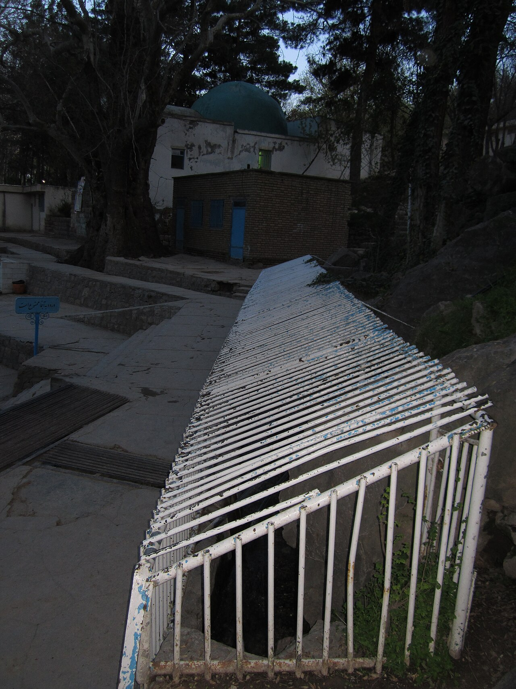

در ده کیلومتری شرق بجنورد در استان خراسان شمالی، در میان دره‌ای سرسبز و پوشیده از چنارهای چندصدساله، چشمه‌هایی پرخروش و زلال از دل صخره‌ها فوران می‌کنند که به «پارک بابا امان» شهرت دارند. این مکان با چنارهای برافراشته و استخرهای طبقاتی آب زلالش، پناهگاهی دل‌انگیز برای مسافران جاده شمال و خراسان است. اما در باورهای فولکلوریک مردم کُرد کرمانج و ترک‌های خراسانی، این چشمه‌سار تبار در روایتی قدسی و اسطوره‌ای دارد؛ مکانی که در آن پیر وارسته‌ای به نام «بابا امان» در ازای نجات تشنگان، با ارواح پاک چشمه‌ها پیمان جاودانگی بست تا جوشش آب هرگز در این دره خاموش نگردد.

روایت محلی می‌گوید قرن‌ها پیش، کاروانی بزرگ از زائران و عشایر در میانه خشکسالی سهمگین در دشت تشنه اترک گرفتار شدند؛ کودکان از بی‌آبی بی‌تاب بودند و دام‌ها بر زمین می‌افتادند. پیری روشن‌ضمیر به نام بابا امان که از صلح‌جویان و درویشان پاک‌سرشت البرز خاوری بود، بر فراز تپه شنی ایستاد، دست بر سینه نهاد و با اشک دیده به راز و نیاز با معبود پرداخت. او عصای چوبین خود را با عشقی پاک بر زمین کوبید و فرمود: «امان، امان از تشنگی پاک‌دلان!» ناگهان سنگ‌ها شکافته شدند، آب حیات با جوششی زلال فوران کرد و نسیمی عطرآگین سراسر دره را پر ساخت.

> زنان کرمانج هنگام نوشیدن از آب بابا امان می‌گویند: «هر شاخه چنار در این دره، ریشه در شکرگزاری کاروانیانی دارد که به دعای پیر نجات یافتند؛ آب پاک است و هر که دلی روشن دارد از پری چشمه برکت می‌گیرد.»

در افسانه‌های بجنورد آمده است که در کنار بابا امان، پری سبزپوشی از فرشتگان آب‌ها زندگی می‌کند که در شب‌های جمعه بر بلندترین شاخه‌های چنار کهنسال می‌نشیند و بر مسافران خسته آرامش می‌پاشد. اگر کسی به نیت شفای بیماری در این چشمه‌ها دست و رو شوید و شاخه شکسته‌ای به درختان آسیب نزند، پری چشمه در خواب او راه درمان را آشکار می‌سازد. نوازندگان بخشی در عروسی‌های کرمانجی همواره ترانه‌هایی در وصف پاکی آب‌های بابا امان می‌سرایند و حرمت خاک چنارستان را پاس می‌دارند. چهار سرچشمه اصلی که آب بابا امان را تشکیل می‌دهند، در زبان مردم به نام‌های چهار برکت (نان، آب، صلح و روشنایی) شناخته می‌شوند. در شب‌های تابستان، هنگامی که نسیم خنک از کوهستان آلاداغ بر شاخسار چنارها می‌وزد، پیرمردان کرمانج با کاسه‌های چوبین آب بر پای درختان کهنسال می‌ریزند تا حرمت خاک و عهد دیرین بابا امان با فرشتگان چشمه‌ساران برای نسل‌های آینده پایدار بماند. چنارهای کهنسال بابا امان با سایه‌سار آرام‌بخش و زمزمه جویبارها، نمادی از پاداش مهربانی و پیوند آب و ایمان در فرهنگ غنی خراسان شمالی است.

### منبع روایت و تصویر
- **خاستگاه افسانه:** روایات شفاهی عشایر کرمانج و ترک‌های خراسان شمالی پیرامون چشمه بابا امان بجنورد، فرهنگ عامه اترک.
- **عکاس / پدیدآورنده تصویر:** Arashk rp2
- **منبع تصویر:** [صفحه تصویر در ویکی‌انبار](https://commons.wikimedia.org/wiki/File:Baba-aman_cheshme.JPG)
- **نوع مجوز:** CC BY-SA 3.0
