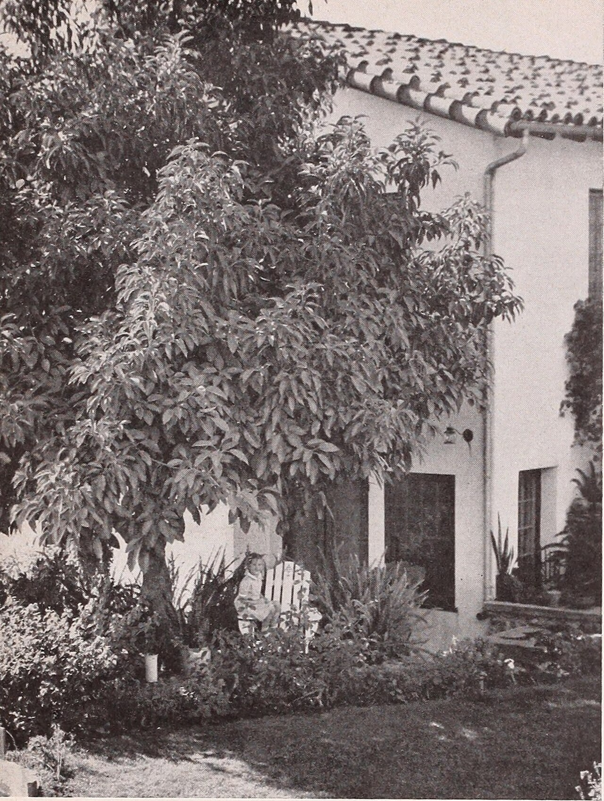

Preserved across centuries within the rich oral folklore of **North Khorasan** (encircling the historical domains of **بجنورد**), the legendary lore of **Gal** stands as a compelling testament to Iran's enduring mythic imagination. Transmitted across hearths, mountain paths, and rural caravans, the tale has survived through the living memories of local elders.

Folklorists generally categorize **Gal** within the mythological taxonomy of *موجود افسانه‌ای*. As with many traditional entities of Iranian folk belief, it embodies both the untamed natural elements and the ancestral anxieties regarding solitary wilderness. Classical collectors recorded its traditional traits as follows:

> "Illustration by Yalda Rasekhi People from Shirvan (located in North Khorasan province in northeastern Iran) believe in a creature called ‘Gaal’. This creature is described as something similar to a male human with hair all over his body and head. He is more than 2 meters long and has a weirdly big chest, ears, and legs. Gaal is normally seen around water springs and wells. At nights he appears in front of farmers and gardeners, who are on their way to water their plants and fields, and starts imitating them. After that, he slowly gets closer to them to hurt them. The best weapon against Gaal is ignoring it. You have to act like he doesn’t exist. Translation: Sarah Mohebbi Moghadam"

In local oral tradition, an encounter with **Gal** was regarded as a formidable threshold between familiar domestic reality and the unseen realm. Elders customarily advised night travelers, shepherds, and caravan drivers traversing the historic passes of North Khorasan to heed ancient apotropaic rituals—such as carrying iron amulets, maintaining solemn reverence towards nature, and never uttering provocative words—to pass through its territorial domain unharmed.

Today, the chronicle of **Gal** forms an invaluable component of Iran's intangible cultural heritage, offering modern readers an evocative window into how ancient communities interpreted their ecology, mystery, and moral balance.

---

### Sources & Image Attribution
- **Folklore Research & Origin:** Sourced and adapted from the Eranshahr Folklore Archive (`eranshahr.com/myths`) and regional oral narratives of North Khorasan.
- **Visual Artifact:** *"Armstrong Nurseries (1941) (19713257694).jpg"*, sourced via Wikimedia Commons, contributed by Internet Archive Book Images, licensed under `No restrictions` ([Source Link](https://commons.wikimedia.org/wiki/File:Armstrong_Nurseries_(1941)_(19713257694).jpg)).