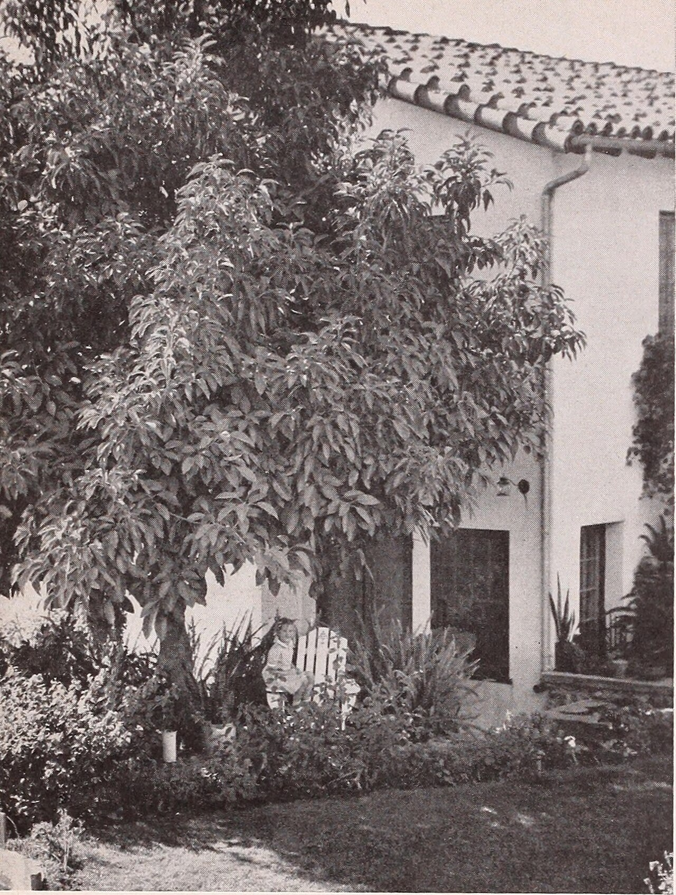

در یادمان‌های شفاهی و باورهای عامیانه‌ی مردم **خراسان شمالی** (به‌ویژه در گستره‌ی **بجنورد**)، روایت‌های پرشماری از پدیده‌ای شگفت و موجودی دیرپا به نام **«گال»** سینه به سینه از روزگاران باستان تا کنون بازگو شده است. راویان بومی که با گویش و لهجه‌ی **کرمانجی / ترکی خراسانی** به نقل قصه‌ها می‌نشستند، پیدایش این پدیده را با کوهساران، دشت‌های بی‌کران، جنگل‌ها یا آب‌های مرموز این خطه پیوند می‌زدند.

در طبقه‌بندی فرهنگ عامه، **گال** را غالباً با تیره‌ی *موجود افسانه‌ای* هم‌بسته می‌دانند؛ چهره‌ای که تجسم نیروهای ناشناخته‌ی اقلیم و جهان نادیدنی پیرامون نیاکان بوده است. در توصیف‌ها و متون بازمانده‌ی پژوهشی پیرامون این افسانه آمده است:

> «Gal|گال|هرچ گال در باورهای مردم شیروان در خراسان شمالی، موجودی‌ست شبیه به مردی که بدن و سرش پر از مو است. قد او به بالای دو متر می‌رسد و سینه‌ها، گوش‌ها و پاهایش بسیار بزرگ‌تر از حد معمول است.گال عموما کنار چشمه‌ها و چاه‌های آب دیده می‌شود. این موجود، شب‌هنگام جلوی راهِ باغبانان و کشاورزانی که برای آبیاری به باغ‌ها و زمین‌هایشان می‌روند را گرفته و شروع به تقلید رفتار آنان می‌کند، سپس آرام آرام سعی می‌کند به آنان نزدیک شود تا به آنان آسیب برساند.بهترین سلاح برای مبارزه با گال، بی‌توجهی به اوست؛یعنی باید طوری رفتار کرد که انگار او وجود ندارد، در این صورت گال ناامید شده و به راه خود می‌رود. غولیبانی/ طنطل/مردآزما»

پیران و ریش‌سفیدان منطقه در شب‌نشینی‌ها گوشزد می‌کردند که رویارویی با **گال** همواره نشانه‌ای از لزوم هشیاری در برابر ناشناخته‌های طبیعت بوده است. در اعصار گذشته، مسافران، شبانان و کاروانیانی که شب‌هنگام در این نواحی گذر می‌کردند، برای مصون ماندن از گزند یا فریب این موجودات، آیین‌ها و دعاهای محافظتی خاصی را به کار می‌بستند و از شکستن سکوت شب یا نزدیک شدن به زیستگاه‌های آنان پرهیز می‌کردند.

امروزه داستان **گال** یکی از گنجینه‌های ماندگار میراث معنوی و مردم‌شناسی دیار **خراسان شمالی** به شمار می‌رود که پیوند عمیق روان‌شناختی انسان کهن را با رمزورازهای زیست‌بوم سرزمین ایران به تصویر می‌کشد.

---

### منابع و اعتبار تصویر
- **پژوهش و خاستگاه روایت:** برگرفته از دانشنامه فولکلور و اسطوره‌شناسی ایران‌شهر (`eranshahr.com/myths`) و روایت‌های شفاهی بومی خراسان شمالی.
- **تصویر:** اثر *«Armstrong Nurseries (1941) (19713257694).jpg»*، بارگذاری‌شده در ویکی‌انبار (Wikimedia Commons)، پدیدآورنده: Internet Archive Book Images، تحت مجوز آزاد `No restrictions` ([مشاهده منبع](https://commons.wikimedia.org/wiki/File:Armstrong_Nurseries_(1941)_(19713257694).jpg)).