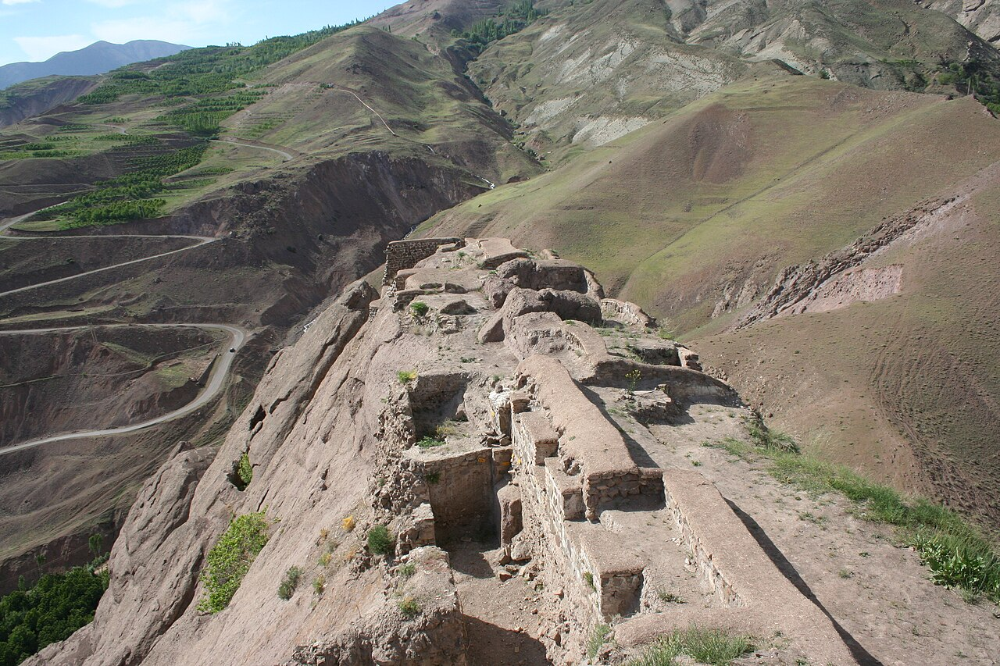

در شمال قزوین و در پیچ‌وخم دره‌های سرسبز الموت، صخره‌ای سرخ‌فام، سهمگین و عظیم با دیواره‌های عمودی ۲۰۰ متری سر از زمین برآورده است که دژ اسطوره‌ای «الموت» بر تارک آن آشیان دارد. نام الموت در زبان کهن دیلمی و تاتی از دو واژه «اَله» (عقاب) و «موت» (آموت/آشیان) گرفته شده است؛ یعنی «آشیانه عقاب» یا «جایی که عقاب راه نمود». این قلعه تاریخی که قرن‌ها پایگاه تسخیرناپذیر حسن صباح و اسماعیلیان بود، در حافظه جهان و فرهنگ شفاهی مردم قزوین زادگاه ده‌ها افسانه پر رمز و راز درباره کتابخانه‌های جادویی، باغات پنهان و عقاب‌های طلایی نگهبان است که سینه به سینه بازگو شده است.

بر پایه روایت‌های بومیان روستای گازرخان، در روزگاران باستان یکی از پادشاهان دیلم برای صید به کوهستان آمد؛ او عقابی شکاری و سپیدپر را رها کرد. عقاب بر بلندای این صخره سرخ‌رنگ فرود آمد و پادشاه با دیدن موقعیت دست‌نیافتنی آن، پی برد که این صخره دژی طبیعی است که هیچ لشکری توان محاصره آن را ندارد. اما افسانه‌ها می‌افزایند که در اعماق مخازن آب و انبارهای زیرزمینی قلعه که در دل سنگ سخت تراشیده شده‌اند، باغ‌هایی سرسبز با نهرهای عسل و شیر پنهان بود که پیر کوهستان با طلسم‌های نجومی آن‌ها را از دید دشمنان می‌پوشاند تا تنها برگزیدگان بدان راه یابند.

> کهنسالان گازرخان در شب‌های مهتابی می‌گویند: «هرگاه باد در دره الموت زوزه می‌کشد، بال زدن عقاب طلایی دژ را می‌توانی حس کنی؛ عقابی که کتاب‌های حکمت نیاکان را در غارهای پنهان صخره پاسداری می‌کند.»

در باورهای محلی آمده است که فداییان دژ برای تسخیرناپذیر ماندن قلعه، با ارواح کوهستان هم‌پیمان شده بودند؛ بطوری که هرگاه سپاهیان مغول به پای صخره می‌رسیدند، سنگ‌های کوهستان زیر پای اسب‌هایشان می‌لغزید و مه‌های تیره آسمان را می‌پوشاند. روستاییان باور دارند هنوز در شکاف‌های صخره سرخ، دست‌نوشته‌های زرینی از کیمیاگری و حکمت باستان خفته است که تنها زمانی آشکار خواهد شد که عقاب افسانه‌ای بار دیگر بر فراز الموت فرود آید. درخت کهنسال گیلاس در پای قلعه، در نگاه مردم نماد خون پاک مدافعان صخره سرخ است. حوضچه‌های دست‌کندی که در مرتفع‌ترین بخش صخره تراشیده شده‌اند، حتی در گرم‌ترین روزهای تابستان لبریز از آب زلال کوهستان هستند و بومیان معتقدند چشمه‌ای جادویی از زیر ریشه‌های صخره سرخ به دعای پیر کوهستان به قله هدایت شده است. هر بار که مه‌های متراکم دره شاهرود را پر می‌سازند، قله الموت مانند کشتی سترگی بر فراز ابرها شناور می‌شود و افسانه‌های حسن صباح و یاران وفادارش را در خیال مسافران زنده می‌دارد. دژ الموت با شکوه ابدی و پرصلابتش، نماد پیوند عقلانیت، رازورزی و پایداری در تاریخ و ادب ایران‌زمین است.

### منبع روایت و تصویر
- **خاستگاه افسانه:** متون تاریخی و روایات شفاهی مردم الموت و روستای گازرخان قزوین، پژوهش‌های اسطوره‌شناسی دژهای حسن صباح.
- **عکاس / پدیدآورنده تصویر:** Ninara (Helsinki, Finland)
- **منبع تصویر:** [صفحه تصویر در ویکی‌انبار](https://commons.wikimedia.org/wiki/File:2008iran._Iran,_Alamut_Castle_(2573255326).jpg)
- **نوع مجوز:** CC BY 2.0
