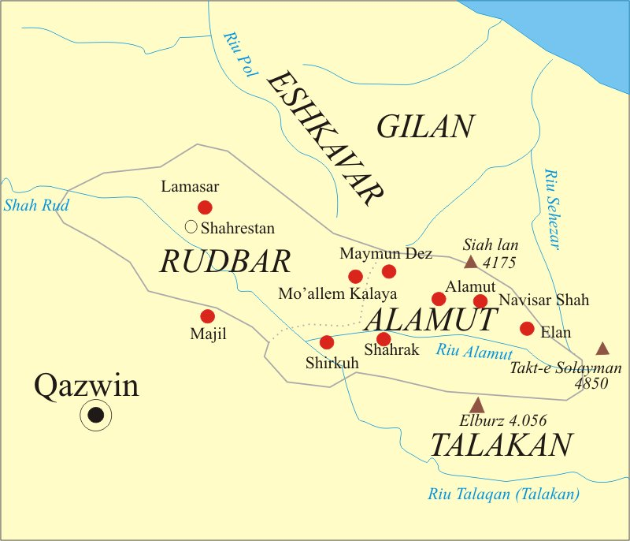

Amidst the dramatic red-sandstone escarpments of Alamut in Qazvin province, carved directly into the vertical precipices above the village of Shams Kelayeh, lie the astonishing rock-cut chambers of *Meymun-Dezh* (Maymun-Diz)—an impregnable cliffside citadel famed in the history of the Nizari Ismailis. The Tat-speaking elders of Alamut cherish the legend of the *Parizad of Meymun-Dezh*—an ethereal fairy crowned with silver light who dwells within the carved subterranean cisterns, safeguarding the lost manuscripts of ancient wisdom.

Tati oral tradition relates that this celestial maiden offered sanctuary to the oppressed fleeing tyranny across the plateau. On nights when heavy fog swallows the ravines of Shams Kelayeh, the Parizad appears upon the rock-cut embrasures holding a lantern of glowing ruby, guiding pure-hearted refugees safely through the treacherous crags. However, should plunderers ascend with iron pickaxes to ransack the hidden gold and ancient blades of the citadel, she unleashes gale-force drafts through the conduits, triggering rockfalls that sweep the looters down into the abyss.

> "Trust the lantern light in the mist along the paths of Shams Kelayeh, but yield not your soul to the glint of gold; the Parizad of Meymun-Dezh shelters calloused hands, but casts the greedy upon the red rocks." — Oral counsel of the Tati elders of Alamut.

Renowned linguist Ehsan Yarshater in *Tati Dialects of Qazvin* and Dr. Manouchehr Sotoudeh observe that the staggering engineering of Meymun-Dezh—chiseled entirely by hand into sheer vertical conglomerate stone—inspired local populations to attribute its architecture to supernatural fairy masonry. This reverent lore preserved the rock-hewn cisterns and secret galleries intact through centuries of siege. Today, the ancient cliff-cut windows of Meymun-Dezh continue to gaze solemnly over the Alamut Valley, an immortal tribute to this fairy guardian.

### Sources & Image Attribution
- **Research Source:** Ehsan Yarshater, *Tati Dialects of Qazvin*, Tehran, pp. 94-102; Manouchehr Sotoudeh, *From Astara to Astarabad*, pp. 180-187.
- **Image Attribution:** Documented on Wikimedia Commons by Jolle; License: [CC BY 3.0](https://commons.wikimedia.org/wiki/File:Alamut.png).
