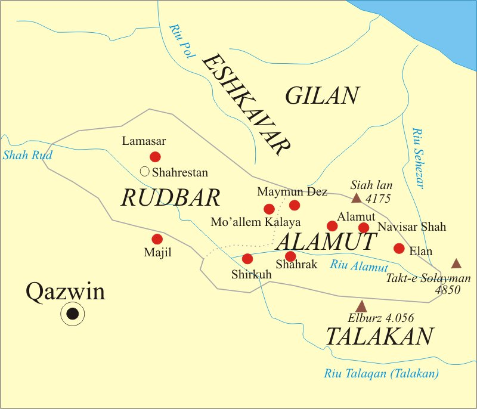

در کوهستان‌های صخره‌ای و سرخ‌فام الموت در استان قزوین، بر فراز پرتگاه‌های عمودی روستای شمس‌کلایه، بقایای دژی دست‌نیافتنی به نام «میمون‌دژ» بر دل صخره‌ها کنده شده است؛ دژی صخره‌ای با اتاق‌ها، حوضچه‌ها و راهروهای زیرزمینی که در تاریخ اسماعیلیان جایگاهی استثنایی دارد. مردم تات الموت از دیرباز بر این باور بوده‌اند که در پس این صخره‌های نفوذناپذیر، «پری‌زاد میمون‌دژ» منزل دارد؛ بانویی اثیری و زیبا از تبار پریان که بال‌هایی از جنس ابریشم سیمین دارد و گنجینه‌های حکمت باستان را در دهلیزهای سنگی دژ پاسداری می‌کند.

روایت تاتی الموت بازگو می‌کند که این پری‌زاد، همدم و راهنمای کسانی بود که به قصد دادخواهی و پناه از ظلم حاکمان ستمگر به کوهستان پناه می‌آوردند. او در شب‌های ابری که مه غلیظ دره شمس‌کلایه را فرا می‌گیرد، با فانوسی از یاقوت درخشان بر طاقچه‌های صخره ظاهر می‌شود و مسافران پاک‌نهاد را از میان پرتگاه‌های لغزنده به سلامت به درون غارها هدایت می‌کند. اما اگر لشکری غاصب یا جوینده‌ای طماع با تیشه و کلنگ در پی یافتن شمشیرها و جام‌های زرین دژ برآید، پری‌زاد با دمیدن بادی تند از دهانه دهلیزها، سنگ‌های سرخ را به ریزش وامی‌دارد و متجاوزان را به قعر دره‌های الموت سرنگون می‌سازد.

> «در راه شمس‌کلایه، به نور فانوس مه اعتماد کن، اما دل به برق طلا مسپار؛ پری‌زاد میمون‌دژ به دستان پینه‌بسته پناه می‌دهد، اما پای طمع‌کاران را بر سنگ سرخ می‌لغزاند.» — روایت کهنسالان تات در کوهپایه‌های الموت.

احسان یارشاطر در پژوهش‌های ماندگار خود پیرامون «زبان‌ها و لهجه‌های تاتی قزوین» و منوچهر ستوده در اسناد تاریخی الموت، یادآور می‌شوند که استحکامات شگفت‌انگیز صخره‌ای میمون‌دژ که کنده شدن آن با دست انسان غیرممکن به نظر می‌رسیده، همواره در ذهن بومیان با خاستگاهی ماوراءطبیعی و نیروهای پریان پیوند خورده است. این باور سبب می‌شد که مردم محلی حریم غارهای باستانی و آب‌انبارهای کنده شده در دل سنگ را محترم شمرده و از گزند چپاولگران در امان نگه دارند.

امروزه نیز هنگامی که آفتاب بر صخره‌های سرخ‌رنگ میمون‌دژ می‌تابد، پنجره‌های تراشیده‌شده در دل سنگ همچون چشمانی نظاره‌گر بر دره الموت می‌نگرند؛ گویی پری‌زاد دژ هنوز در آرامش کوهستان به پاسداری از رازهای کهن نشسته است.

کوهنوردان و راهنمایان محلی الموت اشاره می‌کنند که دالان‌های تودرتوی میمون‌دژ در دل صخره‌های شمس‌کلایه، همواره هاله‌ای از رمز و راز عرفانی در خود داشته‌اند. مردم تات باور دارند که در اعماق غارهای این دژ صخره‌ای، پری‌زاد همچنان بر گنجینه‌های حکمت و کتاب‌های پنهان فداییان کهن نگهبانی می‌دهد و تا زمانی که جوینده‌ای با نیت پاک به کوهستان نیاید، درهای سنگی دژ بسته خواهد ماند.

### منابع و اعتبار تصویر
- **منبع پژوهشی افسانه:** احسان یارشاطر، «زبان‌ها و لهجه‌های تاتی قزوین»، تهران، ص ۹۴-۱۰۲؛ منوچهر ستوده، «از آستارا تا استارباد»، ص ۱۸۰-۱۸۷.
- **اعتبار تصویر:** ثبت‌شده در ویکی‌مدیا کامنز توسط Jolle؛ مجوز انتشار: [CC BY 3.0](https://commons.wikimedia.org/wiki/File:Alamut.png).
