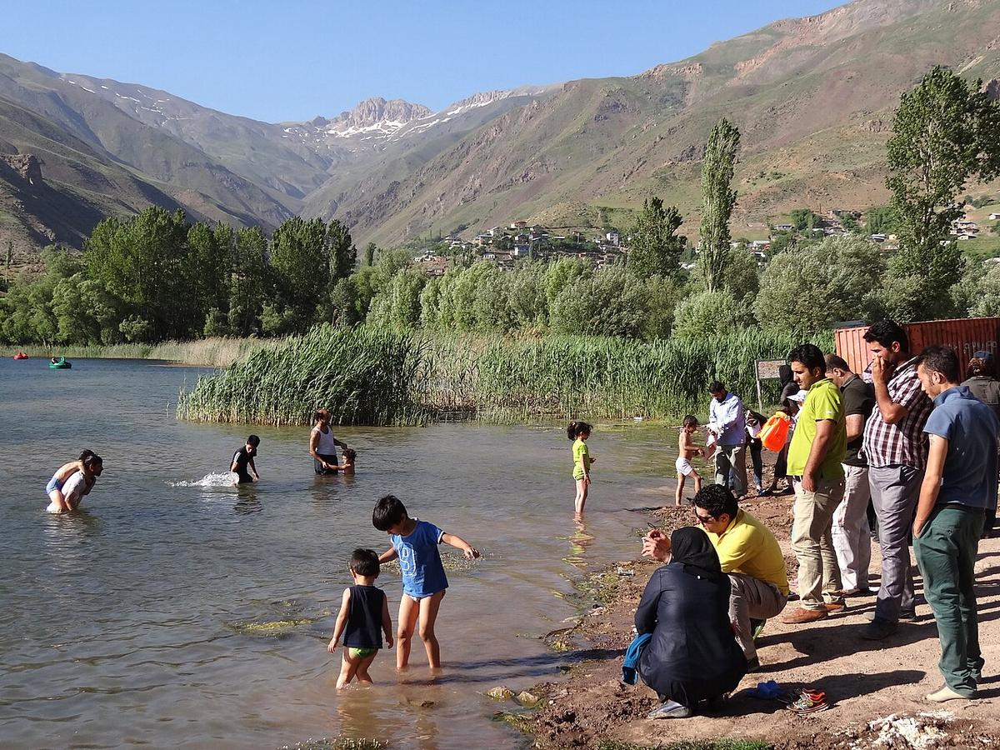

Cradled within the deep, rugged canyons of the Alamut Valley in Qazvin province, beneath the shadow of historic mountain redoubts, lies Lake Ovan—a serene turquoise alpine basin fed entirely by concealed sub-aquatic springs. In the oral traditions of the Tati-speaking villagers of Ovan and Garmaroud, communal memories center around the *Tool-Karan* (seasonal agricultural laborers who endured arduous work in the deep mud, or *Tool*, of terraced paddy fields).

Folklore in the valley maintains that Lake Ovan is watched over by a benevolent yet fierce water spirit, a guardian nymph protecting the pristine flow against greed and ecological defilement. The chronicle recalls an era of severe mountain drought when an unscrupulous feudal chieftain sought to wall off the lake's subterranean outflows, diverting the vital waters into his private pleasure estates while leaving communal grain fields to wither. Exhausted and desperate, the Tool-Karan laborers gathered on the reed-fringed lakeshore under the moonlight to pray for justice.

> As Tati elders of the Alamut gorge remind their kin: "The waters of Ovan demand an unblemished heart; when the honest sweat of the laborer touches the earth, the spring bubbles pure, but if tyranny approaches, the whirlpool swallows the oppressor."

When the chieftain's overseers began building heavy stone dams to starve the downstream terraces, the glassy surface of Lake Ovan suddenly began to churn. A silver mist rolled across the water, and from the luminous eye of the lake emerged the towering form of the guardian water nymph. Her voice, resonant as cascading mountain ice, commanded the hidden currents beneath the lakebed. Massive stone boulders tumbled into the defile, shattering the chieftain's dams in an instant. A deluge of crystal water surged down the ancient stone irrigation channels, restoring life to the thirsty terraces. From that fateful night, the inhabitants of Alamut have honored Lake Ovan as an inviolable sanctuary of communal equity and divine natural justice.

### Anthropological & Folklore Analysis
This Tati folk narrative represents an ecological morality tale deeply intertwined with the agrarian realities of high-altitude irrigation in the Alborz mountains. The guardian nymph of Lake Ovan preserves ancient Anahita-like water veneration motifs, emphasizing that natural water resources are sacred communal trusts that supernatural forces protect against monopolization.

### Archival Sources & Attribution
- **Primary Source:** Alamut Folk Narratives and Local Legends of Ovan and Garmaroud, documented in the Ovan Village Cultural Chronicle.
- **Source URL:** https://ovan.blogfa.com/post/143
- **Original Language:** Tati & Persian
- **Image Attribution:** File:Iranians Enjoy an Afternoon at Lake Avon - Alamut Valley - Northwestern Iran (7417900944).jpg | Photographer: Adam Jones from Kelowna, BC, Canada | License: CC BY-SA 2.0
