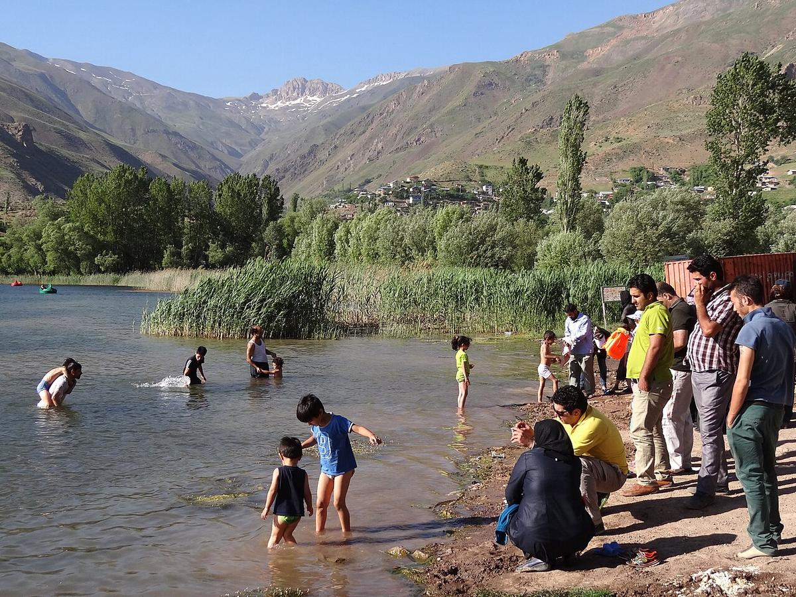

در ژرفای دره سرسبز و صخره‌ای الموت، در سایه‌سار دژهای دست‌نیافتنی حسن صباح، دریاچه فیروزه‌ای «اوان» چونان آینه‌ای آرام در آغوش درختان بید و سپیدار آرمیده است؛ آبی زلال که نه از رودی جاری، بلکه از چشمه‌های جوشان کف دریاچه جان می‌گیرد. کهنسالان تاتی‌زبان آبادی‌های اوان و گرمارود از روزگاران دشوار کار سخت بر روی زمین سخن می‌گویند؛ روزگاری که مردان برای کار شالیکاری به نام «تول‌کار» (Tool-kar؛ در گویش تاتی الموت به گل‌ولای مرطوب شالیزار «تول» می‌گویند) به سمت دشت‌های همجوار کوچ می‌کردند تا در ازای دسترنجی از برنج و زغال بازگردند.

در باورهای عامیانه الموت، دریاچه اوان تنها گستره‌ای از آب نیست، بلکه زیستگاه بانوی محافظ آب‌ها و پریان نگهبان شالیزار است. افسانه‌ها روایت می‌کنند که در سالی خشک و کم‌باران، خانی متکبر و تمامیت‌خواه تصمیم گرفت خروجی آب‌های زیرزمینی اوان را مسدود کند و مسیر جریان حیات‌بخش را به سوی باغ‌های اختصاصی خود بگرداند، بی‌آنکه سهمی برای کشتزارها و مردم رنج‌دیده روستاهای پیرامون باقی بگذارد. تول‌کاران خسته از کار طاقت‌فرسا که شاهد خشکیدن ساقه‌های برنج و ترک خوردن خاک اجدادی بودند، در شبی تاریک در کنار ساحل نیزار اوان گرد آمدند.

> تات‌های الموت در امتداد نسل‌ها می‌گویند: «اوانِ او، دلِ پاک می‌خا؛ تول‌کارِ عرق که به خاک بَرِسه، آبِ چشمه زلال موندِنه، اما پای نامرد به آبش بَرِسه، گرداب غرقش می‌کُنه.» (آب اوان دلی پاک می‌طلبد؛ عرق جبین کارگر شالیزار که به خاک بریزد چشمه زلال می‌ماند، اما پای ستمکار به آن برسد، گرداب او را به قعر می‌کشد).

هنگامی که کارگزاران خان با بیل‌ها و دیواره‌های سنگی قصد انحراف سرچشمه را داشتند، ناگهان خیزابی چرخان از اعماق دریاچه برخاست و مهی سیمین سراسر دره را فرا گرفت. از دل امواج چرخان، هیبت بانوی سپیدپوش دریاچه اوان ظاهر شد. او با صدایی که طنین رعدآسای آبشارهای البرز را در خود داشت، صخره‌های سنگین را به جنبش درآورد و بندهای احداثی خان را در هم شکست. زمین لرزید و آب‌های زلال با شدتی مضاعف در جویبارهای سنتی جاری شدند و زمین‌های خشکیده تول‌کاران را سیراب ساختند. از آن روزگار، اهالی الموت باور دارند که دریاچه اوان خود از حقابه تشنگان و حق ضعیفان پاسداری می‌کند و هیچ قدرتی نمی‌تواند برکت این آب مقدس را به انحصار خود درآورد.

### بن‌مایه‌ها و ویژگی‌های مردم‌شناختی
این افسانه کهن تاتی الموت پیوندی عمیق میان کار مشقت‌بار شالیکاری («تول‌کاری»)، تقدس منابع آب شیرین در اقلیم کوهستانی، و مقاومت نمادین دهقانان در برابر ظلم فئودالی برقرار می‌کند. پری آب اوان تجسم ایزدبانوی کهن آب‌ها آناهیتا در باورهای پسااسلامی حوزه کوهپایه‌های البرز است که عدالت در توزیع منابع حیاتی را تضمین می‌نماید.

### منابع و پژوهش
- **منبع اصلی:** داستان‌های الموتی و باورهای عامیانه روستای اوان و گرمارود (وبلاگ روستای اوان و زرآباد الموت).
- **پیوند مرجع:** https://ovan.blogfa.com/post/143
- **زبان اصلی متن:** تاتی الموتی و فارسی
- **تصویر:** File:Iranians Enjoy an Afternoon at Lake Avon - Alamut Valley - Northwestern Iran (7417900944).jpg | عکاس: Adam Jones from Kelowna, BC, Canada | مجوز: CC BY-SA 2.0
