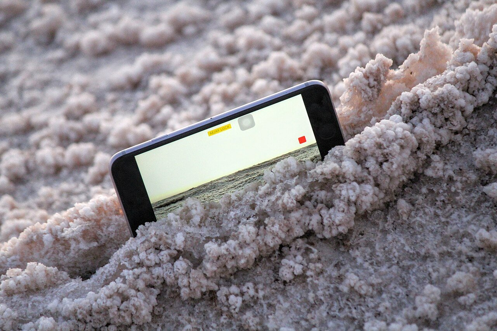

در کویر سوزان و دشت‌های نمکی جنوب غربی قم، در حوالی بخش سلفچگان و دهستان کهن «نیزار»، جایی که زمین‌های شوره و نیزارهای خشکیده به دریاچه‌های نمک ختم می‌شوند، کاروانیان قدیمی همواره از خطری ماوراءطبیعی به نام «دیو چاه نمکین» پرهیز می‌کرده‌اند. این دیو، شیطانی کویری و سپیدپوش است که بدنی پوشیده از بلورهای برنده نمک و دندان‌هایی از سنگ چخماق دارد و در چاه‌های متروکه و گودال‌های لجن‌زار نمکین پنهان می‌شود.

روایت بومی مردم قم بازگو می‌کند که دیو چاه نمکین، استاد سراب‌آفرینی در گرمای هلاک‌کننده‌ی نیمروز است. او با انعکاس نور خورشید بر بلورهای نمک، تصویری از کاروانسرایی باشکوه با حوض‌های آب خنک و نخل‌های سایه‌دار در دل کویر پدید می‌آورد. ساربانان و مسافران تشنه به هوای رسیدن به آب، از جاده مالرو منحرف شده و به سوی باتلاق‌های نمکین نیزار می‌تازند. به محض آنکه کاروانیان به مرکز سراب می‌رسند، زمین زیر پای شتران فرو می‌ریزد و دیو با خنده‌ای خشک، آنان را به درون چاه‌های نمکین زیرزمینی فرومی‌کشد؛ جایی که گوشت و استخوان قربانیان در اثر شوری آب در گذر سالیان به تندیس‌هایی از نمک سخت بدل می‌گردد.

> «در ریگستان نیزار، چشم به دریاچه دروغین مدار؛ آن درخشندگی، دندان‌های دیو چاه است که در آفتاب برق می‌زند تا تشنگان را نمک‌سود کند.» — پند ساربانان کهنسال در کاروانسراهای جاده قدیم قم.

سید ابوالقاسم انجوی شیرازی در «قصه‌های ایرانی» و محمدتقی بیک قمی در کتاب «فرهنگ عامیانه قم» ثبت کرده‌اند که این افسانه بازتابی هشداردهنده از پدیده خطرناک «باتلاق‌های نمکی» و سراب‌های توهم‌زا در بیابان‌های حوض سلطان و نیزار است. کاروانیان برای خنثی کردن فریب دیو، همواره زنگ‌های مسی بر پیشانی شتر پیش‌آهنگ می‌بستند و سگی کویری را پیشاپیش کاروان راه می‌انداختند؛ زیرا باور داشتند که حیوانات هرگز فریب سراب نمک را نمی‌خورند و دیو از پارس سگ فرار می‌کند.

امروزه برج‌های گلی قدیمی و دشت نمک نیزار در غروب آفتاب قم، ابهتی وهم‌انگیز به کویر می‌بخشند؛ گواهی تاریخی بر هوشمندی مسافران کویر در مقابله با خطرات مرگبار طبیعت با ابزار اسطوره.

کاروانیان و بومیان دشت قم باور دارند که دیو چاه نمکین در فصل‌های خشک، چاه‌های کهن را به دامگاهی برای شکار ارواح سرگردان بدل می‌سازد. ساربانان برای مصون ماندن از سراب‌های مهلک، همواره در ساعات اوج گرما در سایه بارانداز کاروانسراها اتراق می‌کردند و با غروب آفتاب و در خنکای شب حرکت را آغاز می‌نمودند تا هوش و حواس مسافران از فریب دیو در امان باشد.

### منابع و اعتبار تصویر
- **منبع پژوهشی افسانه:** سید ابوالقاسم انجوی شیرازی، «قصه‌های ایرانی»، تهران، انتشارات امیرکبیر، جلد ۱، ص ۳۰۲-۳۰۸؛ محمدتقی بیک قمی، «فرهنگ واژگان و باورهای عامیانه قم»، ص ۱۱۳.
- **اعتبار تصویر:** ثبت‌شده در ویکی‌مدیا کامنز توسط Mehrraz؛ مجوز انتشار: [CC BY-SA 4.0](https://commons.wikimedia.org/wiki/File:Salt,_Salt_lake_Qom,_Iran.jpg).
