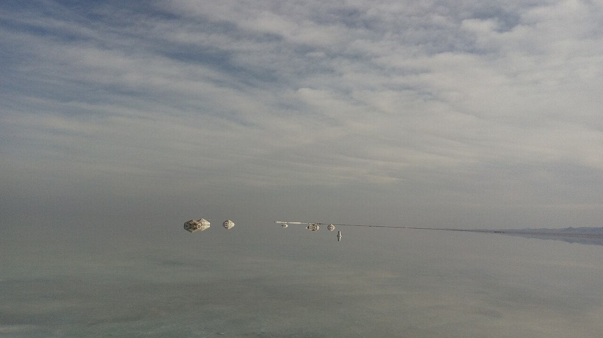

در چهل کیلومتری شمال شهر قم و در حاشیه کویر پررمزوراز، پهنه‌ای سفید و درخشان از بلورهای نمک و لایه‌های نازک آب مانند آینه‌ای بی‌کران به پهنای افق گسترده شده است که بومیان آن را «دریاچه حوض سلطان» (یا دریاچه شاهی) می‌نامند. این تالاب کویری به سبب انعکاس شگفت‌انگیز ابرها و آبی آسمان بر بستر صیقلی نمک، به «بزرگ‌ترین آینه طبیعی ایران» نام‌بردار است. اما در افسانه‌های قدیمی مردم قم و کاروان‌داران کوشک‌نصرت، این دریاچه آینه‌ای جادویی است که پریان نمکستان از آن برای مراقبت از مرز میان جهان خاکی و کهکشان بهره می‌برند و رازهای بیابان را در دل بلورهای خود پنهان می‌سازند.

پیران بومی روایت می‌کنند که در اعصار دور، دشت حوض سلطان چمنزاری سرسبز با کاخی پر از آینه‌های بلورین متعلق به پادشاهی عادل بود. هنگامی که لشکری غاصب برای ویران ساختن کاخ و به غارت بردن آینه‌های مقدس هجوم آورد، دختر شاه که پری آب‌های شور بود، چشمه‌های نمک را از اعماق زمین جوشاند. آب‌های شور کاخ و دشت را در بر گرفتند و تمام آینه‌ها در دل خاک ذوب شدند تا بستر دریاچه را به آینه‌ای یکپارچه تبدیل کنند. مهاجمان با نگاه در آب و دیدن چهره‌های زشت و کردار تباه خویش در آینه، از ترس دچار جنون شدند و در باتلاق‌های گچی فرورفتند.

> شتربانان کاروانسرای دیرگچین به مسافران می‌گفتند: «هنگام طلوع خورشید به لبه حوض سلطان بروید و در آینه نمک نگاه کنید؛ اگر قلبت بی‌کینه باشد، تصویر آینده و آرزوهایت را در آب زلال خواهی دید.»

در باور عامه مردم قم آمده است که پری بلورین نمک در شب‌های خنک تابستان روی دریاچه قدم می‌زند و از پای‌افزار او بلورهای سپید نمک شکوفه می‌دهند. کاروانیان کهنسال باور داشتند کسانی که در بیابان گم می‌شدند، با دنبال کردن بازتاب ستاره قطبی در بستر آرام حوض سلطان مسیر نجات را می‌یافتند. اگر کسی سنگی را به قصد شکستن این آینه طبیعی پرتاب کند، نمک‌ها آبستن گردبادی سرخ می‌شوند تا حریم پاک دریاچه خدشه‌دار نگردد. بومیان هنوز هم بر این باورند که آب شور این دریاچه گرد و غبار گناهان را از روح مسافران خسته می‌زداید. در فصل‌هایی از سال که جلبک‌های میکروسکوپی سطح آب‌های کم‌عمق را به رنگ سرخ آتشین درمی‌آورند، مردم محلی می‌گویند این بازتابنده خون قربانیان کاروان‌های گم‌شده است که به دست غول نمکستان هلاک شدند و دریاچه با سرخ‌فام شدن خویش به مسافران هشدار عبور می‌دهد. اما با سپید شدن مجدد نمک‌ها، آرامش فرشتگان بر بستر آینه بازمی‌گردد و آسمان پرستاره شب را با شفافیتی بی‌نظیر به زمین پیوند می‌زند. حوض سلطان با افق‌های بی‌پایان و سکوت شاعرانه‌اش، یادآور پاکی دل‌ها و شکوه اسطوره‌ای کویر قم است.

### منبع روایت و تصویر
- **خاستگاه افسانه:** باورهای شفاهی مردم حاشیه کویر قم و روستاهای کهن کاروانسراهای دیرگچین و کوشک‌نصرت، فولکلور نمک‌زارهای مرکزی ایران.
- **عکاس / پدیدآورنده تصویر:** Adel1972
- **منبع تصویر:** [صفحه تصویر در ویکی‌انبار](https://commons.wikimedia.org/wiki/File:Hoz-e_Soltan_Salt_Lake.jpg)
- **نوع مجوز:** CC BY-SA 4.0
