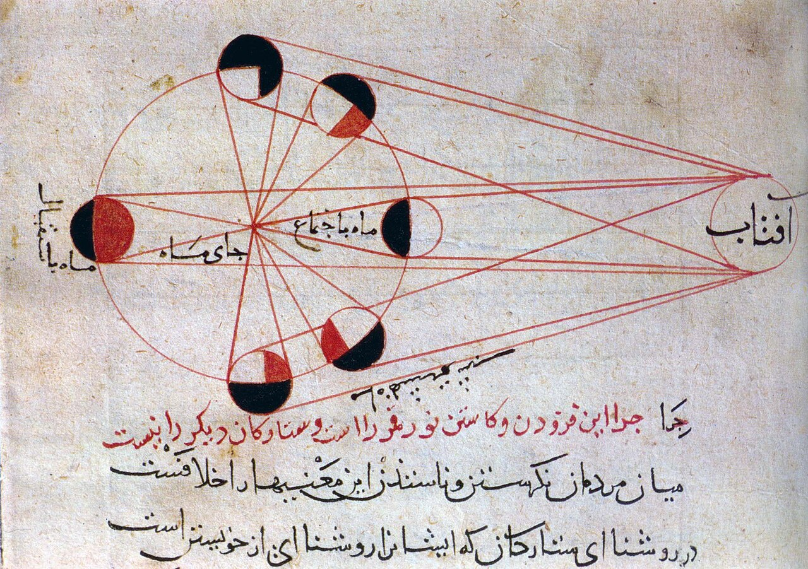

Preserved across centuries within the rich oral folklore of **Razavi Khorasan** (encircling the historical domains of **خراسان (توس و پارت باستان)**), the legendary lore of **Az** stands as a compelling testament to Iran's enduring mythic imagination. Transmitted across hearths, mountain paths, and rural caravans, the tale has survived through the living memories of local elders.

Folklorists generally categorize **Az** within the mythological taxonomy of *Div*. As with many traditional entities of Iranian folk belief, it embodies both the untamed natural elements and the ancestral anxieties regarding solitary wilderness. Classical collectors recorded its traditional traits as follows:

> "Illustration by Mo.Rasoulipour ĀZ, is the name of Div (Demon) in ancient beliefs such as Zoroastrian, Zurvanite, and, especially, Manichean traditions. Āz is Greed, Lust, Avarice, Avidity, Concupiscence—the demon both in its mythological (metaphysical) aspect and in its psychological (religious) aspect realized in man. It brings about death as it destroys man’s physical strength and so keeps him from fulfilling the whole range of religious duties. In Zoroastrian mythology, Āz is let loose already on Gayōmard (First Human). It is believed that Az, next to Ahriman (Chief among Demons) are the last two demons who are defeated by Sorush and Ohrmazd. Though in the Avesta the demon Āzi is the opponent of Ātar (Deity of Fire).In Zurvanite theology, Āz is important as the leader of the demonic host.In Manichean tradition, Āz is considered feminine, who is the mother of the demons “mād čē dēwān”, from whom every sin has come. She is described specifically in the “Third creation” of humans as the corruptor of the human body with her two lion-like demons (šagrkirband mentioned in last week’s post) …"

In local oral tradition, an encounter with **Az** was regarded as a formidable threshold between familiar domestic reality and the unseen realm. Elders customarily advised night travelers, shepherds, and caravan drivers traversing the historic passes of Razavi Khorasan to heed ancient apotropaic rituals—such as carrying iron amulets, maintaining solemn reverence towards nature, and never uttering provocative words—to pass through its territorial domain unharmed.

Today, the chronicle of **Az** forms an invaluable component of Iran's intangible cultural heritage, offering modern readers an evocative window into how ancient communities interpreted their ecology, mystery, and moral balance.

---

### Sources & Image Attribution
- **Folklore Research & Origin:** Sourced and adapted from the Eranshahr Folklore Archive (`eranshahr.com/myths`) and regional oral narratives of Razavi Khorasan.
- **Visual Artifact:** *"Lunar phases al-Biruni.jpg"*, sourced via Wikimedia Commons, contributed by Al-Biruni, licensed under `Public domain` ([Source Link](https://commons.wikimedia.org/wiki/File:Lunar_phases_al-Biruni.jpg)).