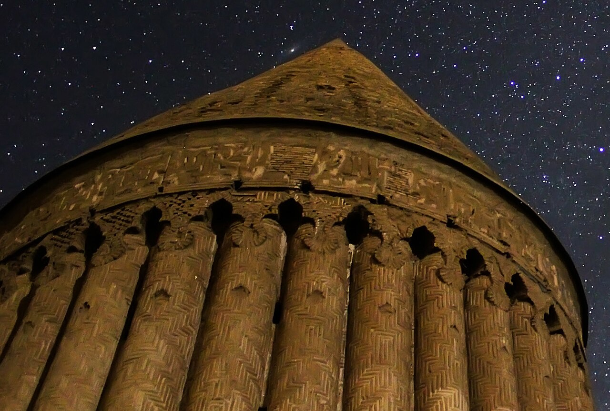

در دشت تاریخی چناران و توس در خراسان رضوی، در کناره‌های حوزه آبریز رودخانه باستانی «کشف‌رود»، برجی آجری و مخروطی با پره‌های استوانه‌ای شگفت‌آور بر دشت سایه افکنده است که آن را «برج رادکان» می‌خوانند. کشف‌رود در اساطیر حماسی ایران و شاهنامه فردوسی، خاستگاه نبرد سهمگین سام نریمان (نیای رستم) با اژدهای دهشت‌زایی است که زمین را از آب تهی ساخته بود. اما در میان مردم بومی رادکان، برج شگفت‌انگیز خواجه نصیرالدین طوسی تنها یک شاهکار نجومی نیست، بلکه در پیوندی اسطوره‌ای، طلسم فلکی برای مهار کالبد سنگی اژدهای باستان به شمار می‌رود که در اعماق خاک این دشت آرمیده است.

روایت‌های کهن خراسانی می‌گویند اژدهای کشف‌رود دیوی عظیم‌الجثه بود که از کوه‌های بینالود تا کرانه‌های رود را با پوست زبر و دندان‌های خنجری‌اش می‌پوشاند. نفس سوزان او پرندگان را در هوا خاکستر می‌کرد و کاروانیان ابریشم را به کام مرگ می‌کشاند. سام نریمان با گرزی گران و توکل بر آفریدگار، به سوی این اژدها تاخت؛ نبردی سه شبانه‌روز ادامه یافت تا سرانجام سر اژدها با ضربت گرز شکافته شد و خون سیاه او در بستر کشف‌رود جاری گشت. تنه اژدها در گذر ایام تبدیل به صخره‌های تیره پیرامون دشت شد که تا به امروز در امتداد رود کشیده شده است.

> سالخوردگان رادکان در شب‌های پرستاره پند می‌دهند: «پره‌های دوازده‌گانه برج رادکان برای سنجش زمان است، اما در باور قدما هر پره طلسمی از صور فلکی است تا بندهای اژدهای خفته در زمین گسسته نشود.»

بومیان باور داشتند اگر سایه برج در ظهر بلندترین روز سال به نقطه معینی بر بستر خاک بیفتد، ستاره‌شناسان کهن پی می‌بردند که زمین در تعادل است و روح اژدهای سنگی بیدار نخواهد شد. در شب‌های زمستان که رود کشف‌رود در مه تیره فرو می‌رود، چوپانان ادعا می‌کنند صدای زوزه غریبی از اعماق شیارهای سنگی حاشیه رود می‌شنوند که بازتابنده واپسین ناله‌های هیولای اساطیری در چنگال پهلوان است. کشاورزان دشت توس باور دارند گندمزارهای پربار این سامان، حاصل برکتی است که با برچیده شدن سایه شوم اژدها به خاک بازگشت. روایت‌های سینه‌به‌سینه می‌گویند سنگ‌های صیقلی و سیاهی که کشاورزان در حین شخم زدن دشت کشف‌رود می‌یابند، دندان‌های ریخته‌شده اژدهاست که خواص دفع چشم‌زخم دارند. معماران برج رادکان با آگاهی از این پیشینه، روزنه‌های برج را به گونه‌ای تعبیه کردند که نور خورشید در لحظه اعتدال بهاری بر نقطه مرکزی مزار سام نریمان بتابد و پیروزی ابدی نور بر تاریکی اژدها را جشن بگیرد. رادکان با آجرکاری‌های ظریف و پیوند آسمان و زمین، جلوه‌گاهی تماشایی از جاودانگی نبرد روشنایی با تباهی در قلب خراسان است.

### منبع روایت و تصویر
- **خاستگاه افسانه:** شاهنامه فردوسی (داستان نبرد سام با اژدهای کشف‌رود) و باورهای عامیانه مردم چناران و رادکان پیرامون برج نجومی رادکان.
- **عکاس / پدیدآورنده تصویر:** Mohammad Ghafourian Nasiri
- **منبع تصویر:** [صفحه تصویر در ویکی‌انبار](https://commons.wikimedia.org/wiki/File:Andromeda_over_radkan_tower_(cropped).jpg)
- **نوع مجوز:** CC BY-SA 4.0
