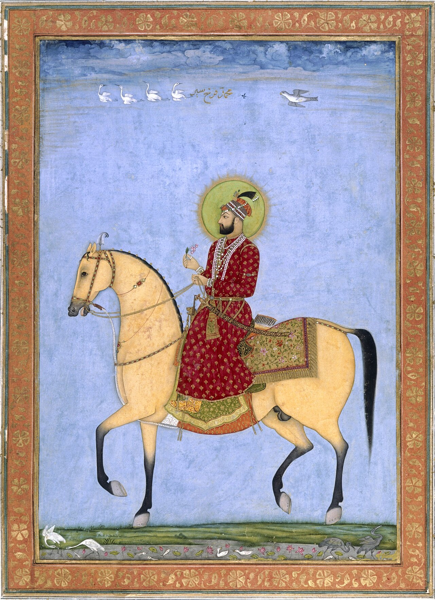

Preserved across centuries within the rich oral folklore of **Razavi Khorasan** (encircling the historical domains of **نیشابور / توس**), the legendary lore of **Emperor of darkness** stands as a compelling testament to Iran's enduring mythic imagination. Transmitted across hearths, mountain paths, and rural caravans, the tale has survived through the living memories of local elders.

Folklorists generally categorize **Emperor of darkness** within the mythological taxonomy of *موجود افسانه‌ای*. As with many traditional entities of Iranian folk belief, it embodies both the untamed natural elements and the ancestral anxieties regarding solitary wilderness. Classical collectors recorded its traditional traits as follows:

> "Illustration by Farima Keshavarz According to Manichaean studies, 'The Emperor of Darkness' is the ruler of the Land of Darkness. He is portrayed as a being with the head of a lion and the body of a dragon. He also had giant wings and a tail that looked like a fishtail. In Manichaean religion, light and darkness used to exist since the dawn of time. When the emperor reached the Land of Light and saw its greatness and brightness, he got jealous and decided to conquer the land.The war between the Land of Light and the Land of Darkness started. The Emperor of Darkness won the battle. After that, the light and soul were held captive by the darkness. According to Manichaean beliefs, this captivity continues to this day. The age of captivation of these fragments of light will continue until the end of the world. These fragments will be released at the end of the world by the warriors of the Land of Light.In the end, a hole as big as the universe will be created, and the Emperor of Darkness will fall inside it. Then, the Land of Light's warriors will put a stone as big as the whole universe on the hole. With that, the age of darkness will come to an end. Light and darkness will also be separated forever. Translation: Sarah Mohebbi Moghadam …"

In local oral tradition, an encounter with **Emperor of darkness** was regarded as a formidable threshold between familiar domestic reality and the unseen realm. Elders customarily advised night travelers, shepherds, and caravan drivers traversing the historic passes of Razavi Khorasan to heed ancient apotropaic rituals—such as carrying iron amulets, maintaining solemn reverence towards nature, and never uttering provocative words—to pass through its territorial domain unharmed.

Today, the chronicle of **Emperor of darkness** forms an invaluable component of Iran's intangible cultural heritage, offering modern readers an evocative window into how ancient communities interpreted their ecology, mystery, and moral balance.

---

### Sources & Image Attribution
- **Folklore Research & Origin:** Sourced and adapted from the Eranshahr Folklore Archive (`eranshahr.com/myths`) and regional oral narratives of Razavi Khorasan.
- **Visual Artifact:** *"Mughal emperor farrukhsiyar16 hi.jpg"*, sourced via Wikimedia Commons, contributed by Chitarman II (attribution), licensed under `Public domain` ([Source Link](https://commons.wikimedia.org/wiki/File:Mughal_emperor_farrukhsiyar16_hi.jpg)).