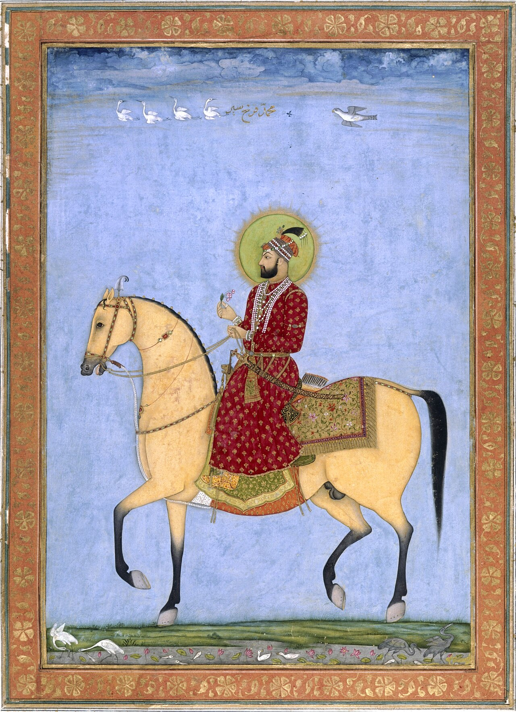

در یادمان‌های شفاهی و باورهای عامیانه‌ی مردم **خراسان رضوی** (به‌ویژه در گستره‌ی **نیشابور / توس**)، روایت‌های پرشماری از پدیده‌ای شگفت و موجودی دیرپا به نام **«شهریارِ تاریکی»** سینه به سینه از روزگاران باستان تا کنون بازگو شده است. راویان بومی که با گویش و لهجه‌ی **خراسانی / مشهدی** به نقل قصه‌ها می‌نشستند، پیدایش این پدیده را با کوهساران، دشت‌های بی‌کران، جنگل‌ها یا آب‌های مرموز این خطه پیوند می‌زدند.

در طبقه‌بندی فرهنگ عامه، **شهریارِ تاریکی** را غالباً با تیره‌ی *موجود افسانه‌ای* هم‌بسته می‌دانند؛ چهره‌ای که تجسم نیروهای ناشناخته‌ی اقلیم و جهان نادیدنی پیرامون نیاکان بوده است. در توصیف‌ها و متون بازمانده‌ی پژوهشی پیرامون این افسانه آمده است:

> «Emperor of darkness|شهریارِ تاریکی شهریار تاریکی در آموزه‌های مانوی، فرمانروای 《سرزمین تاریکی》یا به صورت تطبیقی 《اهریمن》 است. شهریار تاریکی را این‌طور تصویر کرده‌اند که سری مانند شیر، بدنی مانند اژدها، بال‌هایی بزرگ و دُمی چون دم ماهی دارد.تاریکی و روشنی در آیین مانی از ازل وجود داشته‌اند.هنگامی که شهریار تاریکی، به مرز سرزمین روشنایی که توسطِ 《پدرِ بزرگی》 یا 《زروان》اداره می‌شود می‌رسد و نور و شکوه آن را می‌بیند دچار حسد شده و قصد فتح سرزمین روشنایی را می‌کند. جنگی میان سرزمین روشنی و سرزمین تاریکی رخ می‌دهد و شهریار تاریکی در این نبرد پیروز می‌شود.پس از آن، نور و روح به اسارت تاریکی و ظلمت رفتند، که به عقیده مانی این اسارت همچنان ادامه دارد. دوره‌ی اسارت این پاره‌های نور تا پایان جهان ادامه خواهد داشت و در پایان جهان، این پاره‌های نور در جنگی عظیم توسط نیروهای روشنایی آزاد خواهند شد. در پایان و پس از جنگ‌های بسیار، گودالی به بزرگیِ دنیا ایجاد می‌شود که شهریار تاریکی در نهایت به درون آن سقوط می‌کند‌. نیروهای روشنی، سنگی به بزرگی تمام دنیا بر روی آن گودال قرار می‌دهند. به این ترتیب دوران وجود تاریکی به پایان می‌رسد و نور و ظلمت به طور کامل از هم جدا می‌شوند. منابعاسطوره آفرینش در آیین مانی / ابوالقاسم اسماعیل پور»

پیران و ریش‌سفیدان منطقه در شب‌نشینی‌ها گوشزد می‌کردند که رویارویی با **شهریارِ تاریکی** همواره نشانه‌ای از لزوم هشیاری در برابر ناشناخته‌های طبیعت بوده است. در اعصار گذشته، مسافران، شبانان و کاروانیانی که شب‌هنگام در این نواحی گذر می‌کردند، برای مصون ماندن از گزند یا فریب این موجودات، آیین‌ها و دعاهای محافظتی خاصی را به کار می‌بستند و از شکستن سکوت شب یا نزدیک شدن به زیستگاه‌های آنان پرهیز می‌کردند.

امروزه داستان **شهریارِ تاریکی** یکی از گنجینه‌های ماندگار میراث معنوی و مردم‌شناسی دیار **خراسان رضوی** به شمار می‌رود که پیوند عمیق روان‌شناختی انسان کهن را با رمزورازهای زیست‌بوم سرزمین ایران به تصویر می‌کشد.

---

### منابع و اعتبار تصویر
- **پژوهش و خاستگاه روایت:** برگرفته از دانشنامه فولکلور و اسطوره‌شناسی ایران‌شهر (`eranshahr.com/myths`) و روایت‌های شفاهی بومی خراسان رضوی.
- **تصویر:** اثر *«Mughal emperor farrukhsiyar16 hi.jpg»*، بارگذاری‌شده در ویکی‌انبار (Wikimedia Commons)، پدیدآورنده: Chitarman II (attribution)، تحت مجوز آزاد `Public domain` ([مشاهده منبع](https://commons.wikimedia.org/wiki/File:Mughal_emperor_farrukhsiyar16_hi.jpg)).