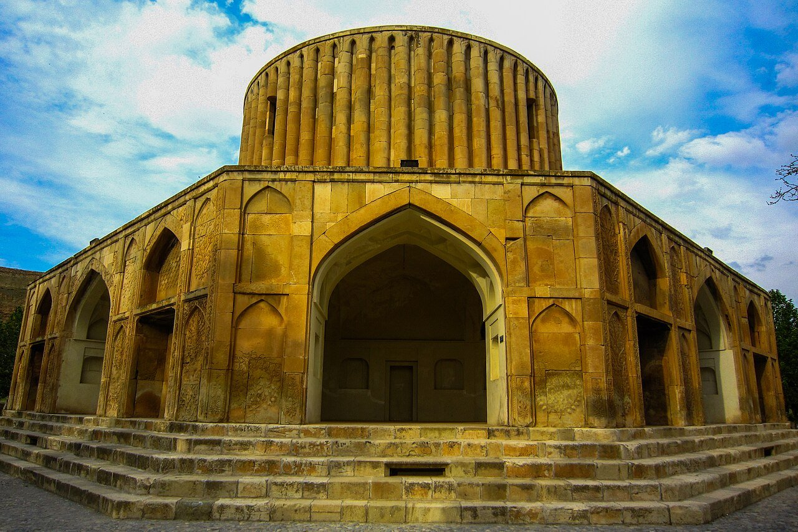

In the northern reaches of Razavi Khorasan lies the impregnable natural mountain citadel of *Kalat-e Naderi*, where the sheer, unscaleable battlements of Mount Hezar-Masjed encircle a lush hidden valley. Access to this mountain fortress was historically confined to a formidable, knife-edge rock canyon known as the *Darband of Arghun-Shah*. In the oral folklore of Khorasan, this desolate threshold was long guarded by the legendary *Ghol-e Biabani* (The Desert Ghoul)—a colossal shapeshifting titan towering like a withered plane tree, its skin crusted with cracked desert clays.

Khorasani oral tradition portrays the Desert Ghoul as a master of sensory illusion. On nights scourged by howling sandstorms, it mimicked a stranded caravaneer, a weeping camel-driver, or a swinging traveler's lantern to lure passing caravans away from the secure gorge and into the treacherous quicksands of the Kashaf River or the precipices of Qarah-Su. Yet, unlike malevolent divs, the ghoul was remarkably gullible; clever local tricksters frequently outsmarted the giant through riddles, wagering contests, and tricks with hot coals, compelling the duped titan to hoist stone blocks for the citadel's battlements.

> "Follow no swinging lantern in the blizzard; the Desert Ghoul wears fire upon his brow to guide your foot to the precipice. Speak with wit and you bind the giant; trust your eyes and you are lost." — Desert adage of the Silk Road camel-drivers.

Ethnographer Ebrahim Shakourzadeh in *Beliefs and Customs of the People of Khorasan* observes that the Desert Ghoul served as a personification of desert disorientation, mirages, and the profound isolation of arid frontiers. Caravans affixed tuned bronze bells to their pack animals, believing the resonant chime of forged bronze repelled the solitary creature. Today, the monumental inscription tower of Nader Shah at the gate of Kalat stands as an enduring monument to human resilience defying the phantom terrors of the wild.

### Sources & Image Attribution
- **Research Source:** Ebrahim Shakourzadeh, *Beliefs and Customs of the People of Khorasan*, Mashhad: Islamic Research Foundation, pp. 278-285; Ali-Akbar Dehkhoda, *Proverbs and Maxims*, entry: Ghol-e Biaban.
- **Image Attribution:** Documented on Wikimedia Commons by Moshtaba.m1363; License: [CC BY-SA 4.0](https://commons.wikimedia.org/wiki/File:Khorshid_Palace.jpg).
