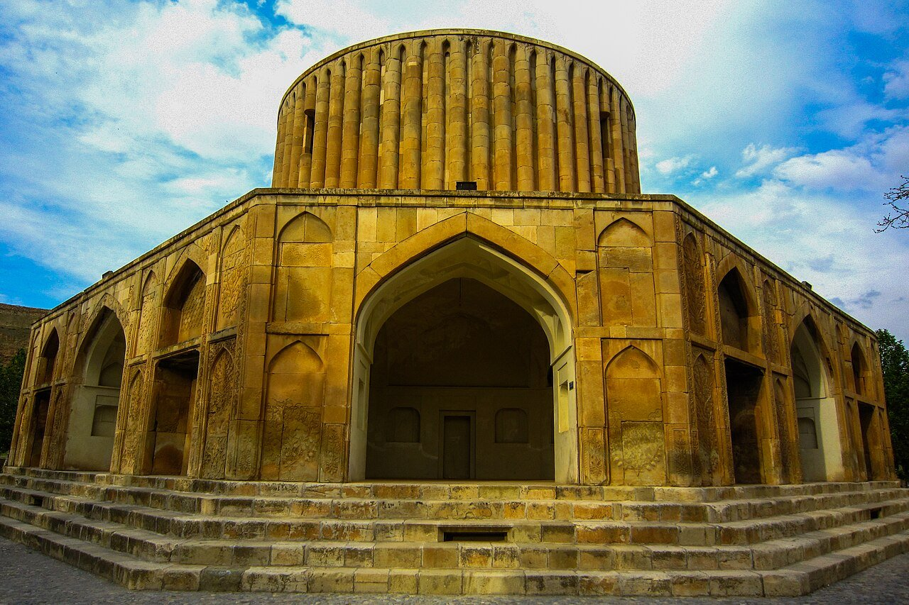

در شمال خراسان رضوی و در دژ طبیعی و دست‌نیافتنی کلات نادری، صخره‌های نفوذناپذیر کوهستان هزارمسجد چون بارویی استوار، دره‌ای حاصلخیز و کهن را در بر گرفته‌اند. تنها راه ورود به این دژ صخره‌ای، شکافی باریک موسوم به «دربند ارغون‌شاه» است. در باورهای عامه مردم کلات و خراسان قدیم، این دروازه‌ی طبیعی قرن‌ها جولانگاه یکی از نیرومندترین موجودات اساطیری کویر یعنی «غول بیابانی» بوده است؛ هیولایی تنومند و دگردیس که قامتی چون درخت سپیدار کهنسال دارد و پوستش همچون گل خشکیده شیاردار است.

روایت‌های خراسانی بازگو می‌کنند که غول بیابانی کلات، استاد فریب و دگرپیکری است. او در شب‌های تاریک و طوفان‌های شن، خود را به شکل مسافری مانده در راه، ساربانی شترگم‌کرده یا فانوسی روشن در افق درمی‌آورد تا کاروان‌ها را از دهانه امن دربند ارغون‌شاه منحرف ساخته و به سوی باتلاق‌های نمکین کشف‌رود یا پرتگاه‌های دره قره‌سو بکشاند. با این حال، غول بیابانی بر خلاف دیو، بسیار ساده‌لوح و زودباور است؛ داستان‌های محلی روایت می‌کنند که پهلوانان و رندان خراسانی با زیرکی و شوخ‌طبعی، او را با بازی‌های زبانی و شرط‌بندی بر سر پرتاب سنگ فریب می‌دادند و با داغ کردن کف پایش با آهن گداخته، او را به خدمتگزاری دروازه کلات وامی‌داشتند.

> «در شب طوفان، پی فانوس متحرک مرو؛ غول بیابان چراغ بر سر می‌نهد تا پایت را در پرتگاه خاره بگذارد. هر که با عقل سخن گوید، غول را به بند می‌کشد و هر که به چشم اعتماد کند، هلاک خواهد شد.» — پند کهن ساربانان راه ابریشم در کلات نادری.

ابراهیم شکورزاده در اثر پژوهشی بنیادین «عقاید و رسوم عامه مردم خراسان» یادآور می‌شود که غول بیابانی در ادبیات شفاهی خراسان، تجسم تنهایی و وهم ناشی از وسعت بی‌کران بیابان‌ها و خطرات گم‌گشتگی در ریگستان‌های مرزی بوده است. باور بر این بود که غول از نام آهن و خواندن اذان می‌هراسد؛ از این رو مسافران همواره زنگوله‌های مفرغی بر گردن شتران می‌آویختند تا طنین زنگ، غول را فراری دهد.

امروزه برج کتیبه نادری و طاق تاریخی دربند ارغون‌شاه، با غرور در دهانه دره کلات ایستاده‌اند؛ جایی که یادآور رویارویی هوش انسانی با خطرات وهم‌آلود غول بیابانی در گذرگاه تاریخ است.

### منابع و اعتبار تصویر
- **منبع پژوهشی افسانه:** ابراهیم شکورزاده، «عقاید و رسوم عامه مردم خراسان»، مشهد، انتشارات بنیاد پژوهش‌های اسلامی، ص ۲۷۸-۲۸۵؛ علی‌اکبر دهخدا، «امثال و حکم»، مدخل غول بیابان.
- **اعتبار تصویر:** ثبت‌شده در ویکی‌مدیا کامنز توسط Moshtaba.m1363؛ مجوز انتشار: [CC BY-SA 4.0](https://commons.wikimedia.org/wiki/File:Khorshid_Palace.jpg).
