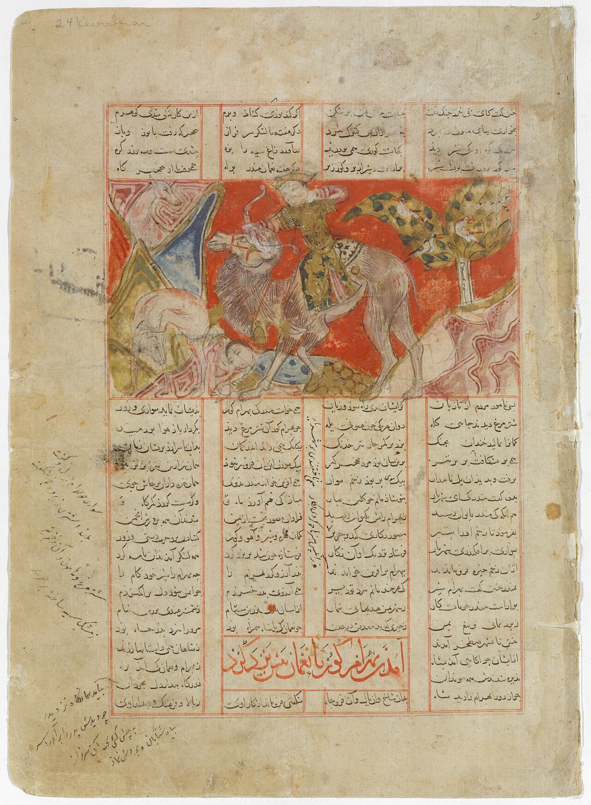

Preserved across centuries within the rich oral folklore of **Razavi Khorasan** (encircling the historical domains of **نیشابور / توس**), the legendary lore of **Gur-Gur** stands as a compelling testament to Iran's enduring mythic imagination. Transmitted across hearths, mountain paths, and rural caravans, the tale has survived through the living memories of local elders.

Folklorists generally categorize **Gur-Gur** within the mythological taxonomy of *موجود افسانه‌ای*. As with many traditional entities of Iranian folk belief, it embodies both the untamed natural elements and the ancestral anxieties regarding solitary wilderness. Classical collectors recorded its traditional traits as follows:

> "Illustration by Erfan Aghvami 'Gur-Gur' is a creature in the beliefs of people from Chenaran (Razavi Khorasan Province located in northeastern Iran). According to these people, it exists inside of the graves.According to the stories, if someone looks inside a grave, they would probably be marked as the next person who dies. The person who looked inside would dream of a dark grave with two eyes inside of it, and then two hands would drag him inside the grave. If the person sees this in their dreams, they must offer oblations to keep away Gur-Gur. Translation: Sarah Mohebbi Moghadam …"

In local oral tradition, an encounter with **Gur-Gur** was regarded as a formidable threshold between familiar domestic reality and the unseen realm. Elders customarily advised night travelers, shepherds, and caravan drivers traversing the historic passes of Razavi Khorasan to heed ancient apotropaic rituals—such as carrying iron amulets, maintaining solemn reverence towards nature, and never uttering provocative words—to pass through its territorial domain unharmed.

Today, the chronicle of **Gur-Gur** forms an invaluable component of Iran's intangible cultural heritage, offering modern readers an evocative window into how ancient communities interpreted their ecology, mystery, and moral balance.

---

### Sources & Image Attribution
- **Folklore Research & Origin:** Sourced and adapted from the Eranshahr Folklore Archive (`eranshahr.com/myths`) and regional oral narratives of Razavi Khorasan.
- **Visual Artifact:** *""Bahram Gur Hunting with Azada", Folio from a Shahnama (Book of Kings) MET DT200631.jpg"*, sourced via Wikimedia Commons, contributed by Ferdowsi, licensed under `CC0` ([Source Link](https://commons.wikimedia.org/wiki/File:%22Bahram_Gur_Hunting_with_Azada%22,_Folio_from_a_Shahnama_(Book_of_Kings)_MET_DT200631.jpg)).