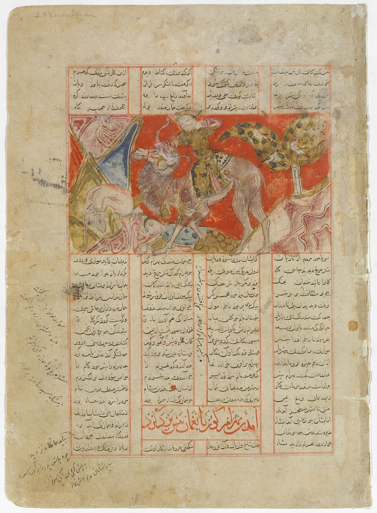

در یادمان‌های شفاهی و باورهای عامیانه‌ی مردم **خراسان رضوی** (به‌ویژه در گستره‌ی **نیشابور / توس**)، روایت‌های پرشماری از پدیده‌ای شگفت و موجودی دیرپا به نام **«گورگور»** سینه به سینه از روزگاران باستان تا کنون بازگو شده است. راویان بومی که با گویش و لهجه‌ی **خراسانی / مشهدی** به نقل قصه‌ها می‌نشستند، پیدایش این پدیده را با کوهساران، دشت‌های بی‌کران، جنگل‌ها یا آب‌های مرموز این خطه پیوند می‌زدند.

در طبقه‌بندی فرهنگ عامه، **گورگور** را غالباً با تیره‌ی *موجود افسانه‌ای* هم‌بسته می‌دانند؛ چهره‌ای که تجسم نیروهای ناشناخته‌ی اقلیم و جهان نادیدنی پیرامون نیاکان بوده است. در توصیف‌ها و متون بازمانده‌ی پژوهشی پیرامون این افسانه آمده است:

> «Gur-Gur|گورگور گورگور موجودی است در باورهای مردم روستای چناران خراسان رضوی، که این موجود در قبرها حضور داشته است.بر اساس افسانه‌های محلی این ناحیه، گفته می‌شده است که اگر کسی به قبر حفر شده نگاه کند، این احتمال وجود دارد که گورگور او را نشان کند، یعنی نفر بعدی که می‌میرد او باشد. اگر فردی که به قبر نگاه کرده، شب‌هنگام خواب قبر تاریک ببیند که دو چشم از انتهای آن دیده می‌شود، یا دستی از قبر او را به داخل می‌کشد، باید نذر و صدقه می‌داده تا گورگور را از خود دفع کند.»

پیران و ریش‌سفیدان منطقه در شب‌نشینی‌ها گوشزد می‌کردند که رویارویی با **گورگور** همواره نشانه‌ای از لزوم هشیاری در برابر ناشناخته‌های طبیعت بوده است. در اعصار گذشته، مسافران، شبانان و کاروانیانی که شب‌هنگام در این نواحی گذر می‌کردند، برای مصون ماندن از گزند یا فریب این موجودات، آیین‌ها و دعاهای محافظتی خاصی را به کار می‌بستند و از شکستن سکوت شب یا نزدیک شدن به زیستگاه‌های آنان پرهیز می‌کردند.

امروزه داستان **گورگور** یکی از گنجینه‌های ماندگار میراث معنوی و مردم‌شناسی دیار **خراسان رضوی** به شمار می‌رود که پیوند عمیق روان‌شناختی انسان کهن را با رمزورازهای زیست‌بوم سرزمین ایران به تصویر می‌کشد.

---

### منابع و اعتبار تصویر
- **پژوهش و خاستگاه روایت:** برگرفته از دانشنامه فولکلور و اسطوره‌شناسی ایران‌شهر (`eranshahr.com/myths`) و روایت‌های شفاهی بومی خراسان رضوی.
- **تصویر:** اثر *«"Bahram Gur Hunting with Azada", Folio from a Shahnama (Book of Kings) MET DT200631.jpg»*، بارگذاری‌شده در ویکی‌انبار (Wikimedia Commons)، پدیدآورنده: Ferdowsi، تحت مجوز آزاد `CC0` ([مشاهده منبع](https://commons.wikimedia.org/wiki/File:%22Bahram_Gur_Hunting_with_Azada%22,_Folio_from_a_Shahnama_(Book_of_Kings)_MET_DT200631.jpg)).