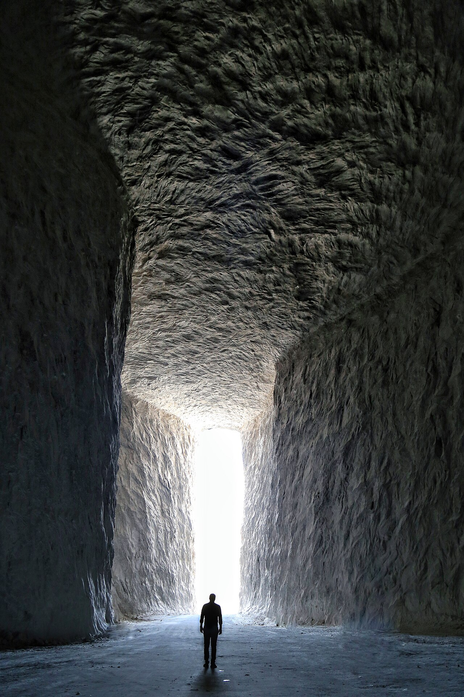

در دامنه‌های جنوبی البرز و در حاشیه کویر پرعظمت سمنان در شهرستان گرمسار، گنبدهای نمکی عظیم با رنگ‌های سرخ، خاکستری و سپید سر برآورده‌اند که در دل خویش تالارهایی اعجاب‌انگیز با قندیل‌های شفاف نمک پنهان کرده‌اند. غارهای نمکی گرمسار با ستون‌های بلورین تراشیده، دریاچه‌های کوچک آب‌شور و سکوت کریستالی ژرف، شبیه به کاخ‌هایی ماورایی هستند که گویی هنرمندانی نامرئی سقف و دیوارهای آن را آراسته‌اند. در فولکلور مردم کهنسال گرمسار، این غارهای بلورین زادگاه و مزار اسطوره‌ای «اژدهای نمک» است؛ موجودی با پولک‌های شیشه‌ای که محافظ ذخایر شفابخش زمین است.

روایت محلی نقل می‌کند که در عهد باستان، ماری غول‌پیکر و آتشین از کوه‌های فیروزکوه به سوی کویر گریخت و به قعر شکاف‌های گرمسار پناه برد. آب‌های شور زیرزمینی و گرمای تابستان کویر، پوست این اژدها را ذره‌ذره سرد کرد و نفس آتشین او در تماس با نمکزار به بلورهایی درخشان و زجاجی بدل گشت. اژدها پیش از آنکه سراسر منجمد شود و به سنگ نمک پاک تبدیل گردد، با ارواح کویر پیمان بست که کالبد شیشه‌ای او تا پایان جهان مرهم دردهای ریوی، چشم‌زخم و افسردگی انسان‌ها باشد. از این رو، استنشاق هوای خنک تالارهای نمکی از دیرباز خاصیت درمانی یافته است.

> معدن‌کاران قدیمی گرمسار به تازه‌واردان گوشزد می‌کنند: «به قندیل‌های تیز نمک تبر نزنید و دیواره‌های شیشه‌ای را مشکنید؛ این تالارها استخوان‌های اژدهای بلورین هستند و غضب او سنگ را فرو می‌ریزد.»

در افسانه‌های سمنان آمده است که در اعماق غیرقابل دسترسی این غارها، چشمه‌ای از آب‌نمک چنان غلیظ می‌جوشد که هر شیء چوبی یا فلزی در آن بیفتد ظرف چند روز به تندیسی جواهرنشان و بلورین تبدیل می‌شود. مردم باور داشتند پریان سپیدپوش در هنگام طوفان‌های کویری به درون تالارها می‌آیند و با ضربه زدن به قندیل‌های نمک، نوایی ملکوتی شبیه به زنگوله‌های شیشه‌ای در فضا طنین‌انداز می‌سازند. چارپاداران قدیمی هنگام عبور از گردنه‌های نمکی، سنگ‌نمکی پاک در جیب می‌نهادند تا از شر دیو بیابان در امان مانند. ستون‌های سترگی که در دل این غارها تراشیده شده‌اند، مانند پایه‌های کاخ‌های هخامنشی از کریستال‌های مکعبی و یکدست نمک تشکیل یافته‌اند. کهنسالان گرمسار معتقدند آب چشمه‌های نمکین که در کف تالارها جاری است، مرهمی باستانی برای دل‌های رنجور است و اگر کسی در سکوت کریستالی غار آرزویی پاک بر زبان آورد، انعکاس صدا در بلورها آن را به اجابت می‌رساند. چارپاداران قدیمی هنگام عبور از گردنه‌های نمکی، سنگ‌نمکی پاک در جیب می‌نهادند تا از شر دیو بیابان در امان مانند. غار نمکی گرمسار با رنگین‌کمان لایه‌های معدنی و شکوه درخشانش، یکی از بدیع‌ترین جلوه‌های آمیزش افسانه و طبیعت در استان سمنان است.

### منبع روایت و تصویر
- **خاستگاه افسانه:** باورهای شفاهی معدن‌کاران و کهنسالان گرمسار و ایوانکی، مردم‌شناسی نمک‌شناسی و اساطیر سنگ‌های بلورین سمنان.
- **عکاس / پدیدآورنده تصویر:** BaharehKhodami
- **منبع تصویر:** [صفحه تصویر در ویکی‌انبار](https://commons.wikimedia.org/wiki/File:Garmsar_salt_mine.jpg)
- **نوع مجوز:** CC BY-SA 4.0
