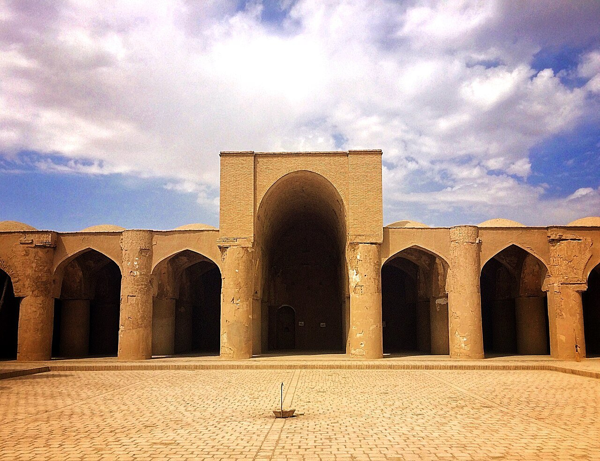

In the venerable desert city of Damghan—once an illustrious capital of the Parthian Empire—adjacent to the eleventh-century brick tower of *Chehel Dokhtaran* and the pre-Islamic columns of Tarikhaneh, lingers a poignant and sacred folk narrative: the legend of the *Forty Chaste Maidens*. According to Komesh oral traditions, during an ancient siege when invading barbarian hordes breached the citadel walls and slaughtered the male garrison, forty noble maidens fled toward a deep dry well at the mountain's foot to preserve their bodily integrity and sacred dignity.

With the thundering hooves of the plundering cavalry closing in upon their footsteps, the maidens joined hands. Uttering collective prayers of purification, they cast themselves one after another into the subterranean darkness rather than suffer dishonor. Yet the earth opened like a loving mother; instead of suffering destruction upon the rocks, cool subterranean springs surged up to cradle their falling forms, spiriting them away into an ethereal sanctuary. Ever since, desert travelers have reported hearing haunting choral lullabies and joyful girlish songs wafting up from the depths of the dry well.

> "The Well of the Forty Maidens is not a tomb; it is an open gate to the heavens. The maidens enfolded by Damghan's soil live on in eternity, perfuming the mountain air with rosewater and wild rue every twilight." — Tradition of Damghan matriarchs.

Folklorist Esmail Honarvar in *Folklore of Semnan and Komesh* and Seyyed Abolghasem Enjavi Shirazi in *Persian Tales* explain that the "Forty Maidens" archetype represents an indigenous motif across the central plateau celebrating moral incorruptibility and sacrifice in the face of brutal invasions. Local women historically lit votive candles and tied colorful silk ribbons to the mudbrick fissures of the Chehel Dokhtaran tower, praying for marital blessings and emotional solace. The solemn Seljuk tower stands today as an enduring beacon of spiritual freedom in the sands of Semnan.

### Sources & Image Attribution
- **Research Source:** Esmail Honarvar, *Folklore of Semnan and Komesh*, Semnan: Hableh-Roud, pp. 92-98; Seyyed Abolghasem Enjavi Shirazi, *Persian Tales*, Vol. 1, p. 241.
- **Image Attribution:** Documented on Wikimedia Commons by حسن اثباتی لواسانی; License: [CC BY-SA 4.0](https://commons.wikimedia.org/wiki/File:Damghan-1.jpg).
